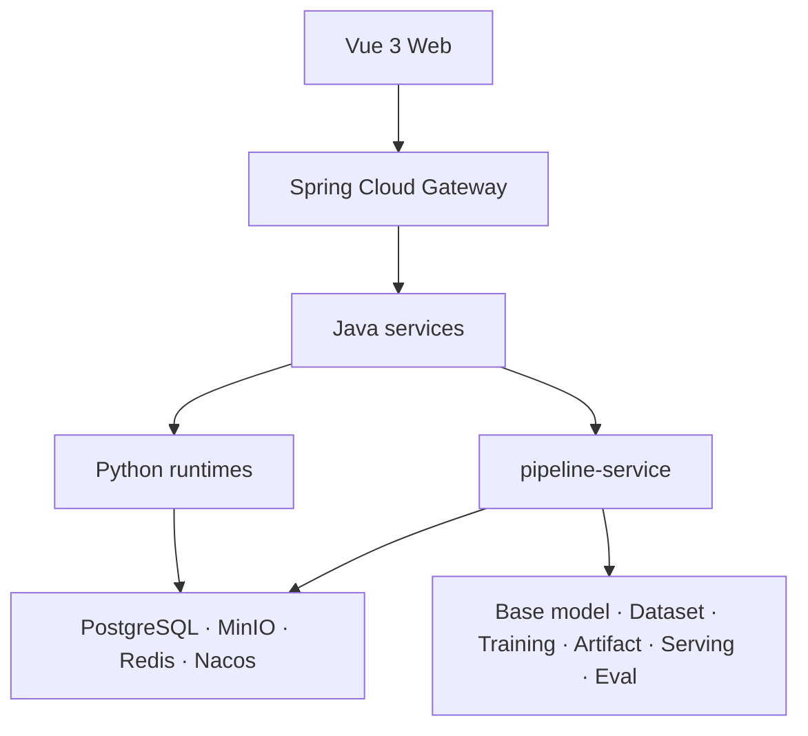

# OpenMaas

> **Open Model-as-a-Service** · Self-hosted AI platform · Base-model agnostic

[English](./README.en.md) | [简体中文](./README.md)

> GitHub: https://github.com/solomonxu/ai-maas-docs · Gitee: https://gitee.com/solomonxu/ai-maas-docs

OpenMaas is a self-hosted platform for model training, inference, and evaluation. It covers base models, datasets, training, model artifacts, inference services, evaluation, model compression, image management, and resource governance, and connects these capabilities through a unified training-to-inference pipeline.

> **Status:** OpenMaas is in open-source closeout. The public repository and documentation site are coming soon.
> **License:** [Apache-2.0](./LICENSE)
> **Authors:** OpenMaas Team · XU Meng (许猛)

## Why OpenMaas

- **Self-hosted:** data and models stay in your environment, suitable for regulated industries.
- **Base-model agnostic:** unified model descriptions and inference adapters; swap Qwen, Llama, DeepSeek, and others without changing business code.
- **End-to-end:** model pull, dataset import, training, artifacts, inference, and evaluation in one platform.
- **Pipeline as a run:** preflight snapshots, stage state machines, database leases, and recovery make cross-service workflows recoverable, explainable, and governable.
- **Operational governance:** tenant isolation, permissions, audit, GPU resource governance, cost attribution, and release gates.

## Architecture



See [Architecture](./docs/architecture.en.md) for details.

## Capabilities

| Area | Capabilities |
|---|---|
| Base models | Registration, pull, scan, variant assets |
| Datasets | Import, scan, versions, subsets, lineage |
| Training | LoRA/QLoRA/full fine-tuning, multiple paradigms, job lifecycle |
| Artifacts | Registration, promotion, Model Card, release governance |
| Inference | Multi-engine runtimes, OpenAI-compatible endpoints, API keys |
| Evaluation | Evaluation sets, tasks, quality gates |
| Compression | Quantization, pruning, distillation, quality reports |
| Pipeline | Preflight, stage state machine, recovery, cost, approval, triggers |
| Resource governance | GPU leases, queues, nodes, images, capacity views |
| App plane | Chat, Speech, Translation, Image Generation (optional) |

## Quick Start

After the code repository is public, start a single-node Docker Compose environment:

```bash
git clone <OpenMaas repository URL> ai-maas
cd ai-maas/deploy/docker-compose
cp .env.example .env
docker compose up -d --build
```

Development endpoints:

```text
Web:     http://localhost:5173
Gateway: http://localhost:18080
```

See [Quickstart](./docs/quickstart.en.md) and [Deployment](./docs/deployment.en.md).

## Documentation

| Document | Description |
|---|---|
| [Overview](./docs/overview.en.md) | Positioning, scope, and target users |
| [Architecture](./docs/architecture.en.md) | Services, control plane, and data |
| [Quickstart](./docs/quickstart.en.md) | Local startup and first steps |
| [Deployment](./docs/deployment.en.md) | Compose, split deployment, GPU, Helm, offline |
| [Development](./docs/development.en.md) | Development conventions and local workflow |
| [Security](./SECURITY.en.md) | Security policy and reporting |
| [Dev Log](./docs/dev-log/) | Daily development records |
| [Technical Articles](./docs/articles/) | Building OpenMaas series |
| [WS Schema](./docs/protocol/ws-message-schema.json) | Runtime WebSocket message contract |

## Contributing

Issues, documentation improvements, and code contributions are welcome. Before the code repository is public, please use Issues or Discussions to start a conversation. After launch, follow [CONTRIBUTING.en.md](./CONTRIBUTING.en.md).

## License

Licensed under [Apache-2.0](./LICENSE). Third-party models, datasets, and images remain under their respective licenses.
