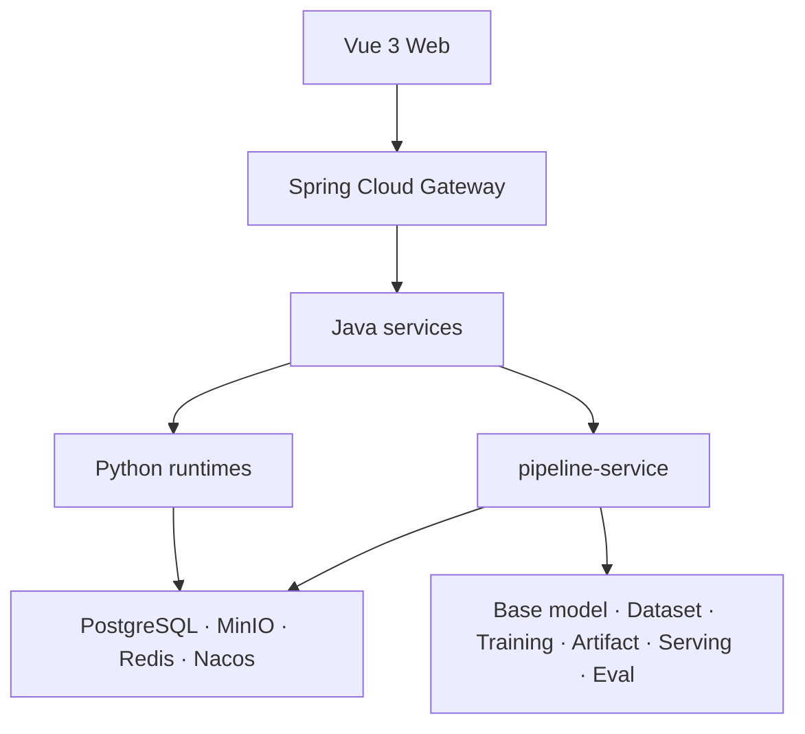

# OpenMaas

> **Open Model-as-a-Service** · Self-hosted AI platform · Base-model agnostic

[简体中文](./README.md) | [English](./README.en.md)

> GitHub: https://github.com/solomonxu/ai-maas-docs · Gitee: https://gitee.com/solomonxu/ai-maas-docs

OpenMaas 是面向私有化部署的模型训推与推理平台，覆盖基座模型、数据集、训练、模型制品、推理服务、评测、模型压缩、镜像与资源治理，并通过统一的训推流水线把这些能力组织成可交付的运行。

> **项目状态**：OpenMaas 目前处于开源收尾阶段，代码仓库与文档站即将开放。
> **许可证**：[Apache-2.0](./LICENSE)
> **作者**：OpenMaas Team · XU Meng（许猛）

## 为什么是 OpenMaas

- **Self-hosted**：数据与模型留在自有环境，适合金融、法律、政务等合规敏感场景。
- **Base-model agnostic**：统一模型描述与推理后端适配，替换 Qwen、Llama、DeepSeek 等基座时不改业务代码。
- **End-to-end**：从模型拉取、数据导入、训练、制品、推理到评测，覆盖完整训推链路。
- **Pipeline as a run**：预检快照、阶段状态机、数据库租约和失败恢复，让跨服务长事务可恢复、可解释、可治理。
- **Operational governance**：租户隔离、权限、审计、GPU 资源治理、成本归集和发布门禁。

## 架构概览



详细架构见 [docs/architecture.md](./docs/architecture.md)。

## 核心能力

| 模块 | 能力 |
|---|---|
| 基座模型 | 登记、拉取、扫描、变体资产 |
| 数据集 | 导入、扫描、版本、子集、血缘 |
| 训练 | LoRA/QLoRA/全参、多范式训练、任务生命周期 |
| 模型制品 | 产物注册、晋级、Model Card、发布治理 |
| 推理服务 | 多引擎运行时、OpenAI 兼容端点、API Key |
| 评测 | 金标集、评测任务、质量门禁 |
| 模型压缩 | 量化、剪枝、蒸馏、质量报告 |
| 训推流水线 | 预检、阶段状态机、恢复、成本、审批、触发器 |
| 资源治理 | GPU 租约、队列、节点、镜像与容量视图 |
| 应用面 | Chat、Speech、Translation、Image Generation（可选） |

## 快速开始

代码仓库公开后，可使用 Docker Compose 启动单机环境：

```bash
git clone <OpenMaas repository URL> ai-maas
cd ai-maas/deploy/docker-compose
cp .env.example .env
docker compose up -d --build
```

开发环境入口：

```text
Web:     http://localhost:5173
Gateway: http://localhost:18080
```

详见 [Quickstart](./docs/quickstart.md) 与 [Deployment](./docs/deployment.md)。

## 文档

| 文档 | 说明 |
|---|---|
| [Overview](./docs/overview.md) | 项目定位、能力边界与目标用户 |
| [Architecture](./docs/architecture.md) | 架构、服务边界、控制面与数据 |
| [Quickstart](./docs/quickstart.md) | 本地启动与首次使用 |
| [Deployment](./docs/deployment.md) | Compose、分离部署、GPU、Helm、离线 |
| [Development](./docs/development.md) | 开发规范与本地流程 |
| [Security](./SECURITY.md) | 安全策略与报告方式 |
| [Dev Log](./docs/dev-log/) | 每日开发记录 |
| [技术文章](./docs/articles/) | OpenMaas 工程系列文章 |
| [WS Schema](./docs/protocol/ws-message-schema.json) | 运行时 WebSocket 消息契约 |

## 参与贡献

欢迎 Issue、文档改进和代码贡献。代码仓库公开前，请先通过 Issue 或 Discussion 沟通；公开后按 [CONTRIBUTING.md](./CONTRIBUTING.md) 提交。

## 许可

本项目使用 [Apache-2.0](./LICENSE) 许可证。第三方模型、数据集和镜像仍遵循各自许可证。
