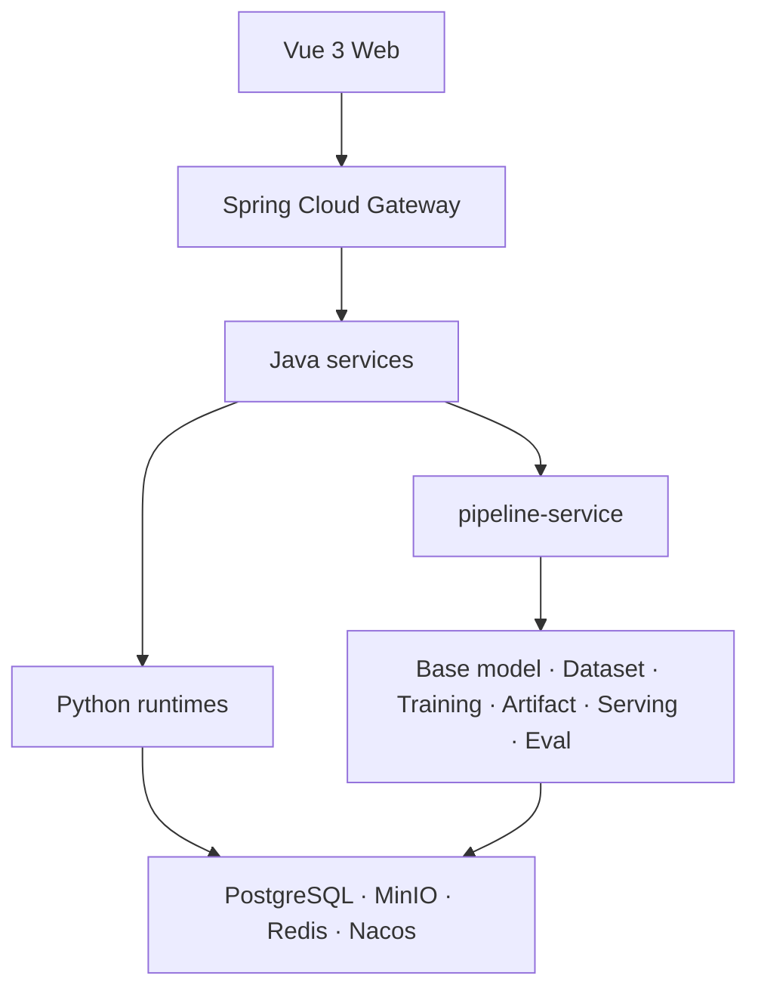

# Architecture

[English](./architecture.en.md) | [简体中文](./architecture.md)

> OpenMaas is in open-source closeout. This document describes the current architecture; APIs and deployment details may continue to change.

## Overview



## Layering

Each Java service follows COLA-style boundaries:

- **adapter**: REST controllers, WebSocket endpoints, MQ listeners;
- **app**: application orchestration and transaction boundaries;
- **domain**: entities, value objects, domain services, state machines, with no framework dependencies;
- **infrastructure**: MyBatis-Plus, Redis, MinIO, and external clients.

```text
adapter → app → domain ← infrastructure
```

ArchUnit guards the dependency direction.

## Service Boundaries

| Service | Responsibility |
|---|---|
| `base-model-service` | Base-model registration, pull, scan, and variants |
| `dataset-service` | Dataset import, scan, versions, subsets, and lineage |
| `training-orchestration` | Training jobs and the runtime control plane |
| `pipeline-service` | Pipeline runs, stages, preflight, leases, recovery, and cost |
| `artifact-service` | Artifact registration, promotion, Model Card, and release governance |
| `serving-service` | Inference instances, endpoints, routes, and API keys |
| `eval-service` | Evaluation sets, tasks, and quality gates |
| `compress-service` | Quantization, pruning, distillation, and quality reports |
| `image-service` | Image specs, builds, scans, and releases |
| `node-service` | Nodes, components, orchestration, and runtime status |
| `scheduler-service` | GPU resources, leases, queues, and capacity |
| `admin-service` | Administration, notifications, audit, and configuration |
| `file-service` | Archive, Parquet, preview, and export content |
| `assistant-service` | In-platform assistant capabilities |
| `chat-service`, `speech-service` | Optional application plane |
| `maas-gateway` | Authentication, routing, and rate limiting |

## Control Plane and Runtimes

Python runtimes connect to the Java control plane over WebSocket. Pullers, trainers, inference workers, compressors, scanners, and node agents receive commands and report status, progress, logs, and results. The contract is defined in [WS Schema](./protocol/ws-message-schema.json).

## Pipeline

`pipeline-service` does not execute training or inference directly. It orchestrates domain services and owns the run model:

- fixed paths before free-form DAGs;
- preflight snapshots that explain why a run was allowed to start;
- stage-level retry and reuse;
- database leases for multi-replica execution and restart recovery;
- cost attribution based on effective execution time.

## Data and Infrastructure

| Component | Purpose |
|---|---|
| PostgreSQL | database/schema-per-service business data |
| MinIO | model, dataset, artifact, and log object storage |
| Redis | sessions, registry, cache, and event support |
| Nacos | service discovery and configuration |
| RocketMQ | asynchronous jobs and decoupling where enabled |

Tenant isolation is enforced at the row level, with MyBatis interceptors and RLS as fallback. Domain code does not depend on tenant internals.

## Frontend

`maas-web` uses Vue 3, TypeScript, Pinia, and Vue Router with in-house components. The UI is organized around user goals and resources rather than exposing raw IDs.

## Security and Governance

The gateway handles authentication, tenant context, and permission propagation. Runtime control interfaces are not exposed publicly. Secrets are injected through environment variables or secret stores and must not be logged. External models, datasets, and images remain under their own licenses.

## Related

- [WS Schema](./protocol/ws-message-schema.json)
- [Deployment](./deployment.en.md)
- [Development](./development.en.md)
- [Security](../SECURITY.en.md)
