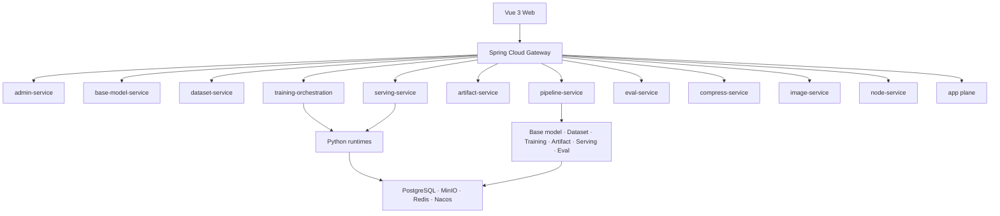

# 架构详解（Architecture）

[简体中文](./architecture.md) | [English](./architecture.en.md)

> OpenMaas 处于开源收尾阶段。本文描述当前主干架构，接口与部署细节可能继续调整。

## 总览



## 分层（Java 微服务）

每个 Java 服务按 COLA 风格分层：

- **adapter**：REST Controller、WebSocket Endpoint、MQ Listener；
- **app**：应用编排、事务边界、跨聚合协调；
- **domain**：实体、值对象、领域服务、状态机，零框架依赖；
- **infrastructure**：MyBatis-Plus、Redis、MinIO、外部客户端实现。

依赖方向：

```text
adapter → app → domain ← infrastructure
```

由 ArchUnit 守护。

## 服务边界

| 服务 | 职责 |
|---|---|
| `base-model-service` | 基座模型登记、拉取、扫描与变体资产 |
| `dataset-service` | 数据集登记、导入、扫描、版本、子集与血缘 |
| `training-orchestration` | 训练任务编排、运行时控制面（runtime-hub） |
| `pipeline-service` | 训推流水线运行、阶段、预检、租约、恢复与成本 |
| `artifact-service` | 模型制品注册、晋级、Model Card 与发布治理 |
| `serving-service` | 推理实例、端点、路由与 API Key |
| `eval-service` | 评测集、评测任务与质量门禁 |
| `compress-service` | 量化、剪枝、蒸馏与压缩质量报告 |
| `image-service` | 镜像规格、构建、扫描与发布 |
| `node-service` | 计算节点、组件、节点编排与运行时状态 |
| `scheduler-service` | GPU 资源、租约、队列与容量视图 |
| `admin-service` | 平台管理、通知、审计与配置 |
| `file-service` | 文件内容服务：压缩包、Parquet、预览与导出 |
| `assistant-service` | 在线助手与平台内辅助能力 |
| `chat-service`、`speech-service` | 可选应用面 |
| `maas-gateway` | 统一入口、鉴权、路由与限流 |

## 控制面与运行时

Python 运行时通过 WebSocket 接入 Java 控制面：

- 拉取器、训练器、推理 worker、压缩器、扫描器、节点代理等；
- 单连接双向：下发任务，回收状态、进度、日志和结果；
- 心跳、离线检测、重连与注册表路由；
- 作业协议见 [WS Schema](./protocol/ws-message-schema.json)。

## 训推流水线

`pipeline-service` 不直接执行训练或推理，而是编排现有领域服务：

```text
Run → Stage → Domain service call → Event / Log / Cost
```

关键设计：

- 固定路径优先，避免首版自由 DAG 复杂度；
- 预检快照保留“为什么允许启动”；
- 失败重试从失败阶段继续；
- 数据库租约支持多副本和重启恢复；
- 计费按有效执行时长，而不是墙上时钟。

## 数据与基础设施

| 组件 | 用途 |
|---|---|
| PostgreSQL | database/schema-per-service 的业务数据 |
| MinIO | 模型、数据集、制品和日志对象存储 |
| Redis | 会话、注册表、缓存和事件辅助 |
| Nacos | 注册与配置中心 |
| RocketMQ | 异步任务与解耦（按部署启用） |

多租户：`tenant_id` 行级隔离，MyBatis 拦截器与 RLS 兜底；domain 层不感知租户细节。

## 前端

`maas-web` 使用 Vue 3 + TypeScript + Pinia + Vue Router，复用自研组件；按“用户目标”组织训推流水线和资源入口，而不是暴露底层 ID。

## 安全与治理

- Gateway 统一鉴权、租户上下文和权限透传；
- 内部运行时接口不直接暴露公网；
- 敏感信息通过 Secret/环境变量注入，不写入日志；
- 外部模型、数据集和镜像遵循各自许可证；
- 公开发布遵循 Model Card、质量门禁和审批策略。

## 相关文档

- [WS Schema](./protocol/ws-message-schema.json)
- [部署](./deployment.md)
- [开发](./development.md)
- [安全](../SECURITY.md)
