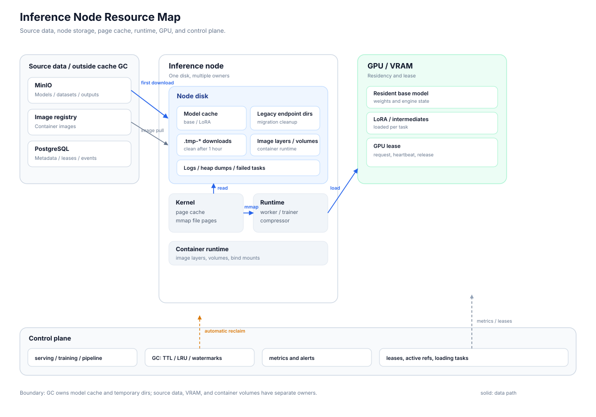
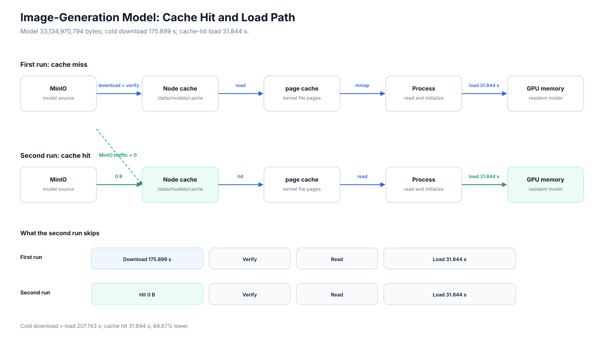
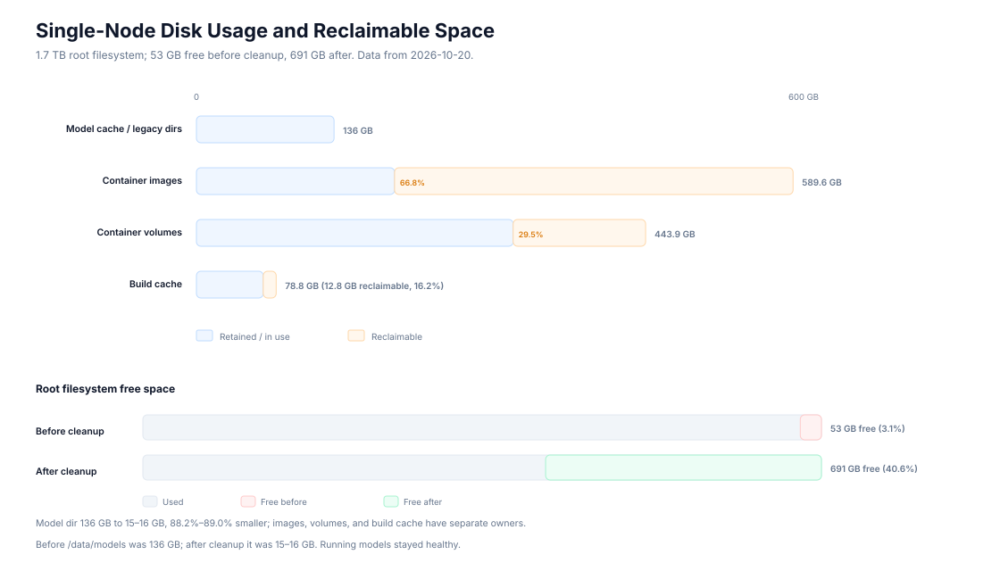
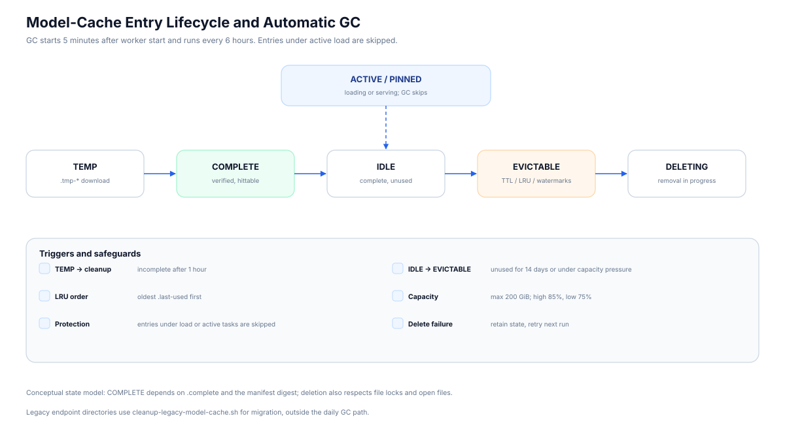
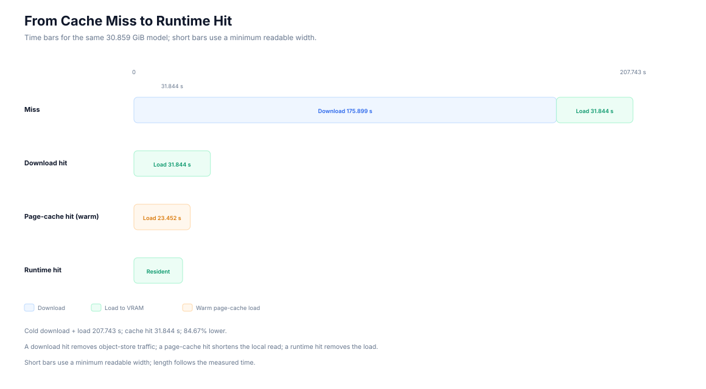
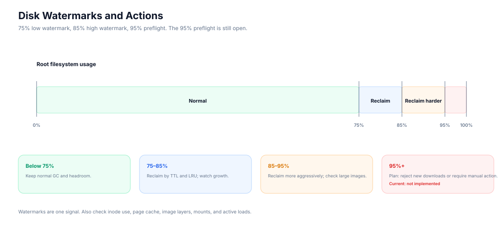

# Cache, Disk, and Load: The Resource Lifecycle of an Inference Platform

*A cache hit removed 175.899 seconds of download time. It still left 31.844 seconds before the model could serve a request.*

> OpenMaas Engineering Series  
>
> Draft v0.1 | 2026-11-14  
>
> Keywords: OpenMaas, model cache, disk lifecycle, page cache, model loading, GPU memory, cache GC

> **OpenMaas project status**
>
> OpenMaas is a private-deployment platform for model training and inference. Project documentation is available on [GitHub](https://github.com/solomonxu/ai-maas-docs) (primary) and [Gitee](https://gitee.com/solomonxu/ai-maas-docs) (China mirror). The code repository is opening soon. This article focuses on the model cache, disk, and load path of one inference node.

> **TL;DR**
>
> - A cache hit removes the download stage and leaves the load stage.
> - The test model still spent 31.844 seconds moving from local disk to VRAM.
> - Disk cleanup recovered 638 GB of root space; cache GC and container cleanup have separate owners.

## 1. The 31-second gap

The first run took 207.743 seconds. The node pulled a 30.859 GiB model from MinIO, wrote it to a local SSD, and loaded it into a 64 GiB GPU. The download took 175.899 seconds. The load took 31.844 seconds.

The second run had the model files on local disk. The download stage disappeared. The load stage remained.

That gap is the subject of this article. It sits between four layers that are easy to mix up: object storage, the node model cache, the kernel page cache, and GPU memory. A cache hit says something about the first layer. It says very little about the last one.

## 2. What OpenMaas is, and why this matters

OpenMaas is a private-deployment platform for model training and inference. This article focuses on one inference node: its model cache, the storage around it, and the path into GPU memory. The same layers appear in other inference stacks; the numbers change, while the ownership boundaries remain.

The test node used an AMD gfx1151 GPU with 64 GiB of VRAM, 10GbE networking, an HDD-backed MinIO service, and a node-local SSD. The image worker was `imagegen-worker:rocm-0.1.65`; staged Qwen loading was off. The model was Qwen-Image-2.1 at the time of testing. The version marks the test object; the resource layers apply across model versions.

The disk data comes from a 2026-10-20 node record. The load data comes from a 2026-11-14 measurement. They describe different runs, so I keep them separate. Both are single-node observations, not a production SLA.

This article uses GiB for model and VRAM figures, and decimal GB for disk capacity. The model is 33,134,970,794 bytes, or 30.859 GiB (33.135 GB).

## 3. Four things people call “cache”

The word cache covers four different layers:

| Layer | What it is | Where it lives | Owner |
|---|---|---|---|
| Artifact | Source data for a model, dataset, or compressed output | S3-compatible object storage | Platform artifact service |
| Model cache | A rebuildable local copy of an artifact | Node disk | Inference worker and cache GC |
| Page cache | File pages kept by the kernel | Host memory | Kernel |
| Runtime residency | Weights already loaded by the engine | Process memory and VRAM | Inference engine |

These layers fail in different ways.

An artifact is the source record; a missing cache entry costs a download. The model cache is a rebuildable local copy. Page cache belongs to the kernel and can be reclaimed under memory pressure. Runtime residency belongs to the engine; deleting a file and releasing VRAM are separate actions. Residency can outlive the disk cache, and the disk cache can outlive residency.

This is why “cache hit” needs a qualifier. A **download hit** means the model cache has the files. A **page-cache hit** means the kernel has the file pages. A **runtime hit** means the engine already has the weights. They happen at different points in the request path.

## 4. The resource map



> Figure 1: Source data, node storage, page cache, runtime, GPU memory, and control plane. Solid lines show data paths; dashed lines show control and telemetry.

The map has three data zones and one control layer.

On the left is source data: models, datasets, and compressed outputs in MinIO; container images in a registry; metadata in PostgreSQL. These are durable inputs. They sit outside the cache lifecycle.

In the middle is the node. Model cache, legacy endpoint directories, temporary downloads, container image layers, volumes, logs, and heap dumps all share the same disk. They have different owners and different deletion rules.

On the right are the kernel, the inference process, and the GPU. Model files move from disk into page cache, then into process memory, then into VRAM. The engine may keep the weights resident after the load completes.

The control plane sits below the data path. It issues leases, records active references, runs cache GC, and reports metrics. The GC reads the model cache directory, `.last-used` timestamps, active tasks, and disk watermarks. It does not manage MinIO retention, Docker volumes, page cache, or VRAM.

Two boundaries matter:

- Source data and node cache are separate. The cache is a local copy. The source has its own retention policy.
- Disk, page cache, and VRAM are separate. A file can be deleted while its pages remain in memory, and VRAM can be released while the file remains on disk.

The map is coarse on purpose. The next sections zoom into the model path and the disk around it.

## 5. From MinIO to VRAM



> Figure 2: First run pays download and load; a later run reads from the local cache, drops object-store traffic to zero, and still pays the load stage.

The model path has five stages:

```text
MinIO -> node model cache -> page cache -> inference process -> GPU memory
```

The shared cache uses a tenant-scoped layout:

```text
/data/models/cache/v1/
  base/<tenant>/<key>/
  lora/<tenant>/<key>/
  .locks/
```

The key is derived from the resource kind, the normalized URI, and the manifest digest:

```text
sha256(kind + normalized URI + manifest sha256)[:32]
```

The worker downloads into a temporary directory, verifies file sizes against the manifest, writes `_cache-meta.json` and `.complete`, then performs an atomic rename into the cache. A file lock serializes concurrent downloads. The complete marker and manifest digest keep a partial download from being treated as a cache hit.

On the first run, the worker pays both stages. The measured average download rate was 179.65 MiB/s, or 1.507 Gbps. Storage and protocol overhead added to the path; the HDD-backed object store and local write also set the pace.

On the second run, the worker reads the model from the local cache. The model-object download drops to zero. The worker still validates the manifest and local metadata, then reads the files and loads the weights.

The load stage includes local file reads, weight materialization, engine initialization, and VRAM allocation. With page cache dropped, the load was 8.392 seconds slower than with a warm page cache; the warm load took 23.452 seconds. The file-read layer accounted for the difference.

This measurement follows the cache path and excludes task queueing and dispatch. The first-run total is the sum of the download and load stages; task timing adds queue and dispatch.

The cache hit removes the download stage and leaves the load. The next question is what else occupies the disk while the model is idle.

## 6. What else fills the disk

The model cache is one occupant of the node disk. It is rarely the largest one.



> Figure 3: Model cache, container images, volumes, and build cache on the same node disk. Root free space moved from 53 GB to 691 GB after cleanup.

On the test node, container storage took more space than the model cache before cleanup. Image layers, volumes, and build cache came from the container runtime and the image build pipeline. They shared the disk with models, but they had different owners and different deletion rules.

This matters because model-cache GC can only manage the model cache. It has no reliable way to decide whether a Docker volume is rebuildable, whether an image is still referenced by a rollout, or whether a build cache is safe to drop. Those decisions need their own owners and their own checks.

The node disk typically holds five groups:

- model cache and legacy endpoint directories;
- container images;
- container volumes;
- build cache;
- temporary downloads, logs, heap dumps, and failed-task output.

Each group has a different rebuild cost. Images can be pulled again. Build cache can be rebuilt. Volumes may contain state that cannot be reconstructed. Failed-task output may be useful for debugging. Treating all of them as “cache” makes deletion risky.

A practical cleanup order starts with a read-only inventory:

```bash
docker system df
du -sh /data/models
df -h
```

Then:

1. remove build cache and unused images;
2. check volume references before removing volumes;
3. remove legacy endpoint model directories;
4. clean temporary files and expired logs;
5. keep the models and runtime data that are still in use.

The model cache owns the legacy-directory and temporary-file steps. Container storage needs a separate cleanup contract.

## 7. Automatic GC and when a file can be deleted

The model cache already has an automatic garbage collector. It starts five minutes after the worker starts, then runs every six hours. The parameters are part of the cache contract:

- remove `.tmp-*` directories older than one hour;
- remove entries unused for 14 days;
- keep the cache under 200 GiB;
- use 85% as the high watermark and 75% as the low watermark;
- skip entries marked as active by a running task.

The deletion check is more than a file timestamp. An entry is eligible when:

- `.complete` exists and the file set is complete;
- no current task holds a reference;
- the load process has finished;
- the entry is past its TTL or selected by LRU under capacity pressure;
- the file lock is released.

An entry under load is skipped. This protection matters: a GC pass that deletes the directory during the load window turns a cache hit into a failed load and a new download.

The worker writes cache metadata before the atomic rename. It records the source URI, the manifest digest, the base digest, the entry kind, and the entry size. The `.complete` marker and the metadata keep a partial directory from being treated as a valid entry.

There is one Linux detail worth keeping in mind: deleting an open file removes the directory entry, but the space returns only after the last file descriptor closes. Container mounts and Kubernetes PVCs add another layer of references. A successful GC call and a lower disk watermark are two different events.

The legacy endpoint cleanup script is a migration tool. It runs with `--dry-run` first, then with `--yes` after the new cache has been validated. Daily reclamation belongs to the background GC.

The model-cache GC also needs its own metrics: bytes released, entries removed, active entries skipped, temporary files cleaned, and execution time. Those metrics distinguish a full disk after GC from a missing GC run.



> Figure 4: Temporary, complete, idle, active, evictable, and deleting states. TTL, LRU, capacity watermarks, and active-task protection decide the transition. The state model is conceptual; field names follow the implementation.

## 8. Three kinds of cache hits

A cache hit has three layers, and each layer removes a different part of the wait.

A **download hit** means the model cache already has the files. The worker reads local metadata and skips the model-object transfer. In the test, this removed the download stage. The load still ran with a cold page cache.

A **page-cache hit** means the kernel already has the file pages. The worker still runs the load, but local reads come from memory instead of the SSD. In the test, the warm-page-cache load took 23.452 seconds; the file-read layer accounted for the difference.

A **runtime hit** means the engine already holds the model in process memory and VRAM. The worker can reuse the loaded weights and skip the load entirely. This is the only hit that removes the load.

The three hit rates answer different questions:

| Hit type | What it removes | What it leaves |
|---|---|---|
| Download hit | Object-store transfer | Local read and load |
| Page-cache hit | Part of the local read | Engine initialization and VRAM allocation |
| Runtime hit | The load stage | Inference work |

A single “cache hit rate” hides this structure. A download hit can look excellent while every user still waits for a cold load. A runtime hit can make latency look excellent while the disk cache is cold and a restart will pay the full cost.

Measure them separately: download hit rate, load-to-VRAM time, and runtime resident hit rate.



> Figure 5: Time bars for miss, download hit, warm page-cache hit, and runtime hit. The axis is time, not request count. Short bars use a minimum readable width so labels remain legible.

## 9. Before and after

The data below separates the cache path from the disk cleanup. They answer two different questions.

### 9.1 Cache path

| Path | Download | Load to VRAM | Total |
|---|---:|---:|---:|
| First run from MinIO | 175.899 s | 31.844 s | 207.743 s |
| Download hit | 0 B | 31.844 s | 31.844 s |

The download stage was 84.67% of the first-run total. The load stage was 15.33%. A download hit removed the first share and left the second.

The load is measured with page cache dropped. With warm page cache, the same load took 23.452 seconds. The table uses the cold-page-cache value so the number represents the full local-read path.

The cache-path measurement excludes task queueing and dispatch. The first-run total is the sum of the download and load measurements; task timing adds queue and dispatch.

### 9.2 Disk

| Item | Before | After | Change | Percentage |
|---|---:|---:|---:|---:|
| Root filesystem free | 53 GB | 691 GB | +638 GB | 3.1% -> 40.6% free |
| `/data/models` | 136 GB | 15–16 GB | -120 to -121 GB | 88.2%–89.0% smaller |
| Container images | 589.6 GB | not measured | -393.8 GB | 66.8% reclaimed |
| Container volumes | 443.9 GB | not measured | -130.9 GB | 29.5% reclaimed |
| Build cache | 78.8 GB | not measured | -12.8 GB | 16.2% reclaimed |

The cleanup recovered 638 GB of root-filesystem space and cut the model directory by 88.2%–89.0%. The image, volume, and build-cache rows show how much of each pool was reclaimable; the final totals for those pools were not measured.

The cache path and the disk cleanup have different outcomes:

- a download hit removes the download stage, while the load stage remains;
- disk cleanup removes duplicate model copies and unused container storage;
- runtime residency removes the load, but only while the model stays loaded.

Keeping those outcomes separate makes the numbers useful.

## 10. Operating rules and boundaries

Five rules follow from this test.

**Measure the stages separately.** Track download time, local read time, load-to-VRAM time, and runtime resident hits. A single cache hit rate explains only one stage.

**Protect active entries.** A model load can hold a cache entry for the full load window. GC must see that window and skip the directory.

**Give each storage pool an owner.** Model cache, image layers, volumes, build cache, logs, and heap dumps have different rebuild costs. Each pool needs separate ownership.

**Use watermarks with a hard stop.** The current cache uses 85% and 75% watermarks. A 95% preflight is still open; a large download can fill the disk and fail inside the load path.

**Revalidate on Kubernetes.** This test ran on one node. A shared PVC changes the cache layout, the lock behavior, and the failure model. The single-node numbers are a starting point for Kubernetes capacity planning.

The boundaries are clear:

- the disk data and load data come from different runs;
- the test covers one node and one model family;
- shared-PVC caching awaits validation;
- MinIO retention and archive policy are still being defined;
- image and volume garbage collection has separate ownership.

These limits belong in the article. They keep the data honest and give the reader a way to map the result onto a different platform.



> Figure 6: Disk usage at 75%, 85%, and 95%, with the corresponding reclaim and reject actions. The 95% preflight is still open.

## 11. Conclusion

A cache hit is a stage boundary.

In this test, the hit removed the download stage and left the load. The first-run path combined both stages; the cache-hit path kept only the load. Total time fell 84.67%, and the load stage stayed in place because the weights still had to move from local storage into the inference process and VRAM.

The disk side tells a separate story: the root filesystem moved from 53 GB free to 691 GB, and the model directory dropped from 136 GB to 15–16 GB. Those gains came from removing duplicate model copies and reclaiming container storage. They left the load unchanged.

The practical checklist is short:

1. Measure download hit, page-cache hit, and runtime hit separately.
2. Protect model-cache entries while a load is in flight.
3. Keep model cache, images, volumes, build cache, and temporary files on separate lifecycles.
4. Set watermarks and a hard preflight for large downloads.
5. Re-run the measurements on Kubernetes before using them for capacity planning.

The gap a cache hit leaves in place is the load stage. Making that gap visible is what turns a cache setting into a resource lifecycle.

---

**OpenMaas Engineering Series**

- This article: Cache, Disk, and Load: The Resource Lifecycle of an Inference Platform
- Related: GPU resource governance in an inference platform ([English article](gpu-resource-governance-article-en.md))

**Read more**

- Documentation: [GitHub](https://github.com/solomonxu/ai-maas-docs) / [Gitee](https://gitee.com/solomonxu/ai-maas-docs)
- Development log: [GitHub](https://github.com/solomonxu/ai-maas-docs/tree/main/docs/dev-log) / [Gitee](https://gitee.com/solomonxu/ai-maas-docs/tree/main/docs/dev-log)

The test data in this article is a local validation record, not a production SLA.
