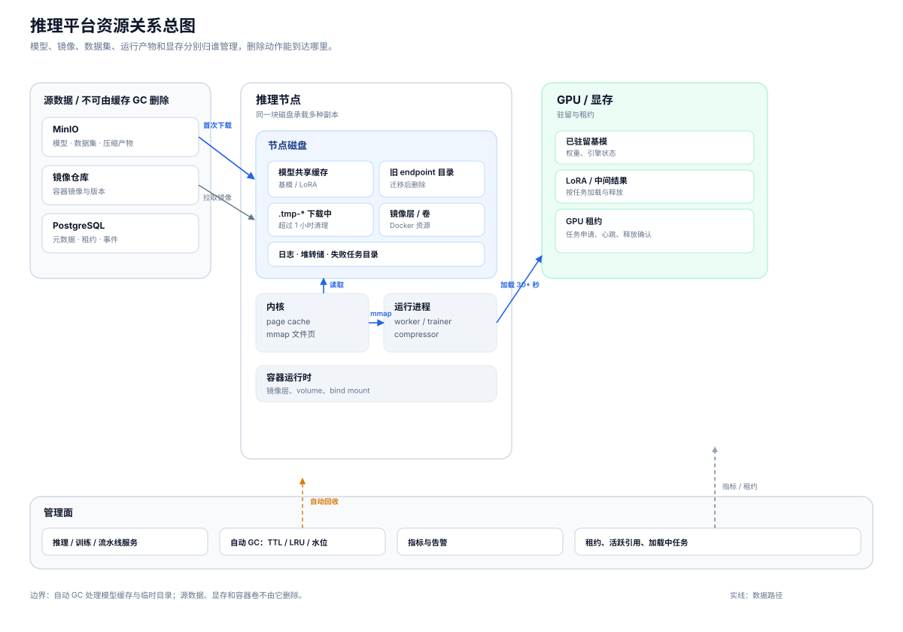
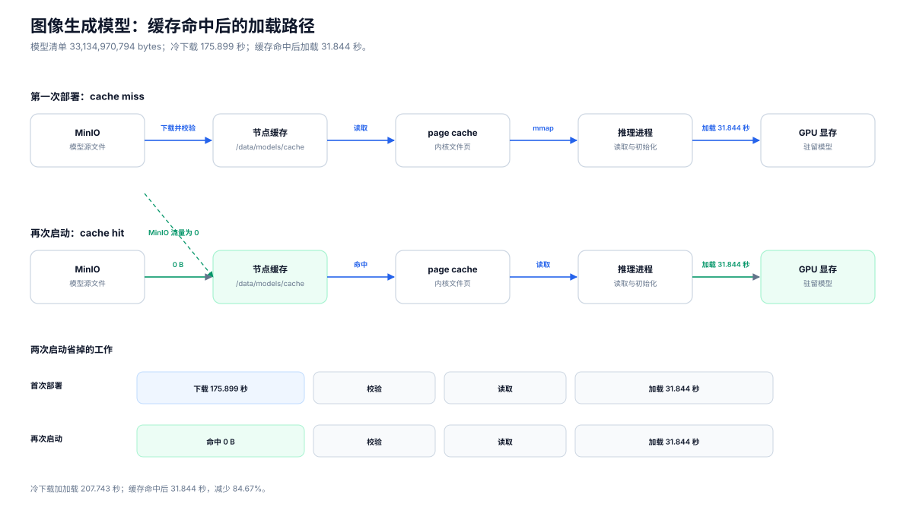
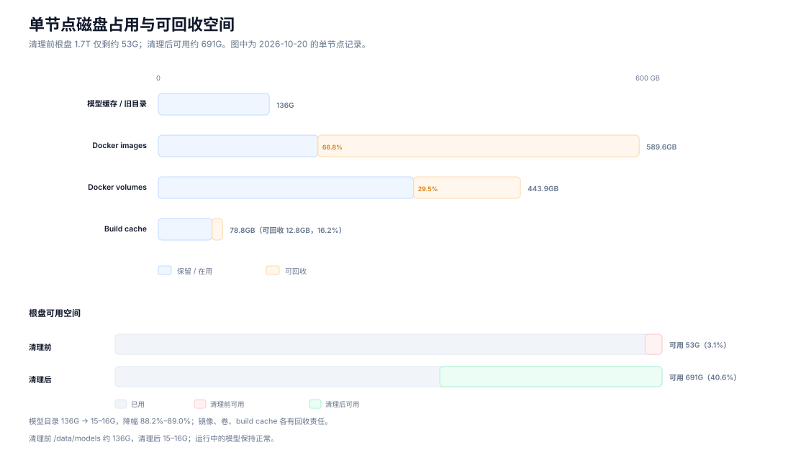
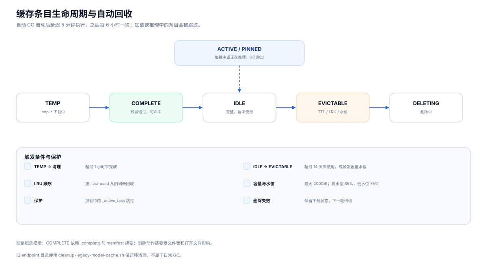
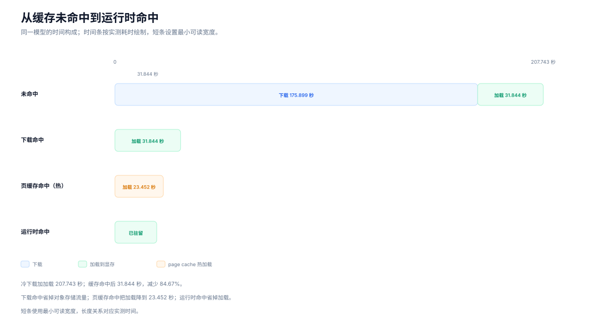
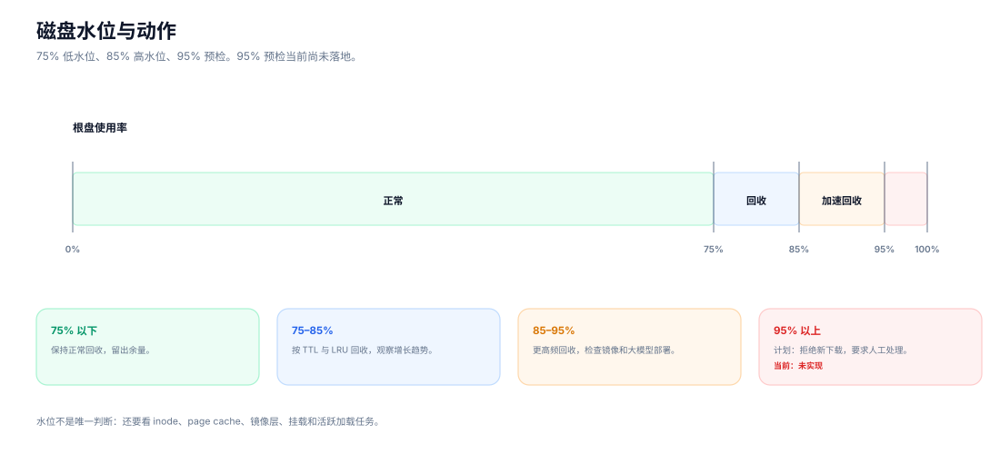

# 缓存、磁盘与加载：推理平台的资源生命周期

> OpenMaas 工程系列  
>
> 草稿 v0.1｜2026-11-14  
>
> 关键词：OpenMaas、模型缓存、磁盘治理、页面缓存、模型加载、GPU 显存、自动回收

> **OpenMaas 项目状态**
>
> OpenMaas 是面向私有化部署的模型训推与推理平台，当前处于开源收尾阶段。项目文档已开放：[Gitee](https://gitee.com/solomonxu/ai-maas-docs)（国内）/ [GitHub](https://github.com/solomonxu/ai-maas-docs)（全球）；代码仓库即将开放。本文范围限定在推理节点上的模型缓存、磁盘和加载链路，训练集群的完整存储方案另行讨论。

## 摘要

- 一个 30.859 GiB 的图像生成模型，从 MinIO 冷下载并加载到显存耗时 207.743 秒；缓存命中后降到 31.844 秒，总耗时降幅 84.67%。下载阶段消失，加载阶段仍在。
- 模型缓存已经由后台自动回收：TTL、LRU、容量上限、高低水位、临时文件清理和活跃任务保护都在运行。
- 一次磁盘治理把根盘可用空间从 53G 提到 691G，模型目录从 136G 降到 15–16G；镜像、卷、build cache 分别回收 66.8%、29.5%、16.2%。

## 数据口径

磁盘数据来自 2026-10-20 的单节点记录；加载数据来自 2026-11-14 的单节点实测。测试环境为 AMD gfx1151、64 GiB 显存、`imagegen-worker:rocm-0.1.65`、`Qwen-Image-2.1`（下称“该模型”）、`STAGED_QWEN=false`、page cache 冷。具体数值见第三节和第七节。

两组数据来自不同验证，仅用于说明资源路径，不作跨模型性能对比，也不作生产 SLA。

## 术语约定

| 术语 | 本文含义 |
|---|---|
| 制品 | MinIO 中的模型、数据集、压缩产物，属于源数据 |
| 缓存 | 节点磁盘上的可重建副本，例如 `/data/models/cache/v1` |
| 加载 | 把缓存文件读入 page cache、进程内存和显存的过程 |
| 驻留 | 模型已经加载完成，继续占用 CPU 或 GPU 内存 |
| 命中 | 可能是下载命中、页缓存命中或运行时命中，三者需要分开统计 |

## 一、根盘只剩 53G

先看现场。

一台推理节点运行了一段时间后，`/data/models` 持续增长，根盘可用空间从充足降到约 `53G`。检查后发现三件事：

- 同一个基模在不同 endpoint 部署时，会按 endpoint 目录重新下载一份；
- 旧 endpoint 停止或删除后，本地模型目录一直保留；
- Docker 镜像、卷和 build cache 同时占用了大量空间。

清理 Docker 构建缓存、无用镜像、无用卷和旧模型目录后，根盘可用空间从约 `53G` 回到 `691G`，`/data/models` 从约 `136G` 降到 `15–16G`。正在运行的模型保持正常。镜像、卷和 build cache 的细项见第七节。

清理从只读盘点开始。先执行几条只读命令，把占用拆开：

```bash
docker system df
du -sh /data/models
df -h
```

`docker system df` 只能看到 Docker 侧的汇总，模型目录要单独统计；`df -h` 看到的是整块盘的结果，只能说明整盘占用。三份信息放在一起，才能判断该清镜像、清卷，还是清模型缓存。

这次排查留下一个值得展开的问题：模型从 MinIO 到 GPU，中间到底经过哪些资源？每层资源什么时候可以删？

## 二、资源关系总图



> 图 1：模型、镜像、数据集和运行产物都可能在节点上留下副本。实线表示数据读写，虚线表示租约、引用、回收和指标。自动 GC 只处理它拥有所有权的模型缓存目录。

先把资源归属列清楚：

| 资源 | 常见位置 | 归属 | 删除方式 |
|---|---|---|---|
| 基模 / LoRA 缓存 | `/data/models/cache/v1` | 推理 worker | 自动 GC |
| 旧 endpoint 目录 | `/data/models/<tenant>/<endpoint>` | worker 迁移脚本 | 迁移脚本清理 |
| 容器镜像 / 卷 | Docker data root | 容器运行时、发布流程 | prune 或保留策略 |
| page cache | 内核内存 | 内核 | 内存压力回收 |
| GPU 驻留 | 显存 | 推理引擎 | 任务结束或驱逐 |

先看全图。

左侧是源数据：MinIO 中的模型、数据集和压缩产物，镜像仓库中的容器镜像，以及 PostgreSQL 中的元数据。它们属于源数据，删除后需要重新上传、构建或拉取。

中间是节点磁盘。模型缓存、旧 endpoint 目录、临时下载目录、容器镜像层、卷、日志和堆转储都在这里。它们共享同一块磁盘，但归属不同。

再往右是内核和进程。模型文件被读取后，会进入 page cache；推理进程通过 mmap 或普通读取拿到文件页；引擎初始化后，权重进入 CPU 内存和 GPU 显存。

最右侧是加速器。GPU 显存里可能有已驻留的基模、LoRA 和推理中间结果。磁盘文件和显存分属两套生命周期：删除文件只影响磁盘，释放显存只影响显存。

图的下方是管理面。推理服务、训练服务、pipeline-service 和 node-agent 负责创建任务、发放租约、上报指标；自动 GC 读取 `.last-used`、活跃任务和磁盘水位，决定哪些缓存条目可以删除。

这张图有两个边界。

第一，源数据和节点缓存要分开。MinIO 里的模型是源数据，节点上的模型目录是可重建副本。清理脚本只处理缓存目录；源数据按保留策略处理。

第二，磁盘、页缓存和显存要分开。磁盘缓存命中，说明可以省去重新下载；页缓存命中，说明文件已经在内存里；运行时命中，说明模型已经加载完成。三个“命中”对应的耗时和资源差异明显。

## 三、一个模型从 MinIO 到 GPU



> 图 2：第一次部署完成 MinIO 下载和显存加载；再次启动直接使用本地缓存，下载量归零，加载阶段仍在。具体耗时见图中的时间标注。

以该模型为例。

模型清单 `33,134,970,794` bytes（`30.859 GiB`），第一次部署时，worker 需要从 MinIO 下载模型文件，写入节点缓存目录，然后加载到显存。第二次部署或重新启动时，缓存已经存在，worker 可以直接使用本地文件。

缓存命中后，下载阶段消失，加载到显存仍要 `31.844` 秒。这段时间花在文件读取、权重加载、显存分配和引擎初始化上。模型越大，缓存命中和“可以推理”之间的差距越明显。

### 3.1 缓存目录怎么组织

旧实现按 endpoint 隔离：

```text
/data/models/<tenant>/<endpoint_id>/base
/data/models/<tenant>/<endpoint_id>/lora
```

同一基模部署到两个 endpoint，就会产生两份文件。endpoint 删除后，目录还留在磁盘上。

新实现改成共享缓存：

```text
/data/models/cache/v1/
  base/<tenant>/<key>/
  lora/<tenant>/<key>/
  .locks/
```

key 由资源类型、规范化后的 URI 和 manifest 摘要生成：

```text
sha256(kind + normalized URI + manifest sha256)[:32]
```

同一基模 URI、同一 manifest，对应同一个目录；LoRA 按自身 URI 缓存，与基模分开命中。

### 3.2 下载之后先校验，再改名

缓存命中的前提是文件完整。`ModelCache.ensure()` 的顺序是：

1. 读取 `_manifest.json`，计算摘要；
2. 获取文件锁；
3. 校验 `.complete` 和 `_cache-meta.json`；
4. 命中时更新 `.last-used`；
5. 未命中时下载到 `.tmp-*`；
6. 按 manifest 校验文件大小；
7. 写入 `_cache-meta.json` 和 `.complete`；
8. 原子 rename 到正式目录。

文件锁串行化并发下载；`.complete` 标记完整文件；manifest 摘要区分版本；GC 跳过下载中的半成品。

### 3.3 缓存命中之后还有加载阶段

该模型的加载耗时说明，缓存和加载是两个阶段。

缓存命中之后，worker 还要完成：

- 从本地文件读取权重；
- 把权重放进进程内存；
- 初始化推理引擎；
- 分配显存；
- 完成首次推理前的预热。

如果 page cache 是冷的，模型文件还要从磁盘读一遍；如果 page cache 是热的，读取会快一些，但显存分配和引擎初始化仍然存在。这段加载耗时包含这几段时间，具体占比取决于模型格式、卡型和引擎参数。

### 3.4 加载耗时花在哪里

这段加载耗时由五段动作组成：

- 从本地文件读取模型权重；
- 把权重装入进程内存，必要时做格式转换；
- 初始化推理引擎和运行时组件；
- 分配显存、创建执行上下文；
- 完成首次推理前的预热。

page cache 冷时，第一项会明显变长；page cache 热时，读取会快一些，后面几项仍在。模型从磁盘缓存命中，到可以接受请求，中间还有一条完整的加载链路。

### 3.5 共享到什么程度

当前缓存 key 保留了 tenant 维度，同一租户下的不同 endpoint 可以共享基模，跨租户仍然各存一份。这个选择牺牲了一部分磁盘复用，换来了租户隔离和清理边界。

LoRA 单独缓存，加载时再和基模组合。同一基模配不同 LoRA 只保留一份基模，组合目录不进入缓存条目。

共享范围再扩大，就要处理更多问题：跨租户引用计数、权限校验、一个租户删除时是否影响另一个租户、共享 PVC 的并发访问。当前实现停在租户内共享，边界比较清楚。

## 四、磁盘占用还包括镜像、卷和临时文件



> 图 3：模型缓存、容器镜像、卷和 build cache 共用节点磁盘。清理前根盘只剩约 53G；清理后可用空间回到 691G。图中数字来自 2026-10-20 的单节点记录。

模型缓存已经有自动回收，磁盘仍然会被其他东西占满。

### 4.1 容器镜像、卷和 build cache

这次清理涉及 Docker images、volumes 和 build cache 三类资源，具体回收量见第七节。

这些资源与模型缓存有三点区别：

- 归属方不同。镜像由构建和发布流程产生，卷可能承载数据库、缓存或运行时数据，模型缓存归 worker 管理。
- 删除风险不同。未使用的镜像可以重新拉取；卷里可能有状态数据，按引用和状态清理。
- 回收工具不同。模型缓存走 `ModelCacheGC`，Docker 资源走 `docker image prune`、`docker volume prune`、`docker builder prune` 或镜像仓库保留策略。

模型 GC 只管理模型缓存；Docker 卷由容器运行时和运维负责，清理需要单独的责任人和操作窗口。

### 4.2 临时文件、日志和堆转储

临时文件包括下载中断留下的 `.tmp-*`、转换过程中的中间文件、失败任务的残留目录。日志和堆转储通常在排障时生成，容易在磁盘告警时被忽略。

这些文件也需要 owner 和保留周期。临时目录可以按时间清理；日志按天或按大小轮转；堆转储在问题定位完成后归档或删除。把它们混进模型缓存 GC，会带来误删风险。

### 4.3 清理顺序

磁盘告警时，可以先看整体占用，再决定动作：

```bash
docker system df
du -sh /data/models
df -h
```

清理顺序可以是：

1. 构建缓存和无用镜像；
2. 无引用的卷；
3. 旧 endpoint 模型目录；
4. 临时文件和过期日志；
5. 仍需保留的模型和运行数据。

每一步都要先确认目标目录未被运行中的容器、挂载或任务占用。

### 4.4 清理前先做只读盘点

清理前至少记录四类信息：

- 当前运行中的容器和它们挂载的目录；
- `/data/models` 下每个子目录的大小和最近使用时间；
- Docker images、volumes、build cache 的总量和可回收量；
- 当前正在加载或推理的模型。

这些信息既用于决定清理顺序，也用于清理后的复盘。只保留“清完之后空间回来了”这一个结果，下一次磁盘告警仍然要从头判断。

## 五、自动回收已经在跑



> 图 4：缓存条目从 `.tmp-*` 写入，校验完成后进入可命中状态；加载或推理中的条目会被跳过；超过 TTL 或触发容量水位后进入回收。图是概念模型，不对应单一代码状态机。

模型缓存的生命周期由后台任务自动管理；人工脚本用于迁移和兜底。

### 5.1 启动与执行周期

GC 在 worker 启动后延迟 5 分钟执行，之后每 6 小时一次。启动后延迟，是为了避开模型加载和首次请求的高峰。

每次执行做几件事：

- 清理超过 1 小时的 `.tmp-*`；
- 删除超过 14 天未使用的条目；
- 按 `.last-used` 做 LRU 回收；
- 把缓存总量控制在 200GiB 以下；
- 参考 85% 高水位和 75% 低水位；
- 跳过加载中的 `_active_task`。

一次 GC 的顺序大致是：先清理超时的 `.tmp-*`，再处理超过 TTL 的条目，然后按 LRU 回收到容量上限以下，最后结合磁盘水位判断是否继续。加载中的条目在每一步都会被跳过。

### 5.2 删除资格

自动回收同时看文件时间、活跃引用和容量水位。一个条目要同时满足几个条件才会被删除：

- `.complete` 存在，文件完整；
- 当前无任务引用；
- 加载过程已结束；
- 超过 TTL，或触发容量水位；
- 文件锁已释放。

加载中的模型会被跳过。这个保护很关键：该模型加载期间，如果 GC 删掉目录，加载会失败，重试还要重新下载。

### 5.3 旧 endpoint 目录

共享缓存上线后，旧 endpoint 目录保持只读，等待迁移清理。迁移时先用新缓存验证命中，再删除旧目录：

```bash
bash deploy/scripts/cleanup-legacy-model-cache.sh --dry-run
bash deploy/scripts/cleanup-legacy-model-cache.sh --yes
```

这个脚本用于升级和遗留清理；日常回收由后台任务完成。

### 5.4 自动回收的边界

自动 GC 只覆盖模型缓存目录和临时下载目录；源数据、Docker 镜像和卷、page cache、显存由各自机制管理。

这几层资源需要分别治理：

- 源数据按 MinIO 保留策略和归档策略处理；
- 镜像按发布版本和节点拉取策略清理；
- 卷按业务状态和备份策略处理；
- page cache 交给内核，在内存压力下回收；
- 显存由推理引擎在任务结束或驱逐时释放。

把这些都交给一个缓存 GC，容易造成误删，也会让故障边界变得模糊。

### 5.5 GC 自身也需要观测

自动回收执行后，至少要记录：

- 本次释放了多少字节；
- 删除了多少条目；
- 跳过了多少加载中的条目；
- 清理了多少 `.tmp-*`；
- 执行耗时和下一次执行时间。

这些记录用于判断空间变化；记录缺失时，清理效果缺少判断依据。GC 运行后释放字节为 0，和 GC 未执行，处理方式不同。

### 5.6 删除文件后的空间

Linux 下删除一个正在被进程打开的文件，目录项会消失，但磁盘空间要等文件关闭后才释放。容器挂载、bind mount 和 K8s PVC 还会增加一层引用关系。

GC 执行成功和空间释放是两个时点。排查时要同时看缓存目录、打开的文件和挂载关系。

## 六、命中之后还要加载



> 图 5：下载命中省掉 MinIO 下载；页缓存命中（热）把加载降到 23.452 秒；运行时命中省掉加载。时间条按实测耗时绘制，短条设置最小可读宽度，三种命中需要分开统计。

该模型的加载过程，适合用来说明三种命中的区别。

### 6.1 下载命中

第一次部署时，节点缓存为空，worker 从 MinIO 下载。下载完成后写入共享缓存目录。

第二次部署时，缓存命中，worker 直接使用本地文件。网络和对象存储的流量省掉了。

### 6.2 页缓存命中

本地文件和 page cache 是两层。

第一次读取模型权重时，内核会把文件页放进 page cache。后续读取可能直接命中 page cache，减少磁盘 I/O。

page cache 由内核管理，模型缓存 GC 只管理模型目录。容器内存紧张时，页缓存也可能被回收。把 page cache 当成“永久缓存”会误判加载时间。

### 6.3 运行时命中

模型已经加载到推理进程和显存，新的请求直接复用驻留模型。这是最完整的一种命中，也是唯一能省掉加载时间的命中。

运行时命中依赖模型驻留策略。模型空闲一段时间后可能被释放；显存紧张时也可能被驱逐。释放后再次请求，仍要重新加载。

### 6.4 指标要拆开

把三种命中合并成一个“缓存命中率”，会掩盖加载阶段的问题。更有用的指标是：

- 模型下载命中率和下载耗时；
- 本地文件读取耗时；
- 加载到显存耗时；
- 引擎初始化耗时；
- 首次推理耗时；
- 运行时命中率和重新加载次数。

该模型的案例里，下载命中已经完成，用户仍然要等加载完成。这个等待属于加载阶段。

### 6.5 下载缓存只覆盖下载阶段

下载缓存减少的是对象存储流量和下载时间。缓存命中后，模型权重仍要读进推理进程，再放进显存。

运行时命中才能省掉加载。模型驻留期间，新的请求可以直接复用已经加载的权重；模型被释放后，下一次请求仍要重新走加载链路。

所以，缓存命中率适合描述下载层，加载耗时适合描述启动层，运行时命中率适合描述服务层。三个指标放在一起看，才能解释用户等待的时间。

## 七、治理前后：数据对比

先看加载。

测试条件见“数据口径”。

| 场景 | 下载 | 加载到显存 | 总计 |
|---|---:|---:|---:|
| 首次从 MinIO | `175.899` 秒 | `31.844` 秒 | `207.743` 秒 |
| 缓存命中 | `0 B` | `31.844` 秒 | `31.844` 秒 |

- 下载占总耗时 `84.67%`，加载占 `15.33%`。
- 缓存命中后，总耗时从 `207.743` 秒降到 `31.844` 秒，降幅 `84.67%`。
- page cache 热时加载为 `23.452` 秒；表中采用 page cache 冷。

测量方法：

- 下载：直接调用 `ModelCache.ensure`，从 MinIO 冷缓存开始，不含任务排队和调度。
- 加载：`engine.load` 到 GPU 完成；计时前通过 `posix_fadvise` 丢弃 page cache。
- `23.452` 秒是 page cache 热加载，单独列出，不混入主表。

再看磁盘。

| 项目 | 治理前 | 治理后 | 变化 | 百分比 |
|---|---:|---:|---:|---:|
| 根盘可用 | `53G` | `691G` | `+638G` | 可用率 `3.1%` → `40.6%` |
| `/data/models` | `136G` | `15–16G` | `-120G` 至 `-121G` | 降幅 `88.2%–89.0%` |
| Docker images | `589.6GB` | 未记录 | `-393.8GB` | `66.8%` |
| Docker volumes | `443.9GB` | 未记录 | `-130.9GB` | `29.5%` |
| Build cache | `78.8GB` | 未记录 | `-12.8GB` | `16.2%` |

- 根盘可用空间增加 `638G`；可用率从 `3.1%` 升到 `40.6%`。
- 模型目录从 `136G` 降到 `15–16G`，降幅 `88.2%–89.0%`。
- 镜像可回收量占 images 总量 `66.8%`，卷占 `29.5%`，build cache 占 `16.2%`。
- 同一基模再次启动时，下载阶段从 `175.899` 秒降到 `0 B`，下载阶段减少 `100%`。

这两张表说明两件事：缓存把下载阶段从总耗时中拿掉，加载阶段仍在；磁盘治理把旧副本、镜像、卷和构建缓存清出去，空间回来了。

## 八、水位与磁盘动作



> 图 6：75% 以下保持正常回收；85% 触发更积极的回收；95% 计划用于拒绝新下载或要求人工处理。95% 预检当前尚未落地。

磁盘水位决定回收的力度。

- 75%：低水位。GC 回收到此线以下，保留一部分余量。
- 85%：高水位。触发更积极的回收，优先清理 TTL 过期和 LRU 靠前的条目。
- 95%：危险水位。计划在下载前预检，空间不足时直接拒绝，并给出明确提示。

95% 这一档仍在待办。预检落地前，磁盘写满会在下载或加载过程中暴露，错误信息也更难定位。

水位之外还要看 inode、page cache、镜像层和挂载。一个节点可能磁盘占用较低，但 page cache 很大；也可能磁盘很空，但 inode 已经用完。

### 8.1 水位与任务准入

磁盘接近上限时，任务准入也要参与。模型下载前可以预估文件大小，和当前可用空间、缓存上限、预留空间做比较；空间不足时直接拒绝，比下载到一半失败更容易处理。

95% 预检仍在待办，当前的保护主要依赖 GC 和人工巡检。这个缺口在大模型部署前会放大：该量级模型下载时，模型文件和临时文件会同时占用空间。

预检落地后，下载前要先算一笔空间账：模型大小、临时目录预留、已有缓存可回收量、文件系统保留空间。算完再决定是否允许下载，比失败后重试更可控。

## 九、观测与告警

缓存和磁盘的观测可以分成四组。

| 组 | 指标 |
|---|---|
| 下载 | 命中次数、miss 次数、下载字节数、下载耗时 |
| 加载 | 本地读取耗时、加载到显存耗时、引擎初始化耗时、首次推理耗时 |
| 回收 | GC 释放字节数、淘汰条目数、临时目录清理量、GC 执行时长 |
| 容量 | 磁盘水位、模型目录大小、镜像占用、卷占用、build cache 占用 |

告警可以分两级：

- 85%：预警，检查增长趋势和最近的大模型部署；
- 95%：严重，停止新的模型下载，安排清理或扩容。

告警里要带上活跃加载数和 `_active_task` 数量。磁盘接近上限时，如果有模型正在加载，直接清理可能让任务失败。

告警内容可以带三类上下文：

- 哪个节点、哪个缓存目录、当前水位；
- 最近哪些模型被下载或加载；
- 当前有哪些任务在加载，哪些条目受保护。

只报一个磁盘百分比，值班人员很难判断该删什么。

### 9.1 指标采集的最小集合

指标可以从四个位置采集：

- worker 的缓存模块：命中、miss、下载字节数、GC 释放量；
- 推理引擎：加载到显存耗时、初始化耗时、首次推理耗时；
- 容器运行时：镜像、卷、build cache 占用；
- 宿主机：磁盘水位、inode、page cache、挂载关系。

这些指标可以从少量开始。先有磁盘水位和加载耗时，再补缓存命中和 GC 释放量，排障时就有基本依据。

## 十、边界

### 10.1 单节点结论需要在 K8s 复验

这次验证在单节点完成。K8s 下每个 Pod 有自己的容器文件系统，节点有自己的镜像层和 page cache；共享 PVC 能否跨 Pod 复用模型缓存，待验证。

如果缓存放在节点本地盘，同一模型会在多个节点各存一份，调度时要把节点亲和性和缓存命中一起考虑。如果缓存放在共享 PVC，读写延迟、并发访问和 GC 的锁又要重新设计。

多节点部署还要考虑：

- 模型缓存放在节点本地盘还是共享 PVC；
- 同一模型在不同节点的重复副本；
- 节点磁盘水位不均衡；
- 镜像拉取和模型下载同时发生时，网络和磁盘的竞争；
- 节点下线或替换后，本地缓存如何失效。

### 10.2 源数据保留策略待确定

MinIO 侧的模型保留、归档和删除策略待确定。节点缓存按 TTL 和 LRU 回收，源数据按独立保留策略处理。

### 10.3 镜像和卷的清理责任

模型缓存有自动 GC；镜像、卷、build cache、日志和堆转储的清理责任待明确。它们可能由发布流程、运维脚本或宿主机的定时任务处理，需要明确 owner。

### 10.4 失败任务的中间产物

失败任务的临时目录、压缩中间文件和评测输出保留多久，需要业务确认。保留时间长，磁盘压力大；保留时间短，排障证据可能缺失。

## 十一、结论

该模型的加载过程，把缓存和加载的区别摆在了同一张时间线上：

- 缓存命中解决重复下载，冷下载加加载耗时最长，缓存命中后降到加载阶段；
- page cache 命中减少磁盘读取；
- 运行时命中省掉模型加载；
- 显存驻留决定下一次请求是否还要等待。

模型缓存的自动回收已经运行：TTL、LRU、容量上限、水位、临时文件清理和活跃任务保护共同工作。磁盘治理还要覆盖镜像、卷、build cache、日志、堆转储和失败任务目录。

这套机制能否长期稳定，取决于三个细节：

- 每层资源有明确 owner；
- 每次写入有完成标记和摘要；
- 每次删除先检查活跃引用。

磁盘告警时，先看资源关系，再决定删什么。清理完成的标准是下一次加载可预测。

对使用方来说，缓存命中、加载耗时和运行时驻留是三个不同的等待点。平台把这些等待点分开记录，容量规划和故障排查才有共同语言。

---

**OpenMaas 工程系列**

- 本篇：缓存、磁盘与加载：推理平台的资源生命周期
- 相关：一块 GPU 上的四种资源：训推平台的 GPU 资源治理

**继续阅读**

- 文档：[Gitee](https://gitee.com/solomonxu/ai-maas-docs) / [GitHub](https://github.com/solomonxu/ai-maas-docs)
- 开发日志：[Gitee](https://gitee.com/solomonxu/ai-maas-docs/tree/main/docs/dev-log) / [GitHub](https://github.com/solomonxu/ai-maas-docs/tree/main/docs/dev-log)

OpenMaas 当前处于开源收尾阶段，文档已开放，代码仓库即将开放。文中的测试数据为本地验证记录，不构成生产 SLA。
