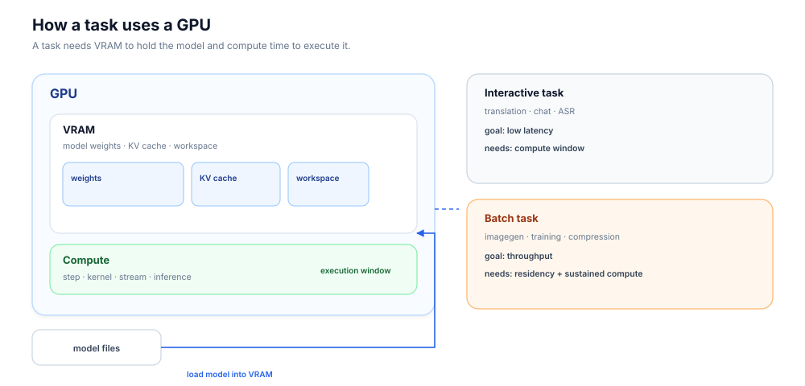
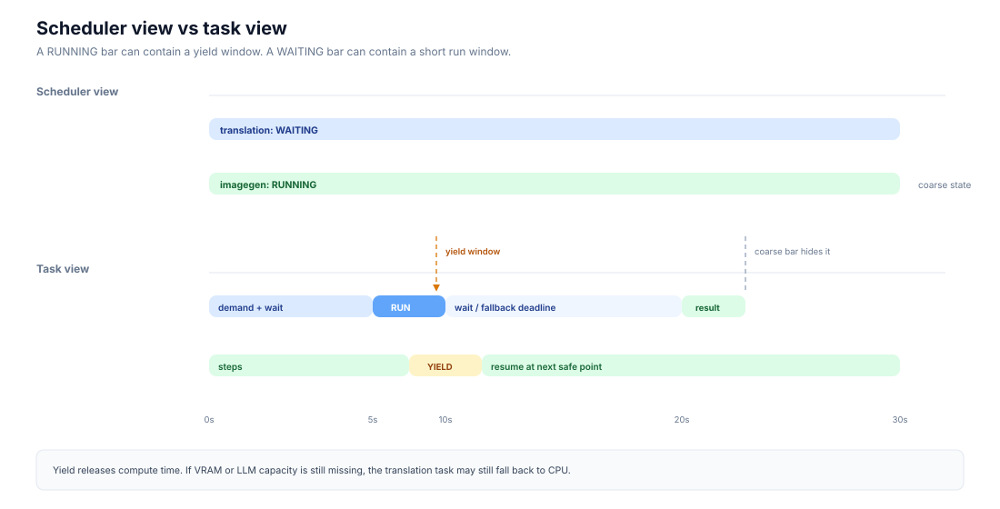
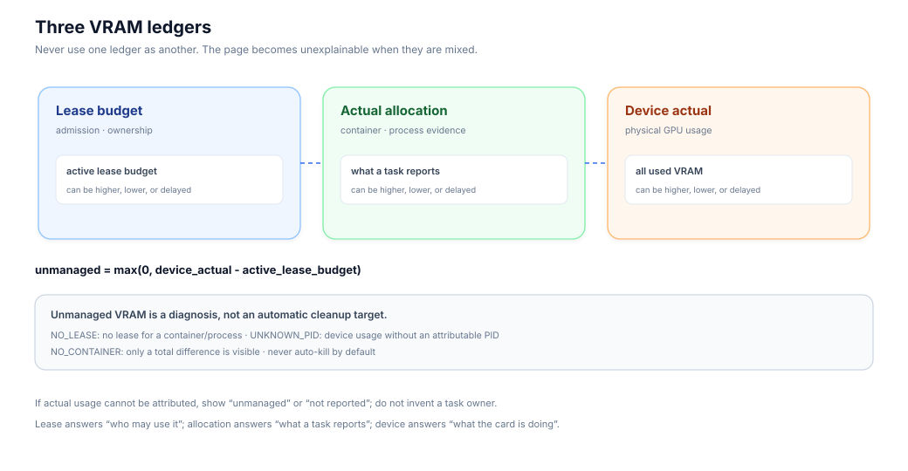
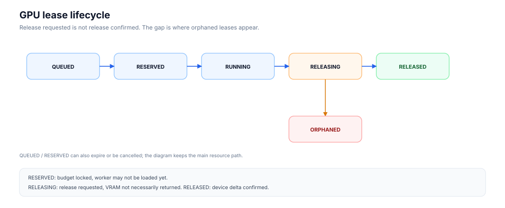
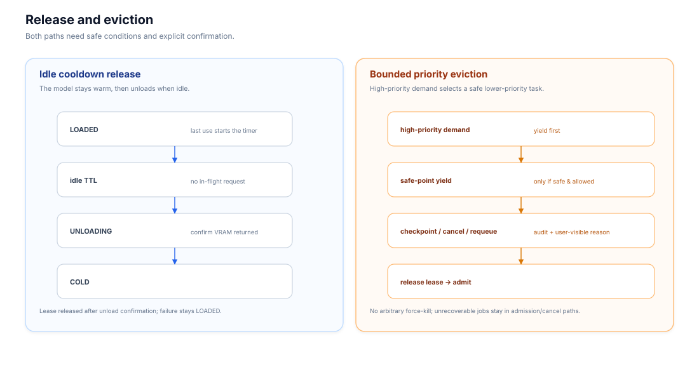

# Four Resources on One GPU: GPU Resource Governance for Training and Inference Platforms

> Building OpenMaas · GPU Resource Governance
>
> By XU Meng
>
> Keywords: GPU governance, VRAM, leases, model residency, interactive QoS, bounded eviction
>
> [Chinese version](./gpu-resource-governance-article.md)

## Introduction: A Translation Request Waits for Image Generation

A user submits a high-quality translation request. On the same GPU, a batch image-generation job is still producing images.

The translation request needs an answer. The image-generation job needs throughput. The scheduler shows two coarse states: one task is waiting, one is running. Most of the interesting behavior sits inside those two bars.

Is the translation model loaded? Is VRAM still held by image generation? Can image generation pause at a step boundary? Does translation get a real execution window? If it still cannot proceed, when does it fall back to a CPU engine?

This article opens those bars and explains what GPU resource governance actually coordinates. The short version: one GPU presents at least four different resource questions:

1. Can the model fit in VRAM?
2. Which task gets the next slice of compute time?
3. When can a new task be admitted?
4. What happens when a task waits too long?

These questions are related, but they are not the same. A queue answers one of them. A lease answers another. An interactive signal answers another. A fallback policy answers the last.

OpenMaas is a self-hosted platform for model training, inference, and evaluation. The examples below come from its GPU governance work, but the problem is general: any platform that shares GPUs between interactive and batch workloads will meet some version of it.

This article focuses on GPU governance. CPU, memory, disk, and Java runtime governance are separate topics and are not covered here.

## 1. How a Task Uses a GPU

### 1.1 VRAM and compute time

From a platform's point of view, a GPU provides two resources that matter immediately:

- **VRAM**, which holds model weights, KV cache, and temporary workspace;
- **compute time**, which is the execution window in which the GPU runs kernels, steps, or inference work.

A task usually follows this path:

```text
model files → load into VRAM → acquire compute time → produce results
```

Both steps matter. If VRAM is insufficient, the model cannot load. If compute time is unavailable, a loaded model can only wait.

### 1.2 Model loading has a cost

Models do not appear in VRAM instantly. Inference, image generation, translation, and training all need to load weights first. Depending on model size, storage location, and device state, loading can take seconds or minutes.

This creates a cold-start problem. If every request reloads the model, users see higher first-token latency, slower first images, and more timeouts. Platforms therefore keep models loaded for some period of time.

That is model residency.

### 1.3 Residency is not the same as busy

A resident model is present in VRAM. It may be serving a request, or it may be idle and waiting for the next one.

A useful platform distinction is:

- **loaded:** the model is in VRAM;
- **busy:** the model is processing a request;
- **idle:** the model is in VRAM but has no active request.

If a platform treats “loaded” as “busy,” it misreads capacity. If it treats “idle” as “safe to unload immediately,” it can interrupt a request that has just arrived.

Residency governance is about when a model should stay and when it can leave.

### 1.4 A workbench analogy

A simple analogy helps explain the difference between compute and memory.

Think of a GPU as a workbench:

- VRAM is the table area;
- the model is the tools and materials on the table;
- compute time is the worker operating the tools;
- loading is placing the tools on the table;
- residency is leaving the tools there for the next job;
- yielding is the worker stepping away for a moment.

The analogy is imperfect, but it captures one important point:

> Releasing compute time and reclaiming VRAM are different operations.

A translation task may get a compute window while the image-generation model still occupies the table. If the translation model does not fit, compute time alone is not enough.

### 1.5 Interactive and batch tasks

Two broad classes of GPU work meet on the same card.

**Interactive tasks** have a user waiting for a result. Examples include:

- chat;
- high-quality translation;
- speech recognition;
- online inference.

Interactive work prioritizes latency and predictability.

**Batch tasks** run for longer periods and prioritize throughput. Examples include:

- batch image generation;
- training;
- compression;
- offline evaluation.

Batch work prefers to keep running and avoid unnecessary interruptions.

When these two classes share a GPU, the conflict is structural. They are not simply competing for “a turn.” They are competing for memory, execution windows, admission order, and degradation policy.



> Figure 1: A task needs VRAM to hold the model and compute time to execute it. Interactive and batch tasks share the same card.

## 2. The Contention Point

Return to the translation and image-generation example.

The translation service decides that a high-quality request should use an LLM path and asks the platform for GPU compute time. The image-generation batch job has already loaded its model and is producing images step by step.

The sequence can be understood in five stages.

### 2.1 Translation registers interactive demand

The translation service tells the scheduler that a user is waiting.

This is **interactive demand**. It influences queue priority and whether batch work should yield at a safe point.

Demand is a soft signal. It expresses intent. It does not reserve VRAM, replace a lease, or prevent an out-of-memory failure.

### 2.2 Image generation yields at a step boundary

Image generation advances in steps. Between steps, there is a relatively safe point to pause.

When interactive demand is active, the image-generation worker can pause at a step boundary and release compute time to the translation task.

This is **safe-point yield**.

The batch job keeps its progress and state. It has not been cancelled, and its model may still be resident.

### 2.3 Translation gets an execution window

If VRAM and LLM capacity are available, translation can use the window to load, execute, and return a result.

From the user's perspective, the request may simply be “a little slow.” Inside the platform, several things happened:

- interactive demand was registered;
- the batch task reached a safe point;
- compute time moved to the interactive task;
- the batch task resumed later.

### 2.4 VRAM may remain resident

Yield releases compute time. It does not necessarily release VRAM.

The image-generation model may still be loaded, and its residency lease may still be active. If translation needs to load a large LLM and VRAM is still occupied, the execution window alone may not be enough.

At that point the platform has several choices:

- keep waiting;
- unload the image-generation model to reclaim VRAM;
- send translation to a CPU engine;
- return a busy or queued response.

For translation, the platform can define a maximum wait time. When the limit is reached, the request falls back to a CPU engine and returns a result with a different quality and latency profile.

That is **fallback**.

### 2.5 The scheduler view and the task view

A scheduler often reduces this story to two bars:

```text
translation: WAITING ───────────────
imagegen:    RUNNING ─────────────────
```

The task timeline contains more detail:

```text
imagegen:    step → step → YIELD → step
translation: demand → wait → RUN → result
                         ↑
                    yield window
```

The scheduler needs coarse states. Operators need the task-level view. A GPU page that shows only the first view cannot explain why a task waited, whether it ever ran, or whether it degraded.



> Figure 2: A schematic, not to scale. The scheduler sees coarse states; the task view shows demand, step boundaries, yield, a possible execution window, and fallback.

### 2.6 The four questions behind the scene

The example contains all four questions:

1. **VRAM:** can the translation model fit?
2. **Compute time:** which task gets the next execution window?
3. **Admission:** when can translation enter the GPU at all?
4. **Degradation:** what happens if translation cannot run in time?

The rest of this article expands each question, then links them through leases, residency, cooldown, and bounded eviction.

## 3. VRAM Ledgers: Budget, Allocation, and Device Usage

VRAM governance starts by separating three numbers that are often collapsed into one.

### 3.1 Three perspectives

| Perspective | Question | Typical source |
|---|---|---|
| Lease budget | Who may use VRAM, how much, and in what state? | Scheduler |
| Actual allocation | How much does the task or container report? | Runtime, container, task context |
| Device actual | How much is the whole card using? | GPU device, driver, or device plugin |

The lease budget drives admission and ownership. Actual allocation helps attribute usage to a task. Device actual tells the platform whether the card has room.

The three values can diverge:

- a lease is reserved before the worker has loaded anything;
- a worker is loaded but uses less than its budget;
- a task has finished but its process has not exited;
- a lease is released but VRAM has not returned yet.

The platform needs three ledgers, not one “VRAM number.”

### 3.2 Unmanaged VRAM

The gap between device usage and active lease budget is:

```text
unmanaged = max(0, device_actual - active_lease_budget)
```

Unmanaged VRAM usually has one of three sources:

- `NO_LEASE`: a container or process has no associated lease;
- `UNKNOWN_PID`: the device shows usage but no attributable PID is available;
- `NO_CONTAINER`: only a total difference is visible, with no container attribution.

Unmanaged VRAM is a diagnostic signal. The platform can alert, show the reason, and ask an operator to review it. It does not automatically terminate a process merely because the process appears unclaimed.



> Figure 3: Lease budget, actual allocation, and device usage are different ledgers. Unmanaged VRAM is a difference to diagnose, not an automatic cleanup permit.

### 3.3 A task across the three ledgers

Consider an image-generation task with a 20 GB lease budget.

- The scheduler records the 20 GB budget.
- The worker begins loading and actual allocation moves from zero toward the budget.
- The device may show 25 GB because a worker base process and another lease are also present.
- When the task ends, the worker requests unload and actual allocation begins to fall.
- Only after device VRAM is confirmed to drop does the lease reach `RELEASED`.

The numbers 20 GB, 18 GB, and 25 GB can all appear in the same window. They answer different questions: budget, task usage, and whole-card usage.

### 3.4 Why a page can show 75 GB on a 64 GB card

A page can display an apparently impossible value:

```text
allocated: 75 GB
physical VRAM: 64 GB
```

The usual cause is mixed accounting:

- the “allocated” number includes multiple lease states;
- an orphaned lease is counted as normal allocation;
- allocation and device usage are counted twice;
- unmanaged VRAM is merged into assigned usage.

The fix is not to shrink the number. The fix is to separate the ledgers:

- normal lease budget;
- exceptional budget, such as `ORPHANED`;
- actual allocation;
- unmanaged VRAM;
- device actual usage.

Every number on the page should have a source. When a value is missing, the page should show “not reported,” not zero.

### 3.5 A troubleshooting order

When a user says “the GPU is stuck,” a useful order is:

1. Is the device healthy?
2. Does device free VRAM look sufficient?
3. Does the task hold a lease?
4. Did the task load successfully?
5. Is the task yielding?
6. Has release been confirmed?
7. Is there unmanaged VRAM?

This separates “VRAM is full” into distinct, actionable cases.

## 4. Lease Lifecycle: From Queue to Confirmed Release

A GPU lease turns VRAM from a number into a resource with ownership, state, and release confirmation.

### 4.1 QUEUED

The task has expressed a demand, but resources are not ready.

Reasons include:

- insufficient VRAM;
- the GPU is occupied;
- a single-GPU-per-task policy;
- node capacity limits;
- a higher-priority task.

Queueing should return a reason, not just “try later.”

### 4.2 RESERVED

`RESERVED` means the scheduler has set aside budget for the task.

The worker may not have loaded the model yet. The page should show both the reservation and actual usage. “Reserved” is not “running.”

### 4.3 RUNNING

`RUNNING` means the worker has begun using the lease.

The platform still tracks budget, actual allocation, and device usage separately. Task completion, model unload, and process exit do not necessarily happen at the same time.

### 4.4 RELEASING

`RELEASING` means a release request has been issued. VRAM may not have returned yet.

Reasons for delay include:

- the model is still unloading;
- the CUDA context has not been reclaimed;
- the process has not exited;
- device statistics have not refreshed.

The scheduler compares VRAM before and after release. It reaches `RELEASED` when the drop is confirmed.

### 4.5 RELEASED

`RELEASED` means the scheduler has confirmed that VRAM was returned.

Confirmation requires:

- before/after VRAM comparison;
- a minimum drop threshold;
- tolerance for device-statistics delay;
- a release record.

“The release call succeeded” is not the same state as “the resource is confirmed available.”

### 4.6 ORPHANED

`ORPHANED` means a release was requested, but confirmation timed out.

Handling options include:

- runtime unload confirmation;
- a newer lease that supersedes the old lease for the same task;
- a newer lease for the same worker and runtime;
- manual confirmation;
- automatic closure under an explicit policy.

A break-glass window is an operational recovery mode. It still checks actual VRAM; it does not bypass physical capacity.



> Figure 4: `RELEASING` is a request state. `RELEASED` is a confirmed state. `ORPHANED` is a release waiting for confirmation.

### 4.7 Why release confirmation matters

If the platform treats a release request as a completed release, the next task can start on a device that looks free but is still occupied. The result is an out-of-memory error, a failed load, or another orphaned lease.

Release confirmation aligns the scheduler, runtime, and device. Only then is the lease fully closed.

## 5. Residency and Idle Cooldown Release

### 5.1 Why models stay resident

Inference and image generation pay a cold-start cost.

Reloading a model for every request leads to:

- slower first tokens;
- slower first images;
- repeated allocation and release;
- unstable user experience.

Residency is reasonable. The platform question is when to keep a model warm and when to unload it safely.

### 5.2 Residency states

```text
COLD → LOADING → LOADED → UNLOADING → COLD
```

`LOADED` means the model is in VRAM. It does not mean the model is busy.

The platform also tracks:

- whether an in-flight request exists;
- the last time the model was used;
- whether the model is pinned or warm;
- whether a worker base lease is held;
- whether unload has been confirmed.

A **worker base lease** covers the worker's CUDA context, residual VRAM after unload, and runtime baseline. It keeps device usage explainable even when no model is loaded.

### 5.3 Idle cooldown release

**Idle cooldown release** is the path where a model stays warm for a period, then unloads when it has been idle long enough.

A complete path is:

```text
LOADED
  → idle timer
  → no in-flight requests
  → UNLOADING
  → device VRAM confirmed lower
  → COLD
  → residency lease released
```

The cooldown window serves two goals:

- reuse a loaded model for follow-up requests;
- return VRAM after a long idle period.

Common policy modes are:

| Mode | Behavior | Typical use |
|---|---|---|
| `off` | Keep the model resident | Dedicated GPU, stable long-lived workloads |
| `idle` | Unload after an idle TTL | Shared GPU, constrained capacity |
| `aggressive` | Shorter TTL, still protecting in-flight work | Very tight VRAM, cold starts acceptable |

Cooldown release protects:

- in-flight requests;
- loading and unloading operations;
- pinned or warm models;
- the worker base lease;
- state fallback when unload fails.

If unload fails, the model should remain in a visible loaded or failure state. Reporting `COLD` while VRAM is still held would make every later decision wrong.

### 5.4 The trade-off in the cooldown window

Cooldown release is a balance, not a fixed rule.

A short TTL causes frequent cold starts. A long TTL keeps idle models in VRAM and can make interactive requests wait.

The right policy depends on the model, node, and workload:

- frequently used models can stay resident or be pinned;
- large low-frequency models can use shorter TTLs;
- image generation, inference, and speech may use different policies;
- constrained nodes can enable more aggressive reclamation;
- critical models can be kept warm.

The goal is an explainable balance between cold-start cost and VRAM utilization.

### 5.5 Residency and yield are different

A model can be loaded and still yield compute time.

In that state it keeps VRAM and its residency lease, but does not use the GPU for execution. Task context should show:

- whether the model is loaded;
- whether a request is active;
- whether it is yielding;
- how long it has been idle;
- whether unload is allowed.

## 6. Compute Time Governance: Interactive Demand and Bounded Eviction

### 6.1 Interactive demand is a soft signal

Interactive demand tells the scheduler that a user is waiting.

It influences:

- queue priority;
- whether batch work should yield at a safe point;
- whether an interactive task should be woken first.

It is a soft signal. VRAM remains governed by leases.

This layer is commonly called **GPU QoS** (Quality of Service): coordinating compute time between interactive and batch work on a shared GPU.

### 6.2 Safe-point yield

Batch tasks pause at safe points to release compute time:

- training: step or checkpoint;
- video/3D: step or epoch;
- RL: rollout or step;
- image generation: step boundary;
- inference batch: batch or chunk boundary.

Yield preserves progress and task state, and remains distinct from cancellation and unload.

### 6.3 Four distinct actions

| Action | What it does | Releases VRAM? |
|---|---|---|
| `yield` | Pauses compute at a safe point | Usually not |
| `unload` | Removes the model and enters `COLD` | Yes, for model VRAM |
| `evict` | Stops or requeues a low-priority task and releases its lease | Yes |
| `fallback` | Sends work to a CPU or alternate path | Depends on the workload |

The four actions have different costs and risks. Combining them under one “preemption” label hides important behavior.

### 6.4 Bounded priority eviction

When a high-priority task needs resources, the platform can select a lower-priority task and handle it under safe conditions:

```text
high-priority demand
  → select a lower-priority task
  → safe-point yield
  → checkpoint / cancel / requeue
  → release the lease
  → admit the high-priority task
```

The boundaries are:

- only lower-priority, recoverable or rerunnable work;
- training requires a checkpoint;
- compression uses admission, cancellation, or requeue rather than fine-grained yield;
- in-flight or unrecoverable work is not forcibly stopped;
- unmanaged processes are not automatically killed;
- every eviction has an audit record and a user-visible reason.

Bounded eviction works best before a task starts. The high-priority task enters a waiting state, the platform reclaims a safe low-priority lease, and admission proceeds. Evicting a running task is more expensive, so yield comes first and eviction is reserved for work that explicitly supports checkpointing, cancellation, or requeue.

### 6.5 Priority is a policy, not a single number

Priority combines class, recoverability, and rerunnability:

- interactive work: gets compute priority and usually has a latency target;
- high-priority batch: can wait, but should not be interrupted casually;
- medium-priority batch: can be cancelled and rerun from a seed or checkpoint;
- low-priority batch: can be redone and is a candidate for early yield;
- build and preprocessing: lowest priority, interruptible.

Different workloads have different safe points. Training needs a checkpoint. Evaluation can rerun from a seed. Compression may be safe to requeue only at method boundaries. Image generation can pause at a step. One “pause” button cannot represent all of them.

### 6.6 Fallback is a business decision

Translation is one of the few workloads that can fall back to CPU after waiting for GPU.

The business must define:

- the maximum wait time;
- whether a CPU engine is available;
- whether lower quality is acceptable;
- how the result records the fallback;
- whether the user should know that a fallback occurred.

Training, compression, and some inference workloads need their own degradation policies. A generic preemption framework cannot decide whether a CPU result is acceptable for a business.



> Figure 5: Left: idle cooldown release. Right: bounded priority eviction. Both require safe conditions, confirmation, and audit.

### 6.7 Returning to the opening scene

Translation registers demand. Image generation yields at a step boundary. Translation gets an execution window. If VRAM or LLM capacity is still insufficient, translation reaches its 30-second wait limit and falls back to CPU.

This is a resource-coordination sequence with four stages: demand, yield, wait, and fallback.

## 7. Observability: From Status Bars to Task Context

### 7.1 Task context

A task context record should include:

- task ID;
- runtime type;
- node and GPU;
- task title;
- stage and progress;
- actual VRAM;
- peak VRAM;
- start and finish times;
- yield and resume times.

With this information, a GPU page can move from “who holds the card” to “why the card is held.”

### 7.2 Scheduler view and task view

The scheduler expresses coarse state:

- waiting;
- running;
- releasing;
- orphaned.

The task view expresses internal change:

- loading;
- step;
- yield;
- resume;
- fallback;
- unload.

Both views are necessary. With only the scheduler view, users see a task “running” without knowing whether it is progressing, waiting for a load, or repeatedly yielding.

### 7.3 No attribution without evidence

When a GPU allocation cannot be attributed to a task, the platform should:

- fall back to a node or GPU view;
- show unmanaged or not-reported state;
- state that this is a cluster view;
- avoid assigning unknown VRAM to a specific task.

### 7.4 Metrics and alerts

Useful signals include:

- active demand count and oldest wait time;
- admission delay from demand to lease;
- yield count, total yield time, and maximum yield;
- lease queue length and rejection reasons;
- orphaned leases and duration;
- unmanaged VRAM and its reason;
- residency time, cooldown releases, and unload failures;
- delay between release request and VRAM confirmation;
- break-glass activations.

Metrics become actionable when they can be tied to a task and a lease.

### 7.5 A troubleshooting path

When opening the GPU page, read it in this order:

1. Is the card healthy?
2. Which leases are active?
3. What state is each lease in?
4. How much VRAM does each task use?
5. Is there unmanaged VRAM?
6. Is there an orphaned lease?
7. Is a task yielding?
8. Has a cooldown release or eviction occurred?

This turns a wall of numbers into a task-level explanation.

## 8. Limits and Conclusion

### 8.1 Current boundaries

| Area | Current policy | Observable result |
|---|---|---|
| ROCm | Single-GPU-per-task model | MIG-style hard slicing is outside the current scope |
| Unmanaged VRAM | Alert and manual review | The platform does not automatically terminate processes |
| Break-glass | Still checks actual VRAM | Operational access does not bypass capacity |
| Compression | Admission, cancellation, or requeue | No fine-grained yield |
| Training and evaluation | Single-GPU-per-task | No concurrent sharing of one card |
| CPU/IO tasks | CPU/IO governance | No GPU QoS registration |
| Task attribution | Runtime reports and task context | Missing evidence is shown as not reported |

### 8.2 Where this approach fits

This model fits platforms that:

- share GPUs across training, inference, image generation, translation, and speech;
- combine latency-sensitive work with long batch jobs;
- need to explain why a task queues, why VRAM is not released, or why a request degrades;
- run across single-node, multi-node, and Kubernetes environments while keeping the same resource semantics.

It is complementary to GPU virtualization, MIG slicing, and general-purpose preemption frameworks. It does not replace them.

### 8.3 Conclusion

One GPU carries four resource facts that a platform must coordinate:

- VRAM budget;
- actual allocation;
- access to compute time;
- wait and degradation policy.

The value of the platform is to make those facts explainable in one scene:

- why a task waits;
- why VRAM has not returned;
- why a model is still resident;
- why an interactive request slows down;
- why cooldown release happens;
- why a priority eviction is allowed.

When those answers are visible, a GPU becomes an operable resource. The platform can move from “running jobs” to assigning resources to the right work at the right time, with a clear reason for every wait, yield, and release.

---

This article is based on the OpenMaas GPU governance work. Concepts and boundaries reflect the current implementation; concrete parameters follow the project documentation and runtime configuration.

OpenMaas documentation:

- GitHub: https://github.com/solomonxu/ai-maas-docs
- Gitee: https://gitee.com/solomonxu/ai-maas-docs
