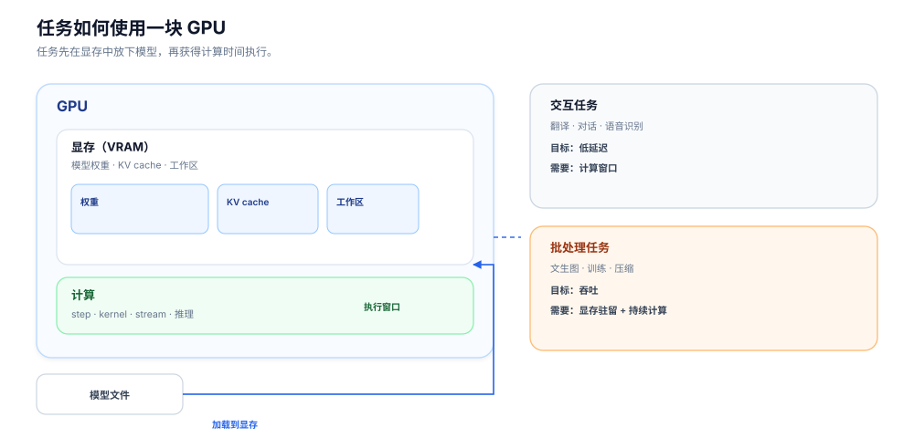
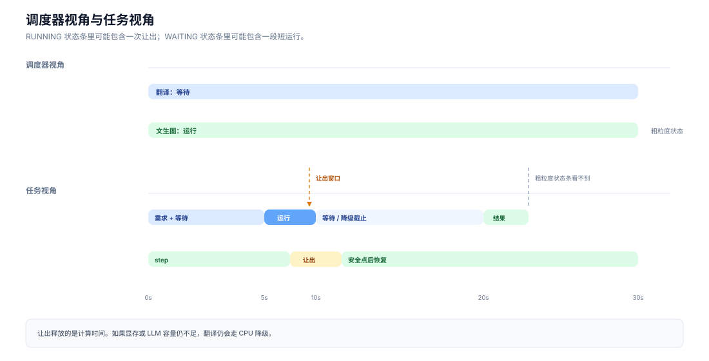
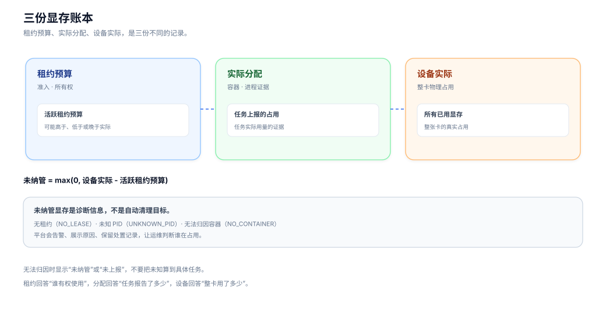
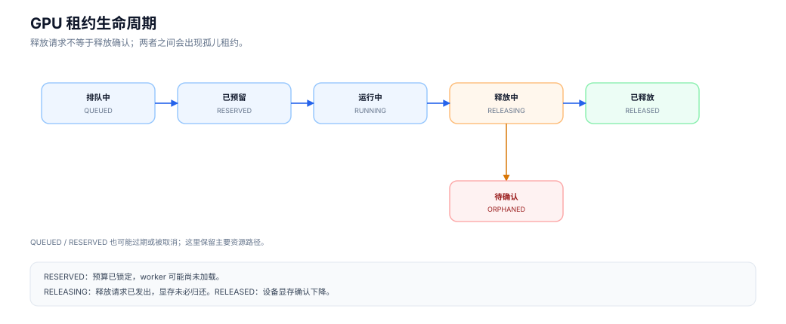
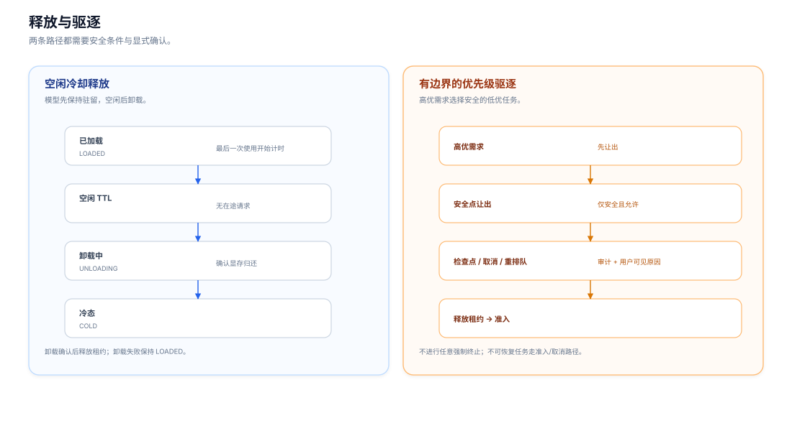

# 一块 GPU 上的四种资源：训推平台的 GPU 资源治理

> OpenMaas 工程系列 · GPU 资源治理
>
> 作者：许猛
>
> 关键词：GPU 治理、显存、租约、模型驻留、交互 QoS、批任务让出
>
> [English version](./gpu-resource-governance-article-en.md)

## 写在前面

这篇文章从一次很常见的等待开始：一个用户提交了高质量翻译请求，同一张 GPU 上，另一个文生图任务正在批量生成图片。

翻译在等结果，文生图在继续跑。调度器看起来只显示了两条状态：一个在等待，一个在运行。但变化发生在状态条内部：模型有没有加载、显存有没有被占住、文生图什么时候让出、翻译有没有拿到计算时间、最后有没有降级。

如果只看调度器，这些变化都被压成了一条横条。

本文想把这个横条展开，讲清楚 GPU 资源治理在管什么，以及为什么一块 GPU 上会同时存在四种需要协调的资源。

适合读者：

- 正在建设 AI 平台、MLOps 平台或推理平台的架构师和研发；
- 负责训练、推理、图像生成、翻译等 GPU 服务的工程师；
- 关注长任务、显存回收、冷启动和资源争用的团队。

---

## 一、先认识 GPU：显存、计算和模型加载

### 1.1 GPU 上有两样东西最值得关心

从平台视角看，一块 GPU 至少有两类资源：

1. **显存**：模型权重、KV cache（推理缓存）、临时 workspace 放在这里；
2. **计算时间**：GPU 执行计算的窗口。

一个任务要跑起来，通常要经过两步：

```text
模型文件 → 加载到显存 → 获得计算时间 → 产生结果
```

这两步缺一不可。

显存不够，模型加载失败；计算时间拿不到，模型加载了也只能等待。

### 1.2 模型加载需要时间

模型不会凭空出现在 GPU 上。

推理、图像生成、翻译、训练，都需要先把模型权重加载到显存。加载过程可能持续数秒到数分钟，取决于模型大小、存储位置和设备状态。

这就带来一个平台问题：**冷启动**。

如果一个模型每次请求都重新加载，用户会感受到明显的首字延迟、首图延迟，甚至请求超时。所以，平台通常会让模型在一段时间内保持加载状态。

这就是“驻留”。

### 1.3 驻留：模型的停留状态

模型加载后留在显存里，表示它处于驻留状态。

驻留的模型可能正在处理请求，也可能只是空闲等待下一次请求。

这两种状态需要分开：

- **已加载**：模型在显存里；
- **忙碌**：模型正在处理请求；
- **空闲**：模型在显存里，但暂时没有请求。

如果平台把“已加载”当成“忙碌”，就会误判资源；如果平台把“空闲”当成“可以立刻卸载”，又可能打断刚到的请求。

驻留治理要处理的，就是模型何时留下、何时离开。

### 1.4 一个工作台的类比

可以把 GPU 想成一张工作台：

- 显存是台面面积；
- 模型是工具和材料；
- 计算时间是工人操作台面的时间；
- 加载模型是把工具搬上台面；
- 驻留是工具先留在台面上，方便下一次使用；
- 让出是工人暂时离开，但工具可能还留在台面上。

这个类比不完美，但能帮助理解一个关键区别：

> 让出计算时间，和收回台面空间，是两件事。

翻译任务可能拿到一段计算时间，但如果文生图的模型还占着台面，翻译自己的模型仍然可能放不下。

### 1.5 两种任务，两种目标

平台上常见的 GPU 任务可以分成两类。

**交互式任务**

用户正在等待结果，关注延迟和确定性。例如：

- 聊天；
- 高质量翻译；
- 语音识别；
- 在线推理。

交互任务的目标通常是：尽快返回，哪怕需要排队，也要让用户知道在等什么。

**批处理任务**

任务可以持续一段时间，关注吞吐和资源利用率。例如：

- 文生图批量生成；
- 训练；
- 压缩；
- 离线评测。

批处理任务的目标通常是：持续运行，尽量少中断。

这两类任务放到同一张 GPU 上，冲突就出现了。



> 图 1：模型加载到显存，任务获得计算时间；交互任务和批任务共享同一张卡。

---

## 二、争用现场：翻译在等，文生图在跑

回到开篇的场景。

用户提交了一个高质量翻译请求。翻译服务判断需要走 LLM 路径，于是向平台申请 GPU 计算时间。

同一张 GPU 上，文生图批次任务正在运行。它已经加载了模型，正在按 step 生成图片。

接下来发生的事情，可以分成几个阶段。

### 2.1 翻译登记交互需求

翻译服务告诉调度器：有用户在等，这是一个交互请求。

这个信号叫 **交互需求**（interactive demand）。它的作用是让调度器知道“现在有人在等”，从而影响排队和批任务的让出。

交互需求是一个软信号。它表达意图，不直接扣减显存，也不替代租约。

### 2.2 文生图在 step 边界让出

文生图任务通常按 step 推进。每个 step 之间，是一个相对安全的暂停点。

当调度器发现有交互需求时，文生图可以在 step 边界暂停，把计算时间让给翻译。

这个动作叫 **安全点让出**（safe-point yield）。

让出后，文生图的生成进度还在，任务没有丢失；它只是暂时不使用 GPU 计算。

### 2.3 翻译获得一段执行窗口

如果显存和 LLM 资源允许，翻译可以在这个窗口里加载模型、执行翻译，然后返回结果。

从用户视角看，翻译可能只是“稍微慢了一点”；从系统视角看，它经历了一次真实的资源协调：

- 有人登记了交互需求；
- 批任务在安全点让出；
- 翻译获得了计算时间；
- 批任务随后恢复。

### 2.4 让出计算时间之后，显存可能仍然驻留

这里有一个容易被忽略的细节。

文生图让出的是计算时间。它的模型可能仍然驻留在显存里，租约也可能仍然有效。

如果翻译需要加载一个较大的 LLM，而显存已经被文生图占住，翻译仍然可能等不到足够的空间。

这时平台会面临选择：

- 继续等；
- 让文生图卸载模型，释放显存；
- 让翻译走 CPU 引擎；
- 返回繁忙或排队。

翻译场景里，平台通常会设置一个等待上限。超过上限后，切换到 CPU 引擎，先给用户一个结果。

这就是 **降级**（fallback）。

### 2.5 调度器看到的和任务经历的

如果只看调度器，这个场景很容易被压缩成两条横条：

```text
翻译：WAITING ───────────────
文生图：RUNNING ─────────────────
```

但任务内部实际发生的是：

```text
文生图：step → step → YIELD → step
翻译：  demand → wait → RUN → result
                         ↑
                    yield window
```

调度器看到的是粗粒度状态，任务上下文看到的是内部变化。

这也是为什么 GPU 页面会同时展示：

- 任务在等什么；
- 是否发生过让出；
- 让出持续了多久；
- 翻译有没有获得执行窗口；
- 最后是否走了降级。



> 图 2：示意图，不代表每次都会成功运行。上层是调度器看到的粗粒度状态，下层展开为 demand、step、yield、run、fallback；如果显存或 LLM 容量仍不足，翻译仍会走 fallback。

### 2.6 冲突点

这个场景里，冲突并不只有“谁先运行”。

它同时包含：

- 翻译需要显存加载模型；
- 文生图持有驻留显存；
- 翻译需要计算时间；
- 文生图可以在 step 边界让出；
- 翻译等不到时需要降级；
- 文生图让出后需要恢复。

这就是 GPU 治理要处理的四类问题：

1. **显存能不能放下**；
2. **计算时间让给谁**；
3. **新任务什么时候可以进入**；
4. **等不到时怎么办**。

后面的章节会依次展开这四类问题，以及冷却释放、优先级驱逐、任务上下文和可观测性。

---

## 三、显存治理：预算、实际与设备

显存治理首先要把三种数字分清。

### 3.1 三种视角

| 视角 | 回答的问题 | 典型来源 |
|---|---|---|
| 租约预算 | 谁有权使用、预算多少、是否排队 | 调度器 |
| 实际分配 | 任务或容器实际用了多少 | 运行时、容器、任务上下文 |
| 设备实际 | 整张卡实际被用了多少 | GPU 设备、驱动或设备插件 |

租约预算用于准入和所有权，实际分配用于任务归因，设备实际用于判断整卡容量。

这三个数字可以不同步：

- 预算已经锁定，worker 还没加载；
- worker 已经加载，实际占用低于预算；
- 任务已经结束，进程还没退出；
- 租约已经释放，设备显存还没归还。

平台需要把它们当成三份账本，让每个数字都有来源。

### 3.2 未纳管显存

在设备实际和租约预算之间，会有差额：

```text
unmanaged = max(0, device_actual - active_lease_budget)
```

未纳管通常有三种来源：

- `NO_LEASE`：容器或进程没有关联租约；
- `UNKNOWN_PID`：设备有占用，但找不到可归因的 PID；
- `NO_CONTAINER`：只能看到总量差，无法归因到容器。

未纳管进入诊断和人工确认流程。平台会告警、展示原因、保留处置记录，让运维判断谁在占用资源。



> 图 3：租约、实际分配和设备实际是三份账本；未纳管是差额诊断，处理前需要人工确认。

### 3.3 64GB / 75GB 的页面

某次页面出现了一个看起来不可能的数字：

```text
已分配：75GB
物理显存：64GB
```

常见原因是口径混用：

- 已分配把不同租约状态加在一起；
- 孤儿租约被计入正常预算；
- 实际占用和设备占用重复统计；
- 未纳管被错误合并。

处理方式是把账本分开：

- 正常租约预算；
- 异常预算（例如 `ORPHANED`）；
- 实际分配；
- 未纳管；
- 设备实际。

页面上的每个数字都要能说明来源。实际值缺失时显示“未上报”，不显示 0。

### 3.4 排障顺序

当用户说“GPU 有问题”时，可以按这个顺序看：

1. 设备是否健康；
2. 设备实际 free 是否足够；
3. 任务是否拿到租约；
4. 任务是否加载成功；
5. 任务是否在让出；
6. 释放是否确认；
7. 是否有未纳管占用。

这个顺序能把“显存满了”拆成不同的可处理问题，避免一上来就杀任务。

### 3.5 用一个任务走一遍三份账本

假设一个文生图任务申请了 20GB 预算。

- 调度器先记下 20GB 租约预算；
- worker 开始加载模型，实际分配从 0 向 20GB 靠近；
- 设备整卡占用可能已经是 25GB，因为还有基础进程和其他租约；
- 任务结束后，worker 请求卸载，实际分配开始下降；
- 设备显存确认下降后，租约才进入 `RELEASED`。

在这条链里，20GB、18GB、25GB 都可能同时出现。它们分别回答“预算多少”“任务用了多少”“整卡用了多少”。

页面如果只显示一个“20GB”，读者会以为任务已经占满；如果只显示 25GB，又会把其他占用算到这个任务头上。

三份账本的价值，是让每个数字都有归属和解释。

---

## 四、租约生命周期：从申请到确认释放

租约把显存从“一个数字”变成“一个有所有权、有状态、有释放确认的资源”。

### 4.1 QUEUED：等待资源

任务已经表达需求，但资源还没准备好。

排队可能来自：

- 显存不足；
- GPU 被其他任务占用；
- 单卡单任务策略；
- 节点容量水位；
- 更高优先级任务。

排队需要给出原因，让用户知道在等什么。

### 4.2 RESERVED：预算已锁定

租约进入 `RESERVED`，表示预算已经为任务预留。

这时 worker 可能还没加载模型。页面应同时展示预算和实际占用，页面会区分“已保留”和“已运行”。

### 4.3 RUNNING：worker 开始使用

`RUNNING` 表示 worker 已经开始使用租约。

这时仍要区分预算、实际分配和设备实际。任务结束、模型卸载、进程退出，三个数字不一定同时变化。

### 4.4 RELEASING：释放请求已发出

`RELEASING` 表示释放请求已经发出，但显存不一定已经归还。

释放可能延迟于：

- 模型卸载；
- CUDA context 回收；
- 进程退出；
- 设备统计刷新。

平台需要比较释放前后的显存，确认下降后才进入 `RELEASED`。

### 4.5 RELEASED：释放确认

`RELEASED` 表示调度器已经确认显存释放。

确认需要：

- 释放前后显存对比；
- 最小下降阈值；
- 设备统计延迟容忍；
- 释放证据。

只有“请求成功”而没有“资源确认”，不适合直接进入 `RELEASED`。

### 4.6 ORPHANED：释放未确认

`ORPHANED` 表示释放请求已经发出，但超时仍未确认显存归还。

处理路径包括：

- 运行时上报卸载确认；
- 同一任务的新租约替代旧租约；
- 同一 worker/runtime 的新租约替代；
- 人工确认；
- 在明确策略下自动完成收尾。

break-glass 是运维应急窗口；它仍然检查实际显存，不绕过物理容量。



> 图 4：`RELEASING` 表示释放请求，`RELEASED` 表示显存确认，`ORPHANED` 表示释放待确认。

### 4.7 释放确认的价值

如果平台把“发出释放请求”当成“显存已经归还”，后续任务会在看似空闲、实际仍被占用的设备上启动，结果是 OOM、加载失败或新的孤儿租约。

释放确认让调度器、运行时和设备三方对齐，租约才完成收尾。

---

## 五、驻留治理：加载、冷却与释放

### 5.1 模型为什么驻留

推理和图像生成都有冷启动成本。

每次请求都重新加载模型，会带来：

- 首 token 变慢；
- 首图变慢；
- GPU 频繁分配和释放；
- 用户体验不稳定。

所以，模型驻留本身是合理的。平台要处理的是：什么时候继续驻留，什么时候安全卸载。

### 5.2 驻留状态

```text
COLD → LOADING → LOADED → UNLOADING → COLD
```

`LOADED` 表示模型在显存里，不代表正在处理请求。

平台需要额外维护：

- 当前是否有 in-flight（在途请求）；
- 最后一次使用时间；
- 是否 pinned 或 warm；
- 是否有 worker base lease（worker 基础租约）；

worker base lease 用于覆盖进程级 CUDA context、卸载后的残留显存和运行时底噪，让模型卸载后设备占用仍然可解释。
- 卸载是否已经确认。

### 5.3 冷却释放

**冷却释放**（idle cooldown release）指模型空闲一段时间后，平台主动卸载模型并释放驻留租约。

一个完整的冷却释放路径是：

```text
LOADED
  → idle timer
  → in-flight 请求为空
  → UNLOADING
  → 设备显存确认下降
  → COLD
  → residency lease 释放
```

冷却窗口有两个作用：

- 连续请求可以复用已加载模型；
- 长时间空闲可以归还显存。

冷却策略通常有三种：

| 模式 | 行为 | 适用 |
|---|---|---|
| `off` | 不自动卸载，保留驻留 | 专用 GPU、稳定长驻 |
| `idle` | 空闲 TTL 到期后卸载 | 共享 GPU、资源紧张 |
| `aggressive` | 更短 TTL，仍保护 in-flight | 显存极紧，可接受冷启动 |

冷却释放需要保护：

- in-flight 请求；
- 正在加载/卸载的任务；
- pinned/warm 模型；
- worker base lease；
- 卸载失败时的状态回退。

如果卸载失败，状态保持在 `LOADED` 或进入可见的失败状态。

### 5.4 冷却释放的时间窗口

冷却释放需要平衡冷启动成本和显存利用率。

如果 TTL 太短：

- 连续请求会频繁冷启动；
- 首 token / 首图延迟变大；
- 模型反复加载，增加 I/O 和显存碎片。

如果 TTL 太长：

- 空闲模型长期占用显存；
- 其他任务排队；
- 交互任务可能因为没有空间而 fallback。

所以，冷却释放需要按模型、节点和业务设置策略：

- 高频模型可以长驻或 pin；
- 低频大模型可以短 TTL；
- 图像生成、推理、语音可以分别设置；
- 资源紧张时再开启更积极的回收；
- 关键任务保留 warm 集合，避免被误回收。

冷却释放的目标，是在冷启动成本和显存利用率之间做可解释的平衡。

### 5.5 驻留与让出的区别

模型可以“已加载但暂时让出计算时间”。

这时它仍然占用显存和驻留租约，只是不使用 GPU 计算。

任务上下文应同时表达：

- 模型是否加载；
- 是否有请求；
- 是否正在让出；
- 空闲了多久；
- 是否允许卸载。

---

## 六、计算时间治理：交互需求与有边界驱逐

这一层通常叫 GPU QoS（Quality of Service，服务质量）：在共享 GPU 上协调交互任务和批任务的计算时间。

### 6.1 demand 是交互信号

交互需求（interactive demand）表达“有用户在等”。

它影响：

- 排队优先级；
- 批任务是否在安全点让出；
- 交互任务是否被优先唤醒。

它是一种软信号。显存的硬约束仍然由租约负责。

### 6.2 安全点让出

批任务在安全点暂停，把计算时间让给交互任务：

- 训练：step/checkpoint；
- 视频/3D：step/epoch；
- RL：rollout/step；
- imagegen：step 边界；
- 推理 batch：batch/chunk 之间。

让出后，任务状态和进度保留，与取消、卸载不同。

### 6.3 四个动作的区别

| 动作 | 做什么 | 是否释放显存 |
|---|---|---|
| `yield` | 在安全点暂停计算 | 通常不释放 |
| `unload` | 卸载模型，进入 COLD | 释放模型显存 |
| `evict` | 终止/重排队低优任务并释放租约 | 释放 |
| `fallback` | 业务降级到 CPU 或其他路径 | 取决于业务 |

四个动作各有边界。

### 6.4 有边界的优先级驱逐（priority preemption / eviction）

当高优先级任务需要资源时，平台可以选择一个低优先级任务，按安全条件处理：

```text
高优需求
  → 选择低优任务
  → 安全点 yield
  → checkpoint / cancel / requeue
  → 释放租约
  → 高优任务准入
```

边界包括：

- 只处理低优先级、可恢复或可重跑的任务；
- 训练需要 checkpoint；
- 压缩等任务只做 admission / cancel / requeue；
- in-flight 或不可恢复时不强行驱逐；
- 未纳管进程不自动 kill；
- 所有驱逐需要审计和用户可见原因。

前置驱逐适合发生在任务开始之前：高优任务先进入等待，平台再选择一个安全、可恢复的低优任务释放资源。运行中的驱逐成本更高，所以平台优先采用 yield；只有当任务明确支持 checkpoint、取消或重排队时，才进入 evict。

### 6.5 驱逐的优先级分层

优先级由“类别 + 是否可恢复 + 是否可重跑”共同决定。

一个实用的分层是：

- 交互任务：优先获得计算时间，通常不能长时间等待；
- 高优批任务：可以等待，运行中尽量不中断；
- 中优批任务：可以取消，通常可以从 seed 或 checkpoint 重跑；
- 低优批任务：可以重做，适合在资源紧张时先让出；
- 构建/预处理：最低优先级，可以随时中断。

驱逐只在“低优 + 可恢复/可重跑 + 不承载在途用户请求”时发生。

训练任务需要 checkpoint；评估任务可以按 seed 重跑；压缩任务通常在方法边界之后才适合重新排队；图像生成可以在 step 边界暂停。不同任务的“安全点”不同，不能用同一个暂停按钮处理。

### 6.6 fallback 是业务策略

翻译是少数可以“等不到 GPU 就切 CPU”的任务。

这需要业务明确：

- 最长等待时间；
- CPU 引擎是否可用；
- 质量下降是否可接受；
- 结果如何标记降级原因；
- 用户是否需要知道结果来自 fallback。

训练、压缩和部分推理需要各自定义降级策略。



> 图 5：左侧是空闲冷却释放，右侧是有边界的优先级驱逐；两者都需要安全条件、确认和审计。

### 6.7 回到开篇

翻译登记 demand；文生图在 step 边界让出；翻译获得执行窗口；如果显存或 LLM 容量仍不足，30 秒后走 CPU fallback。

这次协调包含 demand、yield、wait 和 fallback 四个阶段。

---

## 七、可观测性：从状态条到任务上下文

### 7.1 任务上下文

任务上下文至少应包含：

- taskId；
- 运行时类型；
- 节点和 GPU；
- 任务标题；
- 阶段和进度；
- 实际显存；
- 峰值显存；
- 开始和结束时间；
- 让出和恢复时间。

有了这些信息，页面才能从“谁占着卡”走到“为什么占着卡”。

### 7.2 调度器视角与任务视角

调度器适合表达粗粒度状态：

- WAITING；
- RUNNING；
- RELEASING；
- ORPHANED。

任务视角表达内部变化：

- 加载；
- step；
- yield；
- resume；
- fallback；
- unload。

两种视角都需要。只保留一种，用户就会看到“状态条在跑，但不知道为什么慢”。

### 7.3 不做无依据的精确归因

如果无法把某个 GPU 分配准确归因到任务，平台应：

- 回退到节点/GPU 视角；
- 显示“未纳管”或“未上报”；
- 说明这是集群视图；
- 不把无法归因的显存算到某个任务头上。

### 7.4 指标与告警

建议关注：

- active demand 数量与最老等待时间；
- demand 到 lease 的准入耗时；
- yield 次数、累计让出时长；
- 租约排队和拒绝原因；
- 孤儿租约；
- 未纳管显存；
- 驻留时长、冷却释放、卸载失败；
- 释放请求到显存确认的延迟；
- break-glass 开启记录。

指标要能定位到任务和租约，才有行动价值。

### 7.5 排障路径

打开 GPU 页面时，可以按这个顺序读：

1. 这张卡是否健康；
2. 谁持有租约；
3. 租约处于什么状态；
4. 任务实际用了多少显存；
5. 是否有未纳管；
6. 是否有孤儿；
7. 任务是否在让出；
8. 是否有冷却释放或驱逐事件。

这条路径帮助读者从数字回到任务。用户不只看 80% 的利用率，还能知道这 80% 是谁、在做什么、下一步会发生什么。

---

## 八、边界与结论

### 8.1 当前边界

| 场景 | 当前策略 | 用户可见结果 |
|---|---|---|
| ROCm | 单卡单任务 | MIG/GPU 硬切片不在当前范围 |
| 未纳管显存 | 告警 + 人工确认 | 不自动终止进程 |
| break-glass | 仍然检查实际显存 | 应急窗口不绕过容量边界 |
| 压缩任务 | admission / cancel / requeue | 不做细粒度 yield |
| 训练/评估 | 单卡单任务 | 不并发共享同一张卡 |
| CPU/IO 任务 | 走 CPU/IO 治理 | 不登记 GPU QoS |
| 任务归属 | 依赖运行时上报与任务上下文 | 无法归因时显示未上报 |

### 8.2 适用场景

这套治理适合：

- 训练、推理、图像生成、翻译、语音共享 GPU 的平台；
- 同时存在交互延迟和长批任务的场景；
- 需要解释“为什么排队、为什么没释放、为什么降级”的运维环境；
- 单机、多节点和 K8s 需要同一套资源语义的场景。

它与 GPU 虚拟化、MIG 切片和通用抢占框架是互补关系。

### 8.3 结论

一块 GPU 上同时存在四种可协调的资源事实：

- 显存预算；
- 实际占用；
- 计算机会；
- 等待与降级策略。

平台的价值，是让这四种事实在同一个场景里被解释清楚：

- 任务为什么等待；
- 显存为什么没有释放；
- 模型为什么还在驻留；
- 交互为什么变慢；
- 冷却释放为什么发生；
- 优先级驱逐为什么被允许。

当这些答案都能被看见，GPU 才从“一块卡”变成了可运营的资源。平台可以进一步做到：让等待、让出和释放都有明确原因，让每次等待都有出处。普通用户看到的是延迟，平台看到的是等待、让出和释放。这类解释能力，决定了 GPU 治理能否从监控面板变成可用的排障工具。

---

本文基于 OpenMaas GPU 治理实践整理。文章中的概念和边界以当前实现为准，具体参数以项目文档和运行时配置为准。

本文只讨论 GPU 资源治理；CPU、内存、磁盘和 Java 管理面属于另一组资源问题，不在本文展开。GPU 虚拟化、MIG 切片和通用抢占框架与本文互补，读者可以按部署环境选择。

OpenMaas 文档：

- Gitee: https://gitee.com/solomonxu/ai-maas-docs
- GitHub: https://github.com/solomonxu/ai-maas-docs
