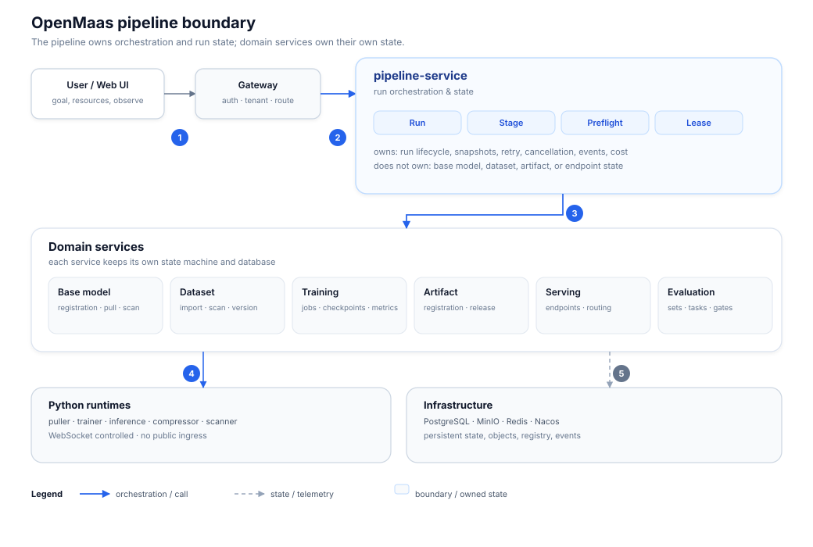
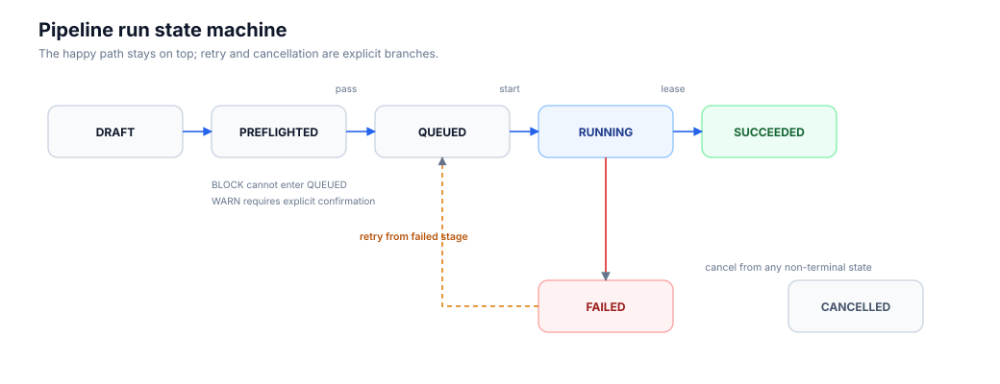
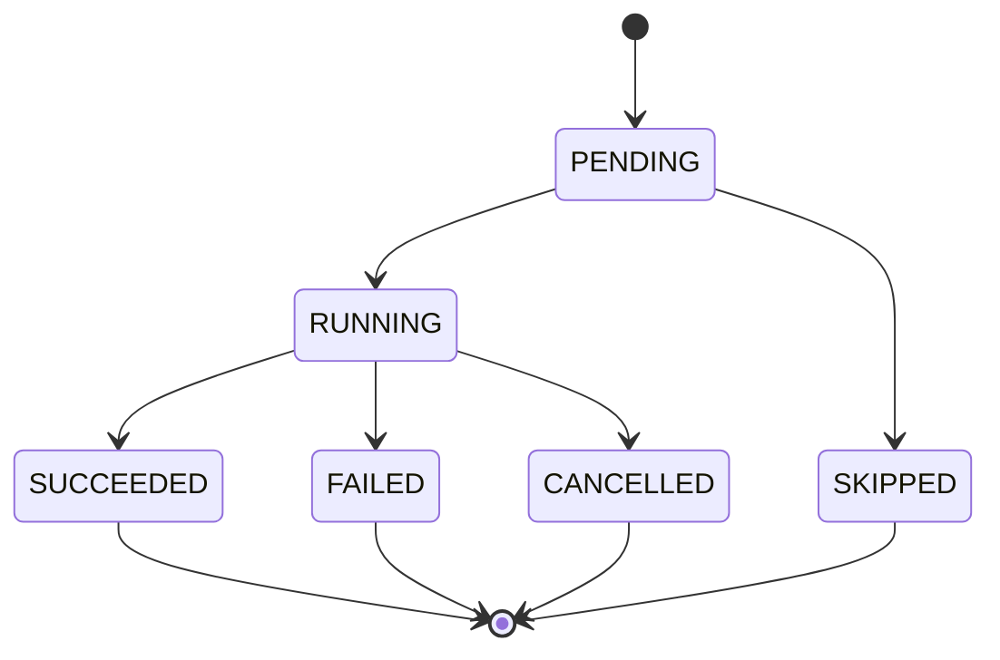
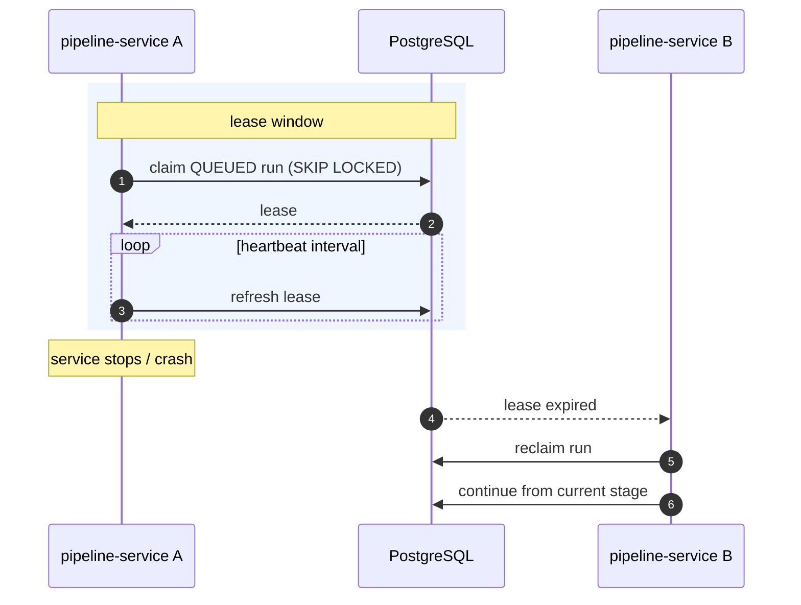
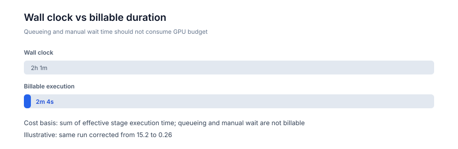
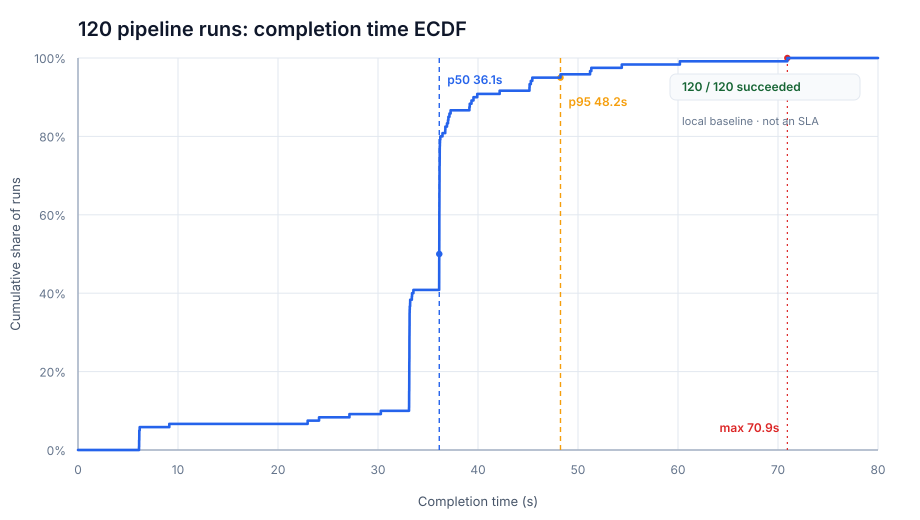

# Designing a Recoverable, Cost-Aware, Automatable Training-to-Inference Pipeline

> **Building OpenMaas · Part 1**
>
> Draft v0.1 · 2026-11-12
>
> By XU Meng
>
> Canonical URL: [OpenMaas Documentation URL]
>
> OpenMaas is in open-source closeout. Documentation is available at [GitHub](https://github.com/solomonxu/ai-maas-docs) (global) / [Gitee](https://gitee.com/solomonxu/ai-maas-docs) (China mirror); the code repository is coming soon.

## Abstract

- A pipeline is not "training and inference on one screen." It is a run model for a long-running transaction that spans multiple services.
- Reliability comes from the run model itself: preflight snapshots, stage state machines, database leases, recovery, and idempotent execution.
- "Cost-aware" means cost can be calculated, attributed, and explained. It is not the same as a complete financial billing system.

## Who This Article Is For

**This article is written for:**

- architects and backend engineers building self-hosted AI platforms;
- MLOps engineers responsible for training, inference, and evaluation workflows;
- platform engineers interested in long-running job reliability, resource governance, and cost attribution;
- open-source contributors who want to understand the design trade-offs behind OpenMaas.

**You can skip parts of this article if:**

- your main interest is model algorithms rather than platform execution. Start with Section 6, "Resource Orchestration," and Section 11, "User Experience," then return to the architecture sections as needed;
- you need a general-purpose workflow engine with a free-form DAG. Read Section 3.2 and the boundaries in Section 12 first, then decide whether this design fits your use case.

**Three ways to read this article:**

- **10 minutes:** Abstract → Design Choices → Results and Limits → Conclusion.
- **20 minutes:** Add the Run Model, Execution and Recovery, Preflight, and Cost sections.
- **Deep read:** The full article, including diagrams, glossary, FAQ, and boundaries.

## Glossary

| Term | Meaning in this article |
|---|---|
| Run | One complete training-to-inference execution |
| Stage | A base model, dataset, training, artifact, inference, or evaluation step |
| Preflight | Resource and compatibility checks performed before a run starts |
| Lease | A time-bounded execution right held by a pipeline service replica |
| Reuse | Reusing an existing training result or inference endpoint |
| Billable Duration | Effective execution time used for cost attribution |

## 1. Why Training-to-Inference Is Still Hard

A self-hosted AI platform rarely suffers from a lack of capabilities. It suffers from the difficulty of composing those capabilities into something reliable.

Base models, datasets, training jobs, model artifacts, inference services, and evaluation tasks are usually owned by separate services. Each service can be perfectly reasonable on its own. But the user's real goal is a sequence:

```text
choose a base model
  → choose a dataset
  → train
  → register an artifact
  → deploy an inference endpoint
  → evaluate
```

That sequence is a long-running transaction across service boundaries. It has several natural difficulties:

- Training can take minutes or hours. Services restart, jobs fail, and resources change during that time.
- Training success does not imply artifact registration success.
- Artifact registration does not imply that inference can start.
- An inference endpoint may come up, but evaluation may still fail.
- When a late stage fails, users often have no choice but to rerun the entire sequence.
- GPU time, queue time, and human waiting time are mixed together, making cost opaque.
- Automation scripts copy complete run configurations, and those copies drift over time.

The problem is not "build another job list page." The problem is:

> How do we establish a shared run model for a cross-service training-to-inference process so that it can recover, explain itself, and be governed?

That is the problem the pipeline is designed to solve.

## 2. What OpenMaas Is—and What the Pipeline Is Not

OpenMaas (Open Model-as-a-Service) is a self-hosted platform for model training, inference, and evaluation. It already provides capabilities for base models, datasets, training, model artifacts, inference services, and evaluation, together with model compression, image management, resource governance, cost governance, and operational visibility.

The pipeline is not a second implementation of those capabilities. Its job is to turn existing training, inference, and evaluation services into a deliverable run. It owns orchestration, run state, recovery, and the evidence trail around a run.

A useful shorthand is:

> The platform owns the capabilities. The pipeline owns the run.

This distinction matters because it keeps the system boundaries honest. The training service remains responsible for training jobs. The inference service remains responsible for endpoints. The evaluation service remains responsible for evaluation tasks. The pipeline decides when to call them, what to do when they fail, and how to present the result as one coherent run.

The detailed responsibility boundary is covered in Section 3.1.

## 3. Design Choices: Service Boundary, Fixed Paths, Database Leases

The pipeline design is built on a few deliberate choices. None of them is universally correct. They are correct for the current stage of a self-hosted AI platform that needs reliability more than infinite flexibility.

### 3.1 An Independent Pipeline Service

The pipeline is implemented as an independent `pipeline-service` with its own database schema and lifecycle. It is responsible for:

- runs, stages, events, preflight snapshots, and logs;
- executors, database leases, heartbeats, cancellation, and recovery;
- run APIs and SSE log streams for the UI;
- calling existing training, inference, and evaluation services to perform the work.

It does not own:

- base model, dataset, or artifact master data;
- the state machines of training jobs and inference endpoints;
- evaluation execution;
- direct writes into other services' databases.

This boundary lets each domain service evolve independently. The pipeline is an orchestration layer, not a replacement for the domains it orchestrates.



> Figure 1: The pipeline service owns orchestration and run state. Domain services continue to own their state machines. Solid arrows are orchestration/calls; dashed arrows are state, telemetry, or data reads.


### 3.2 Fixed Paths Before Free-Form DAGs

The first version does not expose a free-form DAG. It supports five paths that cover the main training and inference scenarios:

| Path | Stages |
|---|---|
| `TRAIN_DEPLOY` | BASE → DATASET → TRAINING → ARTIFACT → INFERENCE |
| `TRAIN_ONLY` | BASE → DATASET → TRAINING → ARTIFACT |
| `DEPLOY_ARTIFACT` | ARTIFACT → INFERENCE |
| `DEPLOY_BASE` | BASE → INFERENCE |
| `EVAL_ARTIFACT` | ARTIFACT → INFERENCE → EVALUATION |

This is a product decision, not a claim that fixed paths are inherently better than DAGs.

Fixed paths trade flexibility for determinism. They make preflight, retries, cancellation, UI, and acceptance testing much easier to reason about. For common scenarios such as "train and deploy," "train only," and "deploy an existing artifact," the path itself becomes the best interaction constraint.

A free-form DAG is not impossible. It simply should not be the source of first-version complexity.

### 3.3 Database Leases Before a Message Queue

The executor does not start with a message queue. It claims work through a database lease:

```sql
SELECT ...
FROM pipeline_run
WHERE status = 'QUEUED' AND available_at <= now()
ORDER BY priority DESC, created_at
FOR UPDATE SKIP LOCKED
LIMIT 1;
```

After a run is claimed, the service records the lease owner, lease expiration, and heartbeat time. If the owner stops sending heartbeats, the lease expires and another replica can take over.

This choice has practical benefits:

- no additional messaging system is required;
- run state and claim state live in the same transaction boundary;
- a `QUEUED` run can be reclaimed after a service restart;
- multiple replicas are mutually exclusive by database semantics;
- the upper-level run model does not change if the claim mechanism is replaced later.

Complexity should be placed where the current system needs it. For this stage of the platform, database leases are sufficient, understandable, and recoverable.

### 3.4 Design Trade-Offs at a Glance

| Choice | Alternative We Rejected | Main Reason |
|---|---|---|
| Independent `pipeline-service` | Extend the training service | Keep training and inference domains separate |
| Five fixed paths | Free-form DAG from day one | Reduce complexity in preflight, recovery, UI, and acceptance |
| Database lease | Message queue from day one | Enough for current scale; simpler recovery semantics |
| Configuration snapshot | Trigger reads the pipeline configuration live | Reproducible automation |
| Stage reuse | Rerun the entire pipeline | Avoid duplicate GPU and artifact consumption |

## 4. The Run Model: Run, Stage, and Preflight

### 4.1 The Run State Machine

The core of the pipeline is not a Start button. It is a run state machine.



> Figure 2: The happy path stays on top; retry and cancellation are explicit branches. `BLOCK` cannot enter `QUEUED`; `WARN` requires explicit confirmation.


Several semantics are important:

- A `BLOCK` preflight result cannot enter `QUEUED`.
- A `WARN` result requires explicit confirmation.
- Retry uses the same `runId` and preserves the event history.
- Cancellation is terminal. Running again requires a new run.
- Retry resets the failed stage and its downstream stages, while reusing successful upstream stages.

### 4.2 Stage State and Reuse

Stages have their own state:



Reuse is not disguised as a new business state. It is expressed through:

```text
reused = true
sourceType = ...
sourceId = ...
```

That distinction is useful. A user can see that a stage was skipped because an existing resource was reused, and can still inspect what was reused and where it came from.

### 4.3 Preflight Snapshots: Preserve Why a Run Was Allowed to Start

Preflight is not a decorative form validation step. It is the decision record for starting a run.

The pipeline performs preflight when a run is created, started, and retried. The result is stored as a snapshot:

- `status`: PASS, WARN, or BLOCK;
- `policy_version`: the policy version used at the time;
- `checks_json`: the complete set of checks;
- `confirmed_warnings`: whether the user accepted warnings;
- `checked_at`: when the checks were performed.

A start request must reference a `preflightSnapshotId`. This means:

> Why a run was allowed to start is not reconstructed from logs. It is a durable, inspectable record.

## 5. Execution and Recovery: Turning Failure into a Manageable Event

### 5.1 Retry Is Not "Start Over"

Script-based pipelines often restart from the beginning after a failure. In training-to-inference workflows, that is expensive:

- training may already be complete;
- retraining consumes GPU time again;
- an inference endpoint may already exist;
- duplicate artifacts and endpoints create cleanup work.

The pipeline instead:

- resets the failed stage and downstream stages;
- marks successful upstream stages as reused;
- keeps the original run's event history;
- continues under the same `runId`.

This is not a UI convenience. It is a direct response to the cost structure of long-running ML workflows.

### 5.2 Cancellation Is Finalized at Stage Boundaries

Cancellation is not "delete a job."

The contract is:

- completed stages are not rolled back;
- unexecuted stages are marked cancelled;
- the current stage is notified through a cancellation coordinator;
- cancellation is propagated through database state and heartbeat checks.

This matches how real systems behave. An artifact produced before cancellation does not disappear, but the platform stops consuming resources for the remaining work.

### 5.3 Multi-Replica Execution and Restart Recovery

The executor supports multiple replicas, with database leases providing mutual exclusion.

Measured behavior:

- two replicas, six runs: 6/6 succeeded, with each replica claiming three runs;
- four replicas, 120 runs: 120/120 succeeded;
- local baseline: p50 ≈ 36.1s, p95 ≈ 48.2s, max ≈ 70.9s.

The important result is not the number 120 by itself. It is that three properties held:

1. the same run was not executed by two replicas at once;
2. stages were not executed twice;
3. queued runs continued to execute after a service restart.



> Figure 3: The executor is an internal component of `pipeline-service` and accesses PostgreSQL directly through repositories/JdbcTemplate. The diagram uses `pipeline-service` as the execution actor rather than presenting an internal component as a separate service.


## 6. Resource Orchestration: Reuse, Do Not Rebuild

The pipeline does not train models itself, and it does not start inference processes itself. It calls existing services:

- the training service owns training jobs;
- the artifact service owns model artifact registration;
- the inference service owns inference endpoints;
- the evaluation service owns evaluation tasks;
- the pipeline connects them and records stage outcomes.

Resource reuse is a first-class design concern:

- when the base model, dataset, method, parameters, and image match, an existing training result can be reused;
- a running inference endpoint can be reused; a stopped one can be started; a failed one can be recreated with a clear warning;
- reuse information is recorded through `sourceType`, `sourceId`, and `reused`.

The benefit is not "one less click." It is less duplicate GPU consumption, fewer duplicate artifacts, fewer orphaned endpoints, and lower cleanup cost.

The pipeline also avoids pretending that it owns resources it does not own. If a resource is reused, the stage points to the original source. If the resource cannot be resolved, the user sees "resource deleted or inaccessible" instead of a broken link.

## 7. Preflight and Compatibility: Move Failures Earlier

Preflight is not only a "does this resource exist?" check. It is a "can these resources work together?" check.

Real examples include:

- a base model that requires a newer Transformers version;
- a Jetson or arm64 image that does not match the node architecture;
- a dataset modality or task type that does not match the training method;
- automatic scheduling that selects an edge runtime for a general-purpose model.

If these issues appear only after training has started, the cost is already paid: GPU time is consumed, time is lost, and a failed artifact may be produced.

The pipeline moves these checks before startup and returns the planned node, planned image, and image source. The result is:

- incompatible combinations are blocked before a run starts;
- combinations requiring human judgment become warnings;
- users can see where the run is expected to execute and which image it will use.

This is a general platform principle: move failures from expensive stages to cheap stages.

## 8. Observability: From "There Are Logs" to "This Is Explainable"

Observability is not a pile of log lines on a page. It answers practical questions:

- Where is the run now?
- Which node and image did this stage use?
- Why did it fail?
- Was an existing resource reused?
- How long did the run actually execute?
- Which GPU was used?

The system provides:

- stage status, duration, and retry count;
- structured events and logs;
- SSE log streaming with `seq`, `stageKey`, and timestamps;
- names and deep links for base models, datasets, artifacts, training jobs, inference endpoints, and evaluation tasks;
- a clear fallback message when a resource cannot be resolved;
- resource summaries on the run detail page, without N+1 lookups on the list page;
- a live resource view with nodes, GPU cards, actual VRAM, leases, and budget;
- GPU attribution through stage `sourceId` matched against `taskId`, with container-name matching as a fallback.

One principle is especially important:

> Do not fake precision.

If a GPU allocation cannot be attributed to a specific run, the system falls back to a cluster view and explicitly says that it is a node/GPU view, not a per-run attribution.

## 9. Cost: Queue Time Should Not Be Billed as GPU Time

Cost is the part of a pipeline that often looks present but is not actually usable.

An early implementation calculated cost from `startedAt → finishedAt`. That includes queue time, manual retry waiting, and other non-execution time. A failed run could look like this:

```text
wall clock: 2h 1m
effective execution: 2m 4s
```

The difference is two orders of magnitude. Cost attribution becomes meaningless.

The corrected model:

- accumulates effective execution duration from stage start and end events;
- distinguishes `wallClockMs`, `activeDurationMs`, and `billableDurationMs`;
- calculates cost from billable duration;
- excludes queueing and manual waiting;
- lazily recalculates historical terminal runs when the detail page is opened.

In one measured case, the cost dropped from about `15.2` to `0.26`, with a billable duration of about `2m 4s`.



> Figure 4: Wall-clock time versus billable duration. The numbers are illustrative and show the cost model, not a universal ratio.

In this article, "cost-aware" means cost can be calculated, attributed, and explained. It does not imply a complete financial billing system.

The current scope includes:

- training execution duration;
- a GPU hourly price configured by the administrator;
- a GPU share factor;
- department and project attribution;
- tenant-level budget overrun notifications.

It does not yet include:

- inference token cost;
- storage amortization;
- evaluation cost allocation;
- multi-level department or project budget trees.

These are boundaries, not a feature list. Getting training cost right is more valuable than shipping a broad but unexplainable cost dashboard.

## 10. Automation: Pipelines First, Triggers Second

The first version of triggers required inline run configuration. The problems were predictable:

- configurations were easy to copy incorrectly;
- template updates did not propagate to triggers;
- users had to hand-write JSON;
- automation scripts and platform definitions drifted apart.

A better model is:

```text
define a pipeline
  ↓
trigger references the pipeline ID
  ↓
configuration snapshot is stored at trigger creation
```

This provides:

- no duplicate run parameters in the trigger UI;
- versioned pipeline definitions with private, tenant, and global visibility;
- a configuration snapshot for reproducibility;
- clear separation between "what to run" and "when to run it";
- backward compatibility with legacy inline configurations.

Automation is not "putting `curl` in cron." It is separating the definition of work from the schedule that initiates it.

## 11. User Experience: Goal-First, Not Stage-Term-First

The pipeline home page is not organized around internal stages such as `BASE_MODEL`, `TRAINING`, and `INFERENCE`. It is organized around user goals:

- train and deploy;
- train only and produce an artifact;
- deploy an existing artifact;
- deploy a base model directly;
- evaluate an artifact.

The creation flow is:

1. choose a goal;
2. choose resources;
3. choose a training template;
4. preview preflight checks automatically;
5. create the run and perform bound preflight;
6. start the run and enter the run detail page.

Users do not need to know node IDs or write training commands. Resource pages can launch "train with this base model," "deploy as a service," or "train with this dataset" directly.

This is not cosmetic UI work. When the underlying run model is clear, the interface can speak in goals instead of leaking implementation details.

## 12. Results, Limits, and What Comes Next

The current implementation covers:

| Scenario | Result |
|---|---|
| CPU training | Completed and registered an artifact |
| GPU training + deployment | All stages succeeded |
| Direct base-model deployment | Succeeded |
| Artifact evaluation | ARTIFACT → INFERENCE → EVALUATION succeeded |
| Cancellation at a stage boundary | Completed stages preserved; unexecuted stages cancelled |
| Restart recovery | QUEUED run continued after restart |
| Lease takeover | Another replica reclaimed the run |
| Multi-replica execution | 6/6 succeeded, no duplicate stages |
| Concurrency regression | 120/120 succeeded, p95 ≈ 48.2s |

### 12.1 Completion Time Across 120 Runs

The ECDF below covers the 120-run concurrency regression. The horizontal axis is actual execution duration from `startedAt` to `finishedAt`, excluding queue time. The vertical axis is the cumulative share of runs.



> Figure 5: Completion-time ECDF across 120 pipeline runs. Local baseline, not an SLA.

Test environment:

| Item | Value |
|---|---|
| Machine | AMD Ryzen AI MAX+ 395 |
| CPU | 16 cores / 32 threads |
| Memory | 64 GB class (62 GiB visible to the OS) |
| GPU | AMD Radeon 8060S (gfx1151, 64 GB unified memory; not used in this CPU-only test) |
| OS | Ubuntu 24.04.4 LTS |
| Docker | 29.4.1 |
| Docker Compose | 5.1.3 |
| Executor | Four `pipeline-service` replicas |
| Training image | `maas/model-trainer:cpu-0.2.49` |
| Path | `TRAIN_ONLY` |
| Base model | Qwen2.5-0.5B |
| Dataset | Small E2E SFT dataset |
| Lifecycle concurrency | 12 |
| Polling concurrency | 24 |
| Runs | 120 |
| Total wall-clock time | About 1,201s |
| Result | 120/120 succeeded |
| p50 / p95 / max | 36.1s / 48.2s / 70.9s |
| Test date | 2026-11-11 |

The chart is generated from local test records. The public version contains aggregate charts only; raw JSON is not included.

> **Important boundary:** This is a local concurrency regression baseline, not a production SLA. It does not represent GPU training performance or every path in the system.

The current limits are explicit:

- the system uses fixed paths, not a free-form DAG;
- inference token cost, storage amortization, and multi-level budgets are not yet included;
- per-run GPU attribution depends on runtime-reported `taskId` and container naming, with a cluster view as fallback;
- cancellation latency for long training jobs still needs dedicated testing;
- approval and budget governance are still evolving.

These limits do not weaken the pipeline. They show that it is not a demo orchestrator; it is a run system that is being closed out under real constraints.

## 13. Conclusion: A Pipeline Is a Run Contract

The hard part of building a training-to-inference pipeline is not connecting a few APIs. It is establishing a trustworthy run contract:

- **Recoverable:** failures know where to continue; restarts know where to resume.
- **Explainable:** preflight has snapshots, stages have events, and resources have attribution.
- **Cost-aware:** cost is based on effective execution time, not wall-clock guesswork.
- **Automatable:** pipelines are defined once; triggers reference them instead of duplicating configuration.
- **Governable:** tenants, permissions, audit, budgets, and approvals have clear places to attach.

A page with a Start button can be built in days. Making a training-to-inference process recoverable, explainable, and cost-aware in real environments requires a run model, state machines, preflight, leases, observability, and a deliberate cost model.

That is the technical value of the pipeline:

> It does not merely put training and inference on the same page. It turns them into a deliverable, traceable, and reusable run.

## FAQ

**Why not use a message queue?**

At the current scale, database leases already provide claiming, mutual exclusion, recovery, and takeover. Run state and claim state stay in the same transaction boundary. A message queue can replace the claim mechanism later without changing the upper-level run model.

**Why not build a free-form DAG?**

The fixed paths cover the main training and inference scenarios while substantially reducing the complexity of preflight, recovery, cancellation, retry, and UI. A free-form DAG requires redesigning dependencies, preflight, cancellation, audit, and interaction. It should not be the source of first-version complexity.

**Why not put pipeline logic inside the training service?**

The training service should own training jobs. The inference service should own inference endpoints. The pipeline is a cross-domain orchestration layer. Keeping it independent avoids domain mixing and allows the run state machine, leases, and audit trail to evolve separately.

**Why not calculate cost from wall-clock time?**

Wall-clock time includes queueing, manual confirmation, and retry waiting. Those periods are not equivalent to actual GPU execution time. A training-to-inference platform must distinguish total span from billable duration; otherwise cost is systematically overstated.

## Series

**Building OpenMaas**

- Part 1: Designing a Recoverable, Cost-Aware, Automatable Training-to-Inference Pipeline
- Next: Preflight and Compatibility
- Later: Long-Running Job Leases and Recovery, Resource Governance, Cost and Budget, Trigger Automation

OpenMaas is in open-source closeout. The repository will be public soon. The test data in this article is a local regression baseline, not a production SLA.

---

*Canonical version: [OpenMaas Documentation](https://github.com/solomonxu/ai-maas-docs/blob/main/docs/articles/pipeline-technical-article-en.md)*

**Further reading**

- This article: [GitHub](https://github.com/solomonxu/ai-maas-docs/blob/main/docs/articles/pipeline-technical-article-en.md) / [Gitee](https://gitee.com/solomonxu/ai-maas-docs/blob/main/docs/articles/pipeline-technical-article-en.md)
- Documentation: [GitHub](https://github.com/solomonxu/ai-maas-docs) / [Gitee](https://gitee.com/solomonxu/ai-maas-docs)
- Architecture: [GitHub](https://github.com/solomonxu/ai-maas-docs/blob/main/docs/architecture.en.md) / [Gitee](https://gitee.com/solomonxu/ai-maas-docs/blob/main/docs/architecture.en.md)
- Quickstart: [GitHub](https://github.com/solomonxu/ai-maas-docs/blob/main/docs/quickstart.en.md) / [Gitee](https://gitee.com/solomonxu/ai-maas-docs/blob/main/docs/quickstart.en.md)
- Dev Log: [GitHub](https://github.com/solomonxu/ai-maas-docs/tree/main/docs/dev-log) / [Gitee](https://gitee.com/solomonxu/ai-maas-docs/tree/main/docs/dev-log)
