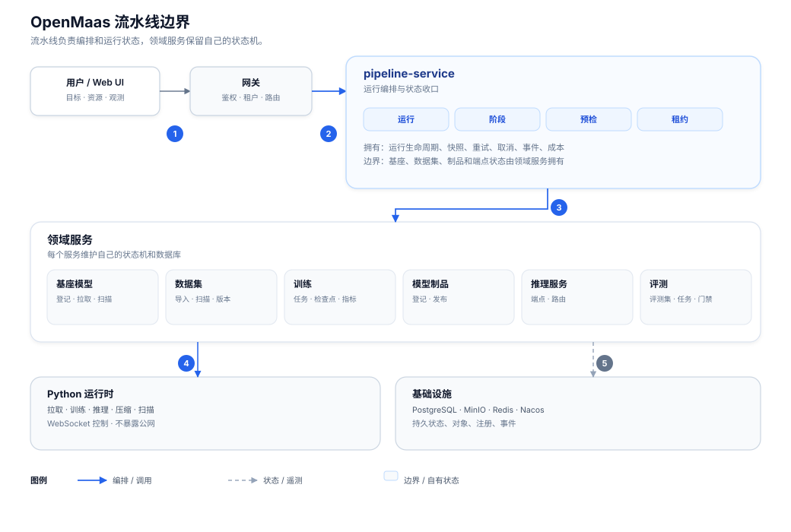
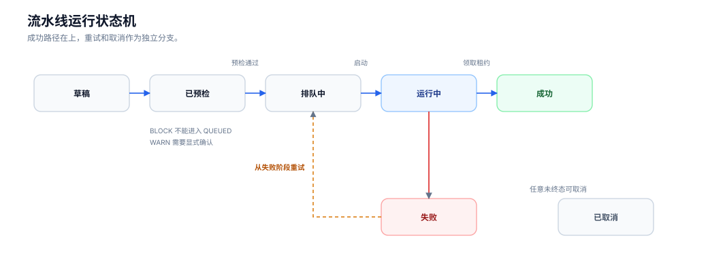
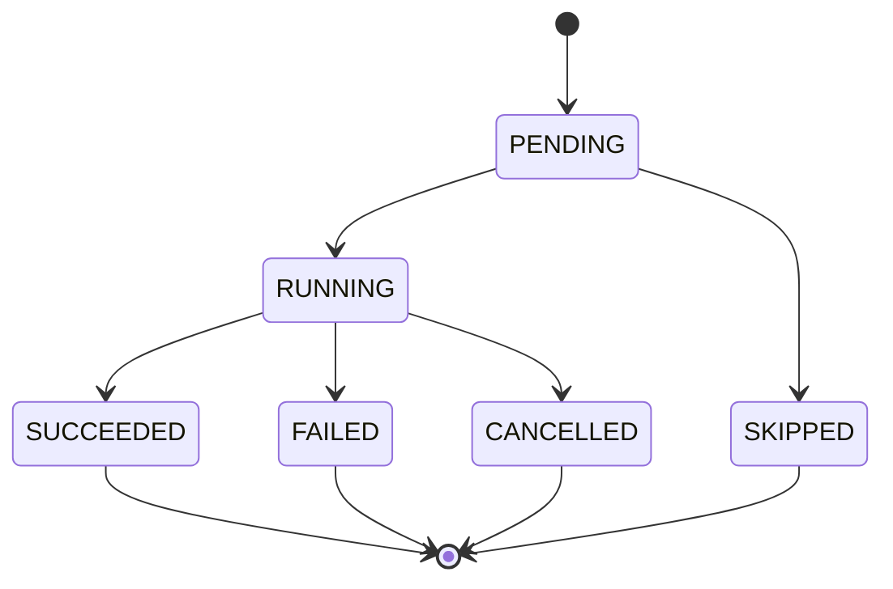
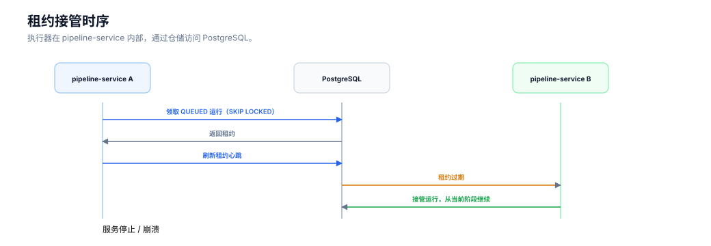
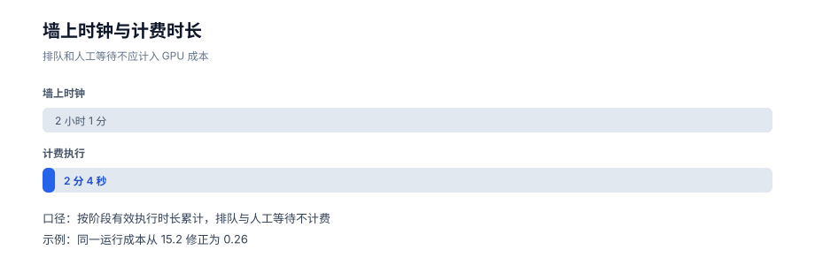
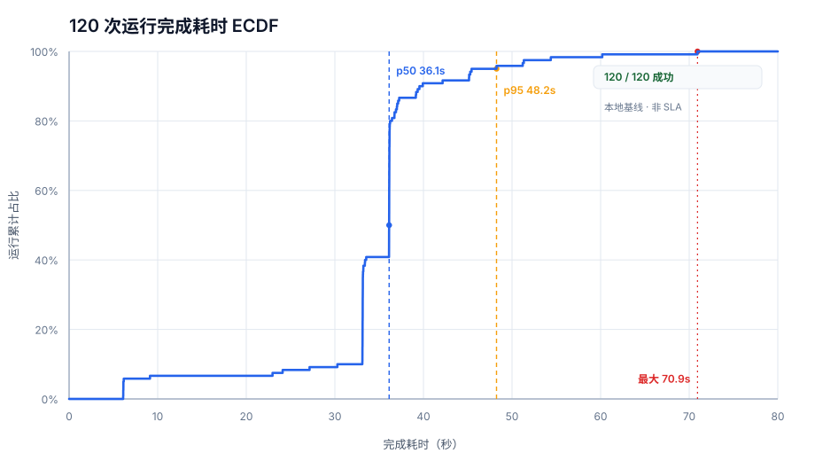

# 把模型训推做成一条可恢复、可计费、可自动化的流水线

> OpenMaas 工程系列 · 第 1 篇
>
> 作者：许猛
>
> 草稿 v0.2｜2026-11-12
>
> 关键词：OpenMaas、AI 平台、训推流水线、运行状态机、数据库租约、预检快照、成本治理

> **OpenMaas 项目状态**
>
> OpenMaas 是面向私有化部署的模型训推与推理平台，当前处于开源收尾阶段。项目文档已开放：[Gitee](https://gitee.com/solomonxu/ai-maas-docs)（国内）/ [GitHub](https://github.com/solomonxu/ai-maas-docs)（全球）；代码仓库即将开放。本文聚焦其中的 `pipeline-service` 训推流水线模块，不覆盖平台全部能力。

## 摘要

- 流水线不是“把训练和推理放在一个页面”，而是把跨服务长事务收口成一套运行语义。
- 可靠性来自运行模型：预检快照、阶段状态机、数据库租约、失败恢复和幂等执行。
- “可计费”指成本可计算、可归集、可解释，不等同于完整的财务结算系统。

## 阅读指南

**适合谁读：**

- 正在建设私有化 AI 平台的架构师和后端工程师；
- 负责训练、推理、评测链路的 MLOps 工程师；
- 关注长任务可靠性、资源治理和成本口径的平台研发；
- 想了解 OpenMaas 设计取舍的开源贡献者。

**可以先跳过的情况：**

- 如果你更关心模型算法本身，可以先读第五节“资源编排”和第十节“用户体验”，再按需回看架构部分；
- 如果你当前需要自由 DAG 编排，可以先读 2.2 节和第十一节的边界说明，再判断本文是否适合你的场景。

**三种读法：**

- 10 分钟：摘要 → 设计取舍 → 实测与边界 → 总结；
- 20 分钟：增加运行模型、执行恢复、预检和成本；
- 深度阅读：全文 + 图示 + 边界说明。

## 关于 OpenMaas

OpenMaas 是面向私有化部署的模型训推与推理平台，已经提供基座模型、数据集、训练、模型制品、推理服务、评测等能力，并配套模型压缩、镜像、资源治理、成本治理和运行观测。

流水线模块的目标不是重新实现训练、推理和评测能力，而是把已有的模型、数据、训练、制品、推理和评测服务组织成可交付的运行；它负责运行编排、状态收口和恢复，具体职责边界见 2.1 节。

项目文档：[Gitee](https://gitee.com/solomonxu/ai-maas-docs)（国内）/ [GitHub](https://github.com/solomonxu/ai-maas-docs)（全球）

**术语约定：**

| 术语 | 本文含义 |
|---|---|
| Run | 一次完整的训推运行 |
| Stage | 基座、数据集、训练、制品、推理、评测等阶段 |
| Preflight | 启动前的资源与兼容性检查 |
| Lease | 执行器对运行的短期执行权 |
| Reuse | 复用已有训练或推理资源 |
| Billable Duration | 实际计费的有效执行时长 |

## 一、问题不在训练，而在跨服务长事务

一个 AI 平台通常不会缺能力，而是缺“把能力串起来”的可靠性。

基座模型、数据集、训练任务、模型制品、推理服务、评测任务，往往分别由不同服务负责。单看每个服务都很清晰，但用户真正要做的是：

```text
选基座 → 选数据 → 训练 → 注册制品 → 部署推理 → 评测
```

这是一条跨服务长事务。它有几个天然难点：

- 训练可能几十分钟甚至几小时，期间服务会重启，任务会失败，资源会变化；
- 训练成功了，不代表制品注册成功；
- 制品注册成功了，不代表推理能起来；
- 推理起来了，评测还可能失败；
- 失败之后，用户通常只能整条重跑；
- GPU 时间、排队时间、人工等待时间混在一起，成本说不清；
- 自动化脚本经常复制一整份运行配置，时间一长就彼此漂移。

所以，问题并不是“再做一个任务列表页”，而是：

> 如何为跨服务的训推过程建立统一的运行语义，让它可以恢复、可以解释、可以治理。

这就是流水线要解决的问题。

## 二、设计取舍：独立服务、固定路径、数据库租约

### 2.1 独立流水线服务，而不是把逻辑塞进训练服务

我们把流水线做成独立的 `pipeline-service`，有自己的数据库 schema 和生命周期，负责：

- 运行、阶段、事件、预检快照、日志；
- 执行器、数据库租约、心跳和取消；
- 面向 UI 的运行 API、SSE 日志；
- 调用现有训练、推理、评测服务完成实际工作。

它不负责：

- 基座、数据集、制品的主数据；
- 训练任务和推理端点自己的状态机；
- 评测执行；
- 直接修改其他服务的数据库。

这个边界的价值在于：流水线只做编排，不重新实现领域能力。训练服务仍然对自己的任务负责，推理服务仍然对自己的端点负责，流水线负责“把它们组织成一次可交付的运行”。



> 图 1：pipeline-service 只负责运行编排和状态收口；领域服务仍然拥有自己的状态机。图中实线表示编排/调用，虚线表示状态/遥测或数据读取。

### 2.2 先固定路径，而不是一开始做自由 DAG

首版没有做自由 DAG，而是把训推主场景收敛成 5 条路径：

| 路径 | 阶段 |
|---|---|
| `TRAIN_DEPLOY` | BASE → DATASET → TRAINING → ARTIFACT → INFERENCE |
| `TRAIN_ONLY` | BASE → DATASET → TRAINING → ARTIFACT |
| `DEPLOY_ARTIFACT` | ARTIFACT → INFERENCE |
| `DEPLOY_BASE` | BASE → INFERENCE |
| `EVAL_ARTIFACT` | ARTIFACT → INFERENCE → EVALUATION |

这是一个产品判断：固定路径会牺牲一部分灵活性，但能显著降低预检、恢复、取消、重试、UI 和验收的复杂度。对于“训练并部署”“只训练”“部署已有制品”这类高频场景，路径本身就是最好的交互约束。

自由 DAG 不是不能做，而是不应该成为第一版复杂度的来源。

### 2.3 用数据库租约，而不是一开始引入 MQ

执行器没有从消息队列开始，而是使用数据库租约：

```sql
SELECT ...
FROM pipeline_run
WHERE status = 'QUEUED' AND available_at <= now()
ORDER BY priority DESC, created_at
FOR UPDATE SKIP LOCKED
LIMIT 1;
```

领取后设置租约、心跳和 `lease_until`。心跳有周期，租约可过期，过期后其他副本可以接管。

这个选择的好处是：

- 不额外引入一套消息系统；
- 运行状态和领取状态在同一个事务边界内；
- 服务重启后，`QUEUED` 运行可以被重新领取；
- 多副本通过数据库天然互斥；
- 后续规模变大，再替换成 MQ 也不会改变上层运行模型。

复杂度不是越少越好，而是要在当前规模下放在正确的位置。对 P0/P1 阶段的训推平台，数据库租约已经足够，而且更容易解释和恢复。

### 2.4 设计取舍一览

| 选择 | 放弃的方案 | 主要原因 |
|---|---|---|
| 独立 `pipeline-service` | 扩展训练服务 | 避免训练/推理领域混杂 |
| 固定 5 条路径 | 首版自由 DAG | 降低预检、恢复、UI 和验收复杂度 |
| 数据库租约 | 首版引入 MQ | 当前规模足够，恢复语义更直接 |
| 配置快照 | 触发器实时读取配置 | 保证自动化可复现 |
| 阶段复用 | 失败整条重跑 | 降低重复 GPU 和重复制品消耗 |

## 三、运行模型：Run、Stage、Preflight

### 3.1 运行状态机

流水线的核心不是“开始按钮”，而是运行状态机：



> 图 2：运行状态机。成功路径置顶，失败重试和取消作为独立分支；`BLOCK` 预检不能进入 `QUEUED`，`WARN` 需要显式确认。

几个关键语义：

- `BLOCK` 预检不能进入 `QUEUED`；
- `WARN` 预检需要显式确认；
- 重试使用同一个 `runId`，保留历史事件；
- 取消是终态，重新执行需要新建运行；
- 重试只重置失败阶段及其下游，前序成功阶段复用。

### 3.2 阶段状态机与复用

阶段有自己的状态：



复用不会被伪装成一个新的业务状态，而是通过：

```text
reused = true
sourceType = ...
sourceId = ...
```

表达“这个阶段使用了已有资源”。这样用户既能看到“跳过”，也能知道“跳过了什么、复用了哪个对象”。

### 3.3 预检快照：保留“为什么允许启动”

预检不是一道可有可无的表单校验，而是运行前的决策记录。

流水线在创建、启动、重试时执行预检，并把结果保存为快照：

- `status`：PASS / WARN / BLOCK
- `policy_version`：当时使用的规则版本
- `checks_json`：完整检查项
- `confirmed_warnings`：用户是否确认过警告
- `checked_at`：检查时间

启动请求必须携带 `preflightSnapshotId`。这意味着：

> 运行为什么被允许启动，不是靠日志猜的，而是有可追溯的快照。

## 四、执行与恢复：把失败变成可处理事件

### 4.1 重试不是整条重跑

传统脚本式流水线常见的做法是失败后从头再来。

训推场景里，这种做法的代价很高：训练已经完成，重新训练会再次占用 GPU；推理已经创建，重复创建会产生脏资源。

流水线的重试策略是：

- 失败阶段及其下游重置；
- 前序成功阶段标记为复用；
- 保留原运行的历史事件；
- 使用同一个 `runId` 继续。

这不是“重试按钮”的实现细节，而是对长事务成本的尊重。

### 4.2 取消在阶段边界收口

取消不是简单地删掉一个任务。

流水线的约定是：

- 已完成阶段不回滚；
- 未执行阶段置为取消；
- 当前阶段通过取消协调器通知下游；
- 取消请求通过数据库状态和心跳传递。

这样的语义更符合真实世界：训练已经产出的制品不会因为用户取消后半段而凭空消失，但系统会停止继续消耗资源。

### 4.3 多副本与重启恢复

执行器支持多副本，通过数据库租约互斥。

实测结果：

- 双副本执行 6 个运行：6/6 成功，两个副本各领取 3 个；
- 4 个副本执行 120 个运行：120/120 成功；
- 本地压测基线：p50 约 36.1s，p95 约 48.2s，最大约 70.9s。

这里的重点不是“120 这个数字”，而是验证了三件事：

1. 同一个运行不会被两个副本同时执行；
2. 阶段不会重复执行；
3. 服务重启后，排队中的运行可以继续。

这三点构成了“可恢复”的基础。



> 图 3：执行器是 pipeline-service 内部组件，通过仓储/JdbcTemplate 直接访问 PostgreSQL；租约过期后，其他副本可以接管未完成的运行。

## 五、资源编排：复用，而不是重造

流水线不直接训练模型，也不直接启动推理进程。它通过内部接口调用已有服务：

- 训练服务负责训练任务；
- 制品服务负责模型制品注册；
- 推理服务负责推理端点；
- 评测服务负责评测任务；
- 流水线负责把它们串起来，并记录阶段结果。

资源复用是一个重要设计：

- 训练参数、基座、数据集、方法、镜像匹配时，可以复用已有训练结果；
- 推理端点 running 时复用，stopped 时启动，failed 时新建并提示；
- 复用信息通过 `sourceType/sourceId/reused` 写入阶段。

这样做的收益不是“少一次点击”，而是减少重复 GPU 消耗，减少重复制品和重复端点，降低后续清理成本。

## 六、预检与兼容性：把错误前移

预检不只检查“资源是否存在”，还检查“资源能不能一起工作”。

实际遇到的典型问题包括：

- 基座模型需要更新的 Transformers 版本；
- Jetson / arm64 镜像与节点架构不匹配；
- 数据集 taskType/modality 与训练方法不匹配；
- 自动调度把通用模型分配到边缘运行时。

这些问题如果等到训练阶段才暴露，代价是已经占用了 GPU、消耗了时间，甚至产生了失败制品。

流水线把这些检查前移到预检，并返回计划节点、计划镜像和镜像来源。结果是：

- 不兼容组合在启动前被 `BLOCK`；
- 需要人工判断的组合进入 `WARN`；
- 用户能在创建阶段看到“准备在哪个节点、用哪个镜像运行”。

这是一种很典型的平台设计原则：把失败从昂贵阶段前移到便宜阶段。

## 七、可观测性：从“有日志”到“可解释”

流水线的可观测性不是把日志堆在页面上，而是让用户能回答几个问题：

- 现在跑到哪一步了？
- 这一步用了哪个节点、哪个镜像？
- 为什么失败？
- 之前是不是复用了一个已有资源？
- 这次运行实际执行了多久？
- GPU 到底被谁用了？

为此，系统提供：

- 阶段状态、阶段耗时、重试次数；
- 结构化事件与日志；
- SSE 实时日志，日志带 `seq`、`stageKey`、时间；
- 基座、数据集、制品、训练任务、推理端点、评测任务的名称和深链；
- 资源解析失败时显示“资源已删除或不可访问”，不制造死链；
- 运行详情聚合资源摘要，列表接口不做 N+1 解析；
- 实时资源视图，展示节点、GPU 卡数、实际显存、租约和预算；
- GPU 归属通过阶段 `sourceId` 匹配 `taskId`，容器名包含 `runId` 作为兜底。

这里有一个重要原则：不伪造精确归属。

如果无法把某个 GPU 分配准确归因到本次运行，就回退到集群视角，并明确说明这是节点/GPU 集群视图，而不是“单次运行精确资源归属”。

## 八、计费：排队时间不应该算 GPU 的钱

成本是流水线最容易“看起来有、实际不可用”的部分。

早期按 `startedAt → finishedAt` 计算，会把排队、人工重试等待都算进 GPU 时间。一个失败运行可能出现：

```text
总跨度：2h1m
实际有效执行：2m4s
```

两者相差两个数量级，成本自然失真。

修正后的口径是：

- 从阶段开始/结束事件累计有效执行时长；
- 区分 `wallClockMs`、`activeDurationMs`、`billableDurationMs`；
- 成本按计费时长计算；
- 排队和人工等待不计费；
- 历史终态运行在打开详情时惰性重算一次。

修正后，同一个案例的成本从约 `15.2` 降到 `0.26`，计费时长约 `2m4s`。



> 图 4：墙上时钟与计费时长的差异。图注数据为示意案例，用于说明口径，不代表所有运行的比例。

这里说的“可计费”，指成本可计算、可归集、可解释，不等同于完整财务结算系统。

当前成本口径包括：

- 训练执行时长；
- 管理端配置的 GPU 小时单价；
- GPU 分摊系数；
- 部门/项目归属；
- 租户级预算超支通知。

暂未纳入：

- 推理 token 成本；
- 存储日摊销；
- 评测成本分摊；
- 多级部门/项目预算树。

这不是缺点清单，而是边界说明。先把训练成本算准，比做一个“大而全但不可解释”的成本面板更有价值。

## 九、自动化：先定义流水线，触发器只引用

早期的触发器需要把完整运行配置内联进去。问题是：

- 配置容易复制错；
- 模板更新后，触发器不会自动同步；
- 用户需要在触发器页面手动拼 JSON；
- 自动化脚本和平台定义逐渐漂移。

更合理的模型是：

```text
先定义流水线
  ↓
触发器只引用流水线 ID
  ↓
创建触发器时保存配置快照
```

这样：

- 用户不需要在触发器里重复填写运行参数；
- 流水线定义可以版本化、私有/租户共享/全局共享；
- 触发器保存创建时的配置快照，保证可复现；
- Cron 和 Webhook 只负责“何时触发”，不负责“运行什么”；
- 旧版内联配置仍然兼容，避免破坏已有自动化。

自动化不是把 `curl` 放进 cron，而是把“运行什么”和“何时运行”分开。

## 十、用户体验：目标优先，而不是阶段术语优先

流水线首页不是按 `BASE_MODEL`、`TRAINING`、`INFERENCE` 这些内部阶段组织，而是按用户目标组织：

- 训练并部署；
- 只训练，产出制品；
- 部署已有制品；
- 直接部署基座；
- 评测制品。

创建向导里：

- 选目标；
- 选资源；
- 选训练模板；
- 自动预览预检；
- 创建运行并执行绑定预检；
- 启动后进入运行详情。

用户不需要知道节点 ID，也不需要手写训练命令。资源页可以直接发起“用此基座训练”“部署为服务”“用此数据集训练”。

这不是单纯的 UI 美化，而是运行模型成熟之后自然产生的交互方式：当底层语义清晰，前端才能用目标语言表达，而不是暴露实现细节。

## 十一、实测结果与边界

已覆盖的路径和场景：

| 场景 | 结果 |
|---|---|
| CPU 训练 | 完成并注册制品 |
| GPU 训练 + 部署 | 全阶段成功 |
| 直接部署基座 | 成功 |
| 评测制品 | ARTIFACT → INFERENCE → EVALUATION 成功 |
| 阶段边界取消 | 已完成阶段保留，未执行阶段取消 |
| 服务重启恢复 | QUEUED 运行继续执行 |
| 租约过期接管 | 其他副本可重新领取 |
| 多副本执行 | 6/6 成功，无重复阶段 |
| 并发回归 | 120/120 成功，p95 约 48.2s |

### 11.1 120 次运行完成耗时 ECDF



> 图 5：120 次运行的完成耗时 ECDF。横轴为 `startedAt → finishedAt` 的实际执行耗时，不包含排队等待；纵轴为累计完成比例。

测试环境如下：

| 项目 | 参数 |
|---|---|
| 机器 | AMD Ryzen AI MAX+ 395 |
| CPU | 16 核 / 32 线程 |
| 内存 | 64 GB 级（系统可见 62 GiB） |
| GPU | AMD Radeon 8060S（gfx1151，64GB 统一内存；本测试为 CPU 训练，未使用 GPU） |
| 操作系统 | Ubuntu 24.04.4 LTS |
| Docker | 29.4.1 |
| Docker Compose | 5.1.3 |
| 执行器 | `pipeline-service` 4 副本 |
| 训练镜像 | `maas/model-trainer:cpu-0.2.49` |
| 路径 | `TRAIN_ONLY` |
| 基座 | Qwen2.5-0.5B |
| 数据 | 小型 E2E SFT 数据集 |
| 生命周期并发 | 12 |
| 状态轮询并发 | 24 |
| 运行数 | 120 |
| 总墙钟时间 | 约 1201s |
| 结果 | 120/120 成功 |
| p50 / p95 / max | 36.1s / 48.2s / 70.9s |
| 测试日期 | 2026-11-11 |

图表基于本地测试记录生成；公开版本只提供聚合图表，不附带原始 JSON。

> **重要边界**：这是本地并发回归基线，不是生产 SLA，也不代表 GPU 训练或所有路径的性能。

同时也要明确边界：

- 当前是固定路径，不是自由 DAG；
- 推理 token、存储摊销、多级预算尚未纳入成本；
- GPU 运行级归属依赖运行时上报的 `taskId` 和容器命名，无法匹配时回退集群视角；
- 长训练任务的取消中断时延仍需要专项压测；
- 审批、预算等治理能力仍在逐步完善。

这些边界不会削弱流水线的价值，反而说明它不是“演示型编排器”，而是一套在真实约束下逐步收口的运行系统。

## 十二、常见问题

**为什么不用 MQ？**

当前规模下，数据库租约已经能满足领取、互斥、恢复和接管，并且运行状态与领取状态在同一个事务边界内。后续规模扩大时可以替换为 MQ，而不改变上层运行模型。

**为什么不做自由 DAG？**

固定路径覆盖了训推主场景，同时显著降低预检、恢复、取消、重试和 UI 的复杂度。自由 DAG 需要重新设计依赖、预检、取消、审计和交互，不适合作为首版复杂度的来源。

**为什么不把流水线逻辑放进训练服务？**

训练服务应该对训练任务负责，推理服务应该对推理端点负责。流水线是跨领域编排层，放在独立服务里可以避免领域混杂，也能独立演进运行状态机、租约和审计。

**计费为什么不是按墙上时钟？**

墙上时钟包含排队、人工确认和重试等待，这些时间不等于实际 GPU 执行时间。训推平台必须先区分“总跨度”和“计费时长”，否则成本会被系统性高估。

## 十三、总结：流水线的本质是运行语义

把模型训推做成一条流水线，难点不在于把几个 API 串起来，而在于建立一套可信的运行语义：

- **可恢复**：失败知道从哪里继续，重启知道从哪里接上；
- **可解释**：预检有快照，阶段有事件，资源有归属；
- **可计费**：按有效执行时长计费，而不是按墙上时钟拍脑袋；
- **可自动化**：先定义流水线，触发器只引用，不重复维护配置；
- **可治理**：租户、权限、审计、预算、审批都有明确落点。

如果只做一个“能点开始”的页面，几天就能完成。  
但要让训推过程在真实环境里可恢复、可解释、可计费，需要的是运行模型、状态机、预检、租约、观测和成本口径的系统设计。

这也是这条流水线真正的技术价值：

> 不是把训练和推理放在同一个页面，而是把它们组织成一次可交付、可追溯、可复用的运行。

---

**OpenMaas 工程系列**

- 本篇：把模型训推做成一条可恢复、可计费、可自动化的流水线
- 后续：预检与兼容性、长任务租约与恢复、资源治理、成本与预算、触发器自动化

**继续阅读**

- 本文：[Gitee](https://gitee.com/solomonxu/ai-maas-docs/blob/main/docs/articles/pipeline-technical-article.md) / [GitHub](https://github.com/solomonxu/ai-maas-docs/blob/main/docs/articles/pipeline-technical-article.md)
- 文档：[Gitee](https://gitee.com/solomonxu/ai-maas-docs) / [GitHub](https://github.com/solomonxu/ai-maas-docs)
- 架构：[Gitee](https://gitee.com/solomonxu/ai-maas-docs/blob/main/docs/architecture.md) / [GitHub](https://github.com/solomonxu/ai-maas-docs/blob/main/docs/architecture.md)
- 快速开始：[Gitee](https://gitee.com/solomonxu/ai-maas-docs/blob/main/docs/quickstart.md) / [GitHub](https://github.com/solomonxu/ai-maas-docs/blob/main/docs/quickstart.md)
- 开发日志：[Gitee](https://gitee.com/solomonxu/ai-maas-docs/tree/main/docs/dev-log) / [GitHub](https://github.com/solomonxu/ai-maas-docs/tree/main/docs/dev-log)

OpenMaas 当前处于开源收尾阶段，文档已开放，代码仓库即将开放。本文中的测试数据为本地回归基线，不构成生产 SLA。
