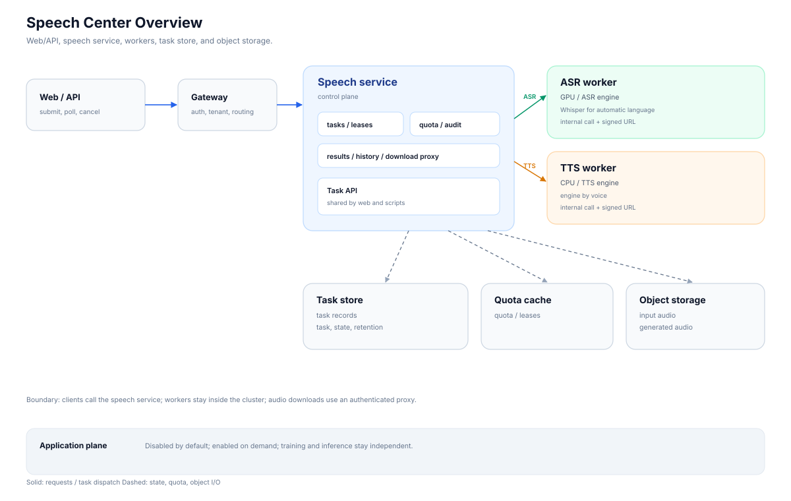
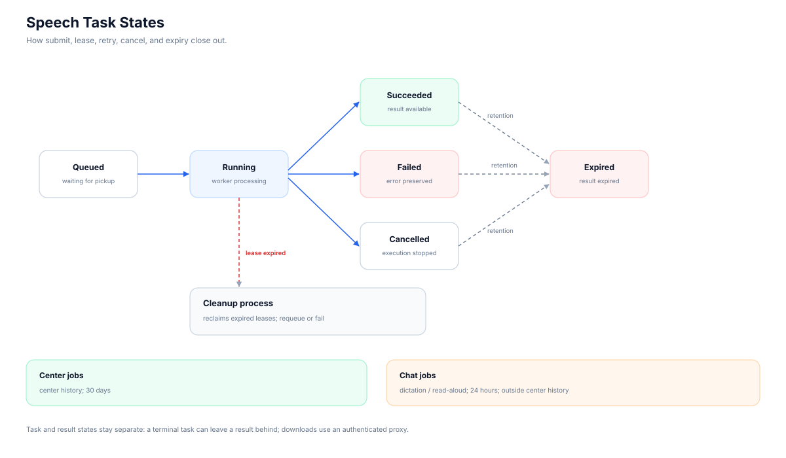
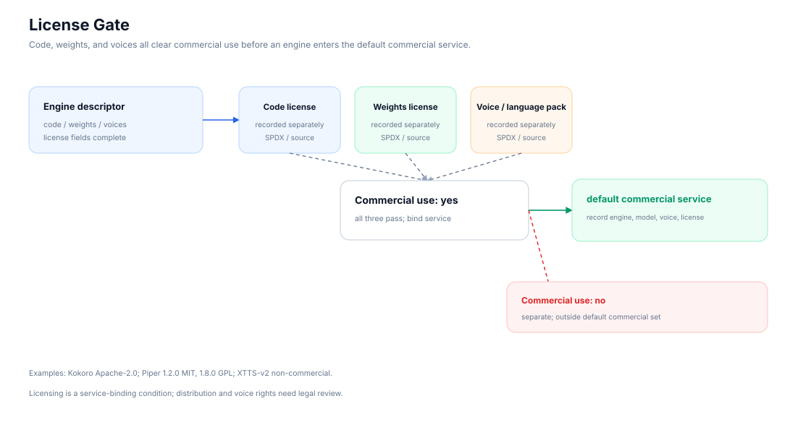
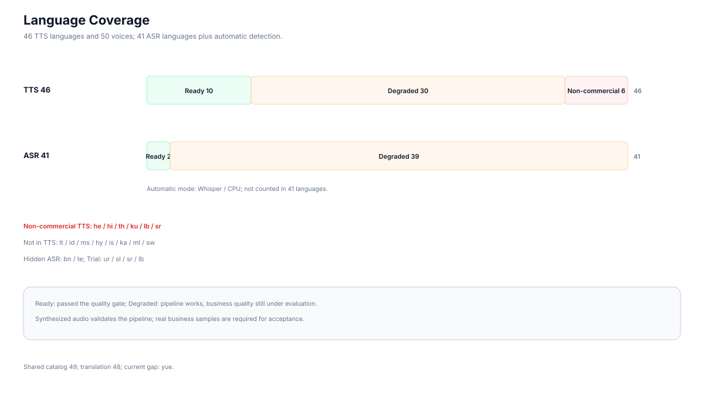
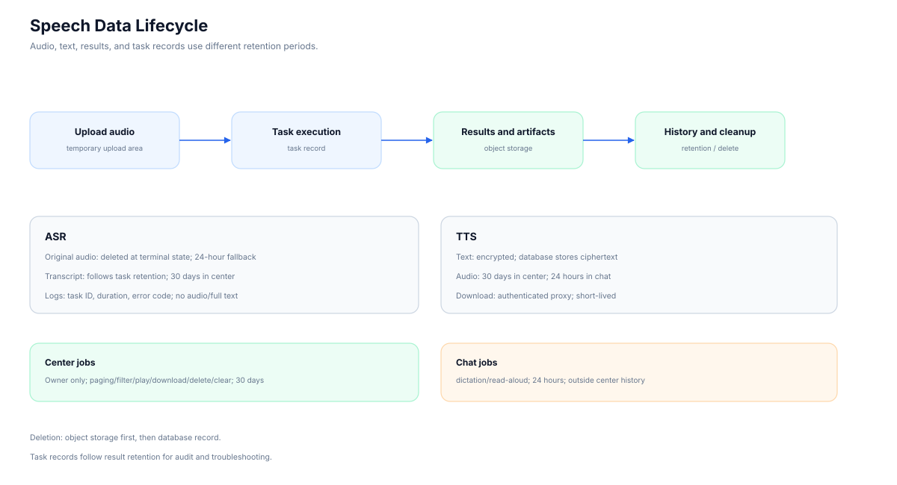

# Speech Center: Turning an Audio File into a Deliverable Transcript

> OpenMaas Engineering Series
>
> By Meng (Solomon) XU
>
> Version 2.0 | 2026-11-14
>
> Keywords: Speech Center, ASR, TTS, asynchronous tasks, multilingual speech, licensing, data retention

## The one-minute version

- Speech Center turns an upload into a task that can be queued, cancelled, checked, delivered, and deleted.
- Speech recognition and speech synthesis run in separate workers and share the same task, quota, artifact, and audit layer.
- Commercial use, language coverage, and retention determine whether the capability can ship.

> **Appendix:** [Glossary and license matrix](./speech-center-language-appendix-en.md#glossary) · [49-language list](./speech-center-language-appendix-en.md#language-list)

**How to read this article:**

- Product overview: Sections 1–5.
- Licensing: Section 7 and the appendix.
- Languages: Section 8 and the language appendix.
- Data retention: Section 10.

## 1. A five-minute recording

At ten in the evening, a five-minute meeting recording is dropped into Speech Center.

The page first shows “Queued,” then “Transcribing.” The first release targets a median of 10 seconds and a 95th percentile of 15 seconds for a five-minute file. The transcript arrives in the result panel, ready to copy or download. The user can remove the original audio along with the result.

The same page accepts 200 characters of text, a voice, and a speaking rate. It returns a playable audio file. The user can listen, download, and return to the result later.

Two entry points. Behind them sits a longer chain: upload, queue, execution, result, download, expiry, and deletion. The models perform recognition and synthesis. Speech Center turns those model calls into a task that can be delivered.

## 2. What Speech Center does

Speech Center is part of the OpenMaas application plane, the layer that runs end-user applications. It reuses the platform’s gateway, tenant model, authentication, object storage, and GPU governance. It does three things:

- **Speech recognition (ASR):** turn audio into text.
- **Speech synthesis (TTS):** turn text into audio.
- **Task management:** give every request a state, a result, and a retention window.

The same task API serves the web page, scripts, and upstream services. A browser and a backend use the same submit, query, cancel, delete, and download paths. The caller changes; the task model stays the same.

For a user, three questions matter more than the engine name: Has the task started? Why did it fail? When does the result expire?

Speech Center can be enabled or disabled independently from training and inference. When GPU or memory is tight, the platform can turn off the speech entry point without taking down the main workload.

## 3. The task path

A speech task starts with an upload and ends when its result expires:

```text
upload → queue → execute → result → download/play → expire/delete
```



> Figure 1: Clients call the speech service. Workers stay inside the cluster. Audio and results move through object storage; downloads use an authenticated proxy.

There are three roles in the path.

**The speech service is the front door.** It accepts requests, records tasks, reserves quota, stores results, serves downloads, and handles deletion. Users talk to this service; workers stay internal.

**The workers are the execution layer.** A recognition worker handles audio. A synthesis worker handles text. Workers receive internal tasks and stay off the public network.

**Object storage holds the audio.** Uploads and generated audio live there. The task store keeps state and ownership. A short-lived cache holds quota and occupancy data.

The task state is deliberately small:

- queued;
- running;
- succeeded;
- failed;
- cancelled;
- expired.

A task can run for seconds or minutes. The result can live for days. The state machine keeps the two clocks separate, which makes “finished” and “still available” different events.

## 4. Why tasks queue

Speech tasks queue for a practical reason: recognition uses the GPU, synthesis uses the CPU, and one worker can only run a limited number of tasks at once.

Speech Center uses a **lease** to manage occupancy. A lease is a temporary claim on a worker: the worker takes a task, holds it for a period, renews while it runs, and releases it at the end. If the worker disappears, the lease expires and a cleanup process makes the task available again.

The lease solves a failure case that a plain “running” flag does not. A worker can crash after taking a task. Without a lease, the task stays “running” forever. With a lease, another worker can pick it up after the claim expires.



> Figure 2: A task moves from queued to running, then to success, failure, or cancellation. Results expire on their own retention clock. Center jobs and chat jobs use different windows.

The state flow keeps terminal states distinct:

- success means a result is available;
- failure keeps an error for the caller;
- cancellation stops unfinished work;
- expiry removes the result after its retention window.

The task record also carries the source. A task created through Speech Center belongs to the center history. A task created by chat dictation or read-aloud belongs to the conversation and stays out of the center history. Both use the same workers; their retention differs.

## 5. Why file-based first

The first release accepts files: upload a recording and wait for a transcript; submit text and wait for audio.

This path lets the team stabilize upload, queueing, retry, delivery, quota, and cleanup before adding continuous audio. Real-time speech changes the protocol, the front-end interaction, the resource model, and the billing unit. Putting all of that into the first release makes the operational layer harder to finish.

The first release supports:

- audio files in wav, mp3, m4a, flac, ogg, and webm;
- files up to five minutes and 50 MB;
- text up to 200 characters per synthesis request;
- asynchronous submit, query, cancel, delete, and download.

Real-time recognition, real-time synthesis, voice activity detection, interruption, speaker separation, timestamps, and voice cloning belong to the next stage.

The sequence is deliberate: make the file path predictable first, then add the streaming path with its own protocol and capacity plan.

## 6. Engines are replaceable

Recognition and synthesis run in separate workers. The speech service exposes service IDs, revisions, and task APIs; engine internals stay private.

Synthesis engines plug in through an adapter and an engine descriptor. Recognition engines are replaced at the worker boundary, with language routing deciding which engine handles a request. An engine change must pass the same license gate; the public API stays stable.

For the reader, the practical result is simple: the front end keeps the same task interface when the back end changes engines.

## 7. Licensing: can it be used commercially?

Speech licensing has three layers:

1. the code license;
2. the model-weight license;
3. the voice and language-pack license.

All three must allow commercial use before an engine enters the default commercial service.

Some concrete examples:

- Kokoro’s Chinese model uses Apache-2.0.
- Piper 1.2.0 is MIT; Piper 1.8.0 is GPL-3.0-or-later, so the version and distribution model need legal review.
- Piper’s phonemizer embeds espeak-ng inside an MIT wrapper, and the combined distribution carries GPL obligations.
- XTTS-v2 uses a non-commercial model license and stays out of the default commercial engine.
- The voices for `he/hi/th/ku/lb/sr` are available for technical evaluation, marked non-commercial, and need a separate license before commercial use.
- Qwen3-TTS is Apache-2.0 in the initial review; ROCm and Jetson evaluation failed, so it remains a CUDA candidate.
- CosyVoice2-0.5B is Apache-2.0 and passed deployment validation; it is planned for a later release.

A repository license is not a model license. A model license is not a voice license. The release gate checks all three, records the result on the service binding, and keeps non-commercial engines out of the default commercial set.



> Figure 3: Code, weights, and voices are recorded separately. All three must clear commercial use before an engine enters the default commercial service.

The [full license matrix](./speech-center-language-appendix-en.md#license-matrix) is in the appendix. The main article keeps the decision rule: code, weights, and voice each need a commercial path.

This section is engineering context, not legal advice. Distribution terms, dependency trees, and voice rights still need legal review before a private deployment ships.

## 8. Languages

Speech Center currently covers:

- synthesis: 46 languages and 50 voices;
- recognition: 41 languages, plus an automatic language mode;
- shared language catalog: 49 languages;
- translation: 48 languages.

Languages sit in four states:

- **ready:** passed the quality gate;
- **degraded:** the pipeline works, business quality is still under evaluation;
- **non-commercial:** technically available, with a license to resolve before commercial use;
- **hidden:** kept in the back end, outside the catalog, with a trial registration.

Synthesis has 10 ready languages, 30 degraded candidates, and 6 non-commercial voices. Recognition has two ready languages and 39 languages in evaluation. Bengali and Telugu are hidden from the recognition catalog; Urdu, Slovenian, Serbian, and Luxembourgish keep a trial label.



> Figure 4: 46 TTS languages and 50 voices; 41 ASR languages plus automatic detection. Ready, degraded, non-commercial, and hidden states stay separate.

Catalog status and business quality are separate. A language in the catalog means the pipeline works; the quality gate decides whether it can ship.

The full list, including language codes, native names, regions, speaker bands, and per-language status, is in the [language appendix](./speech-center-language-appendix-en.md#language-list).

## 9. Recognition and delivery

Recognition has two common quality measures:

- **character error rate (CER):** how many characters differ from the reference;
- **word error rate (WER):** the same idea measured by word, useful for languages with spaces.

The first release uses two gates:

| Gate | Samples | Language detection | Failure rate | Error rate |
|---|---:|---:|---:|---:|
| Trial | at least 10 | at least 80% | at most 10% | CER 0.25 / WER 0.35 |
| Ready | at least 20 | at least 95% | at most 5% | CJK CER 0.15; spaced-language WER 0.25 |

A ready language also needs a 20% human review, with noise and terminology subsets checked separately. Languages move one at a time. A batch approval would hide the weak cases.

Current baselines:

- Chinese recognition on AISHELL: 3.42% CER;
- speech-synthesis loopback: 1.4% CER;
- Kokoro Chinese first packet: 2.25 seconds at the median;
- five-minute recognition target: 10 seconds at the median, 15 seconds at the 95th percentile.

The median is the point where half the requests finish faster. The 95th percentile is the point where 95% of requests finish faster.

AISHELL is a public test set, and loopback uses synthesized audio. Both help engineering decisions; neither replaces a real business sample set.

## 10. Data retention

Speech Center stores tasks and results for a limited time.

| Data | Default retention |
|---|---|
| Original audio | deleted when the task reaches a terminal state; 24-hour fallback after an exception |
| Transcript | 30 days in Speech Center history |
| Synthesis text | encrypted; the database stores ciphertext |
| Synthesized audio | 30 days in Speech Center, 24 hours in chat |
| Task record | follows the result retention window |



> Figure 5: Original audio, transcripts, synthesis text, generated audio, and task records use different retention periods. Downloads use an authenticated proxy.

Center history and chat speech stay separate:

- a center task is visible only to its owner and supports paging, filtering, playback, download, copy, delete, and clear;
- a chat speech task handles dictation and read-aloud, stays for 24 hours, and stays out of center history.

Deletion removes the object from storage first, then removes the database record. Clearing history follows the same order.

Downloads pass through the speech service as an authenticated proxy. Logs stay limited to task IDs, duration, character count, error codes, and state.

## 11. Speech in chat

Chat uses speech in two places:

- **Dictation:** the default is automatic language detection. The transcript goes into the input box, and the user decides whether to send it.
- **Read-aloud:** both user and assistant messages can be read aloud. Long text is synthesized sentence by sentence, so one long recording stays out of the interaction path.

Voice and speaking rate are stored locally. Chat speech tasks use the 24-hour retention window and stay out of Speech Center history. The same workers serve both entry points; the product context changes the retention and the UI.

## 12. Relationship to OpenMaas

Speech Center is an application-plane capability in OpenMaas. It reuses the platform gateway, tenant model, authentication, object storage, and GPU governance.

It sits next to training, model serving, evaluation, compression, and pipelines. A user sees Speech Center as an entry point; the platform sees a set of speech services that can be enabled or disabled on their own. When resources are tight, the speech entry point can be turned off while training and inference continue.

## 13. Boundaries and next steps

The first release is file-based. It supports file recognition and file synthesis. Real-time recognition, real-time synthesis, voice activity detection, interruption, speaker separation, timestamps, voice cloning, emotion, and dialect work belong to later stages.

The center history is visible only to its owner. A tenant administrator view is planned for a later release.

License conclusions still need legal review. Non-commercial voices and language packs stay outside the default commercial service until the rights are resolved.

The next steps are concrete:

- unify the recognition engine interface and engine descriptor;
- move language-to-engine routing from worker code into a registry;
- add real business speech samples;
- align license fields across recognition and synthesis;
- design real-time recognition, synthesis, interruption, and voice activity detection;
- evaluate a tenant administrator view and finer quota controls.

## 14. Conclusion

Speech Center turns model calls into tasks: upload, queue, execute, result, retain, and delete. Each step has a state, and each result has a lifetime.

It also answers three product questions: can this engine be used commercially, can these languages be delivered, and how long should the data stay? Those questions belong in the product surface.

The first release makes the file path predictable. Real-time speech, voice cloning, and broader language coverage come next.

## Appendix

- [Glossary and license matrix](./speech-center-language-appendix-en.md#glossary)
- [Language list: 49 languages, regions, and speaker bands](./speech-center-language-appendix-en.md#language-list)
