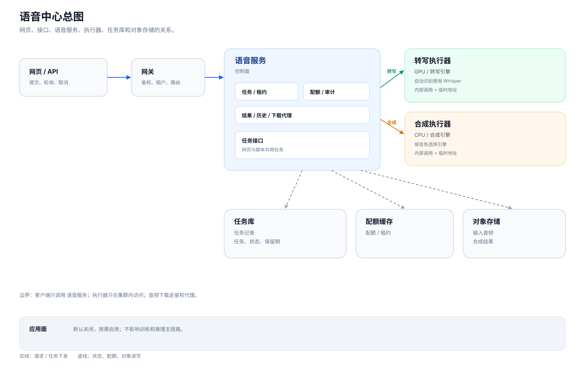
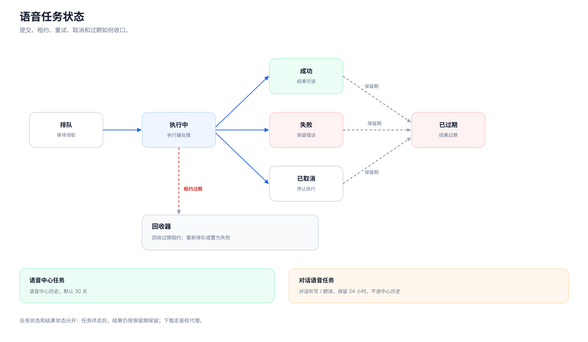
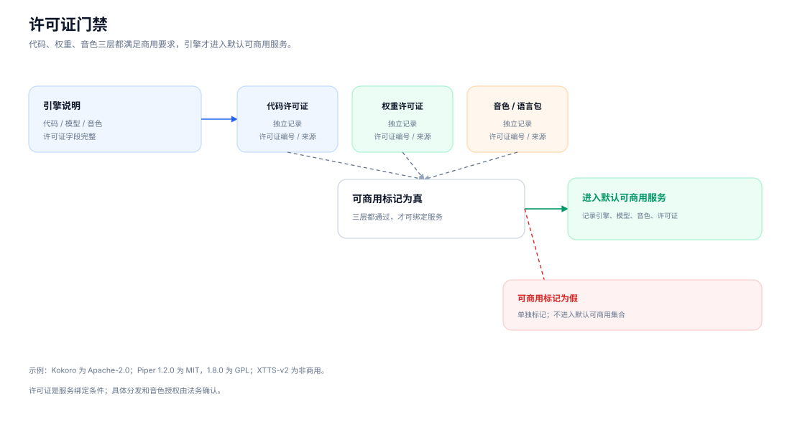
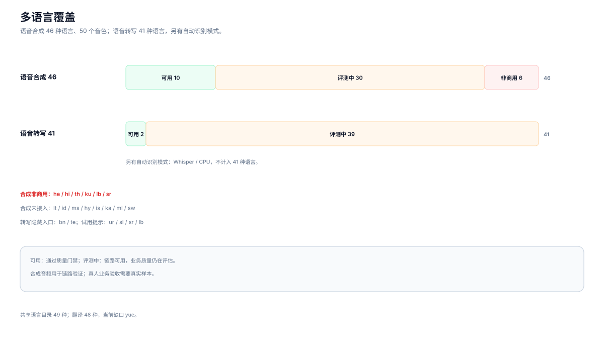
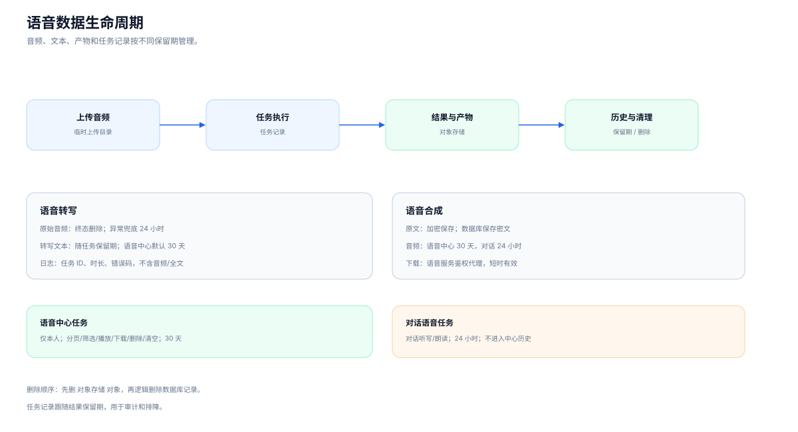

# 语音中心：一段录音怎样变成一份可交付的文本

> OpenMaas 工程系列
>
> 作者：许猛
>
> 版本 2.0｜2026-11-14
>
> 关键词：语音中心、语音转写、语音合成、多语言、许可证、数据保留

## 一分钟版本

- 语音中心把“上传一段录音”变成一条可排队、可取消、可查询、可清理的任务。
- 转写和合成使用不同的执行器，共享任务、配额、产物和审计。
- 能不能商用、能支持哪些语言、保留多久，和模型效果同样重要。

> **附录**：[术语与许可证矩阵](./speech-center-language-appendix.md#glossary) · [49 种语言清单](./speech-center-language-appendix.md#language-list)

**怎么读：**

- 只想了解产品：第 1–5 节；
- 关注许可证：第 7 节 + 附录；
- 关注多语言：第 8 节 + 语言清单；
- 关注数据保留：第 10 节。

## 一、一段录音

晚上十点，一段 5 分钟的会议录音被拖进语音中心。

页面先显示“排队”，接着变成“转写中”。首版目标：5 分钟音频的中位耗时 10 秒，95% 的请求在 15 秒内完成。文本通常十几秒内出现。结果可以复制、下载，也可以连同原始音频一起删除。

同一个页面还能输入 200 字，选一个音色和语速，生成一段语音。用户可以试听、下载，也可以回到历史记录里重新播放。

页面看起来只有两个入口。背后是一条完整的任务链：上传、排队、执行、结果、下载、过期、删除。模型负责识别和合成，语音中心负责把这些动作组织成一次可交付的任务。

## 二、语音中心做什么

语音中心是 OpenMaas 的应用面能力，复用平台的网关、租户、对象存储和 GPU 治理。它做三件事：

- **语音转写（ASR）**：把录音变成文字；
- **语音合成（TTS）**：把文字变成声音；
- **任务管理**：让每一次转写和合成都有状态、有结果、有保留期。

它能被网页使用，也能被脚本或上游服务调用。网页和 API 共用同一套任务接口：提交、查询、取消、删除、下载结果。调用方不同，任务状态和产物路径保持一致。

对用户来说，最重要的不是引擎型号，而是三件事：任务有没有开始、失败原因是什么、结果什么时候过期。

## 三、一条任务怎么走

一条语音任务从上传开始，到结果过期结束：

```text
上传 → 排队 → 执行 → 结果 → 下载/播放 → 过期/删除
```



> 图 1：网页和 API 把任务交给语音服务；语音服务管理任务、配额和产物；转写与合成分别由独立执行器完成。

这里有两个角色。

**语音服务**是前台。它接收请求，记录任务，分配配额，保存结果，处理下载和删除。用户只和它打交道。

**执行器**是后厨。转写执行器负责把录音变成文字，合成执行器负责把文字变成声音。执行器只接收内部任务，不直接面向用户。

录音和合成结果放在对象存储里。数据库保存任务状态和归属，缓存保存短期配额和占用信息。任务结束后，结果按保留期继续存在一段时间，再被清理。

## 四、为什么要排队

语音任务需要排队，原因很实际：转写要占 GPU，合成要占 CPU，同一个执行器一次只能处理有限的任务。

语音中心用“租约”管理占用。可以把它理解成一张临时停车券：

- 任务先排队；
- 执行器领到任务后，拿到一段时间的占用凭证；
- 执行过程中续期；
- 完成后释放；
- 超时没有续期，任务由回收器重新安排。

租约让“谁在占用资源”有明确记录。执行器崩溃、网络断开或任务卡住时，回收器可以接管，避免任务永远停在“执行中”。

任务状态也保持简单：

- 排队；
- 执行中；
- 成功；
- 失败；
- 已取消；
- 已过期。



> 图 2：任务从排队进入执行，再进入成功、失败或取消；结果按保留期过期。语音中心任务和对话语音任务使用不同保留期。

## 五、为什么先做文件式

首版选择文件式任务：上传一段录音，等待转写；输入一段文字，等待合成。

这条路先把 upload、排队、失败重试、结果交付、配额和清理跑通。实时语音会引入新的问题：音频要持续传输，前端要处理打断，资源要按毫秒调度，计费方式也会变化。把这些问题放进第一版，语音中心很难稳定交付。

所以首版支持：

- 音频文件：wav、mp3、m4a、flac、ogg、webm；
- 单文件不超过 5 分钟、50 MB；
- 单次合成不超过 200 字；
- 异步提交、查询、取消、删除和下载。

实时转写、实时合成、自动断句、打断、说话人分离、时间戳和声音克隆，进入后续路线。

## 六、引擎可以替换

转写和合成运行在独立执行器中，语音服务只暴露服务编号、版本号和任务接口，不依赖具体引擎。

合成引擎通过适配器和引擎描述替换；转写引擎在执行器边界替换，由语言路由选择引擎。引擎替换需要同时通过许可证门禁，公共 API 保持不变。

读者可以把它理解成：前端不需要知道后台换了哪家引擎，任务接口和结果格式保持稳定。

## 七、能不能商用

语音能力的许可证要分三层看：

1. 代码许可证；
2. 模型权重许可证；
3. 音色和语言包许可证。

三层都满足商用要求，引擎才能进入默认可商用服务。

几个实际例子：

- Kokoro 中文模型使用 Apache-2.0；
- Piper 1.2.0 是 MIT，1.8.0 是 GPL-3.0-or-later，分发方式需要法务确认；
- Piper 的音素组件内嵌 espeak-ng，包装层是 MIT，组合分发涉及 GPL；
- XTTS-v2 是非商用许可，不进入默认商业引擎；
- `he/hi/th/ku/lb/sr` 这些音色可以技术接入，但标记为非商用，商业项目使用前需要解决授权。

许可证不是文档脚注。它决定一个引擎能不能绑定到商业服务，也决定私有化交付时能不能安全分发。



> 图 3：代码、权重、音色分别记录；三层都满足商用要求，引擎才能进入默认可商用服务。

完整的许可证矩阵和语言清单见 [附录](./speech-center-language-appendix.md)。

## 八、多语言

语音中心目前支持：

- 语音合成：46 种语言、50 个音色；
- 语音转写：41 种语言，另有自动识别；
- 共享语言目录：49 种；
- 翻译：48 种。

多语言分成几种状态：

- **可用**：通过质量门禁；
- **评测中**：链路可用，业务质量还在评估；
- **非商用**：技术可用，商用前解决授权；
- **隐藏**：目录不展示，后端保留试用。



> 图 4：语音合成 46 种语言、50 个音色；语音转写 41 种语言，另有自动识别。完整清单、中文名称、分布地区和人口量级见附录。

语音合成里，中文、英语、法语、俄语、巴西葡萄牙语、阿拉伯语、德语、西班牙语、日语和韩语已经可用。其余语言大多处于评测中，非商用音色单独标记。

语音转写里，中文和英语可用；日语、韩语、粤语以及其他试用语言处于评测中。孟加拉语和泰卢固语当前从目录隐藏，乌尔都语、斯洛文尼亚语、塞尔维亚语和卢森堡语保留试用提示。

完整语言清单见 [语言附录](./speech-center-language-appendix.md)。

## 九、能识别和能交付

“能识别”是链路可用；“能交付”要经过质量门禁。

语音转写看两个指标：

- **字错率（CER）**：识别文本和标准文本之间差了多少字；
- **词错率（WER）**：按词计算，适合有空格的语言。

首版验收线：

- 评测中：至少 10 条样本，语言检测准确率不低于 80%，失败率不高于 10%，字错率不高于 0.25，词错率不高于 0.35；
- 可用：至少 20 条样本，语言检测准确率不低于 95%，失败率不高于 5%，中日韩文字错率不高于 0.15，空格语言词错率不高于 0.25。

当前基线：

- 中文转写在 AISHELL 上的字错率是 3.42%；
- 合成语音回环字错率是 1.4%；
- Kokoro 中文首包 p50 是 2.25 秒；
- 5 分钟音频的验收线是 p50 10 秒、p95 15 秒。

这里的 p50 指一半请求的耗时，p95 指 95% 请求的耗时。

AISHELL 是公开测试集，回环用的是合成音频。它们适合做工程判断，真实业务验收仍需要真人样本。

## 十、数据保留多久

语音中心保存任务和产物，并按保留期清理。

| 数据 | 默认保留 |
|---|---|
| 原始音频 | 任务结束后删除；异常情况兜底 24 小时 |
| 转写文本 | 语音中心历史默认 30 天 |
| 合成原文 | 加密保存，数据库没有明文 |
| 合成音频 | 语音中心 30 天，对话语音 24 小时 |
| 任务记录 | 跟随结果保留期 |



> 图 5：原始音频、转写文本、合成原文、合成音频和任务记录使用不同保留期；下载通过鉴权代理完成。

语音中心历史和对话语音分开：

- 语音中心任务：仅本人可见，支持分页、筛选、播放、下载、复制、删除和清空；
- 对话语音任务：用于听写和朗读，保留 24 小时，不进入语音中心历史。

删除任务时，先删除对象存储里的音频，再删除数据库记录。清空历史按同一顺序处理。

## 十一、对话里的语音

对话里的语音有两个入口：

- **听写**：默认自动识别，录音或上传音频后，转写结果插入输入框，用户决定是否发送；
- **朗读**：用户消息和 AI 消息都能朗读，长文本按句合成，避免一次生成整段长音频。

音色和语速保存在本地。对话语音使用单独的保留期，不进入语音中心历史。

## 十二、和 OpenMaas 的关系

语音中心属于 OpenMaas 的应用面能力，复用平台的网关、租户、鉴权、对象存储和 GPU 治理。它和训练、模型服务、评测、压缩、流水线一起，组成同一套私有化 AI 平台。

对使用方来说，入口是语音中心；对平台来说，它是一组可独立启停的语音服务。资源紧张时，可以先关掉语音入口，不影响训练和推理主链路。

## 十三、边界和下一步

首版边界：

- 文件式任务，非实时；
- 支持文件转写和文件合成；
- 说话人分离、时间戳、声音克隆、情绪和方言进入后续路线；
- 语音中心历史仅本人可见；
- 许可证结论需要法务确认。

下一步：

- 统一转写引擎接口和引擎描述；
- 把语言到引擎的绑定从执行器移到注册表；
- 补充真实业务语音样本；
- 统一转写和合成的许可证字段；
- 设计实时转写、实时合成、自动断句和打断；
- 评估租户管理员视图和更细的配额策略。

## 十四、结论

语音中心把模型能力做成了任务系统：上传、排队、执行、结果、保留和清理，每一步都有状态。

它还要回答三个产品问题：这个引擎能不能商用，这些语言能不能交付，这些数据保留多久。三个问题分开管理，语音中心才能从演示走向可交付。

首版先把文件式任务做稳。实时、克隆和更多语言，留给下一阶段。

## 附录

- [术语表](./speech-center-language-appendix.md#glossary)
- [许可证矩阵](./speech-center-language-appendix.md#license-matrix)
- [语言清单：49 种语言、分布地区和人口量级](./speech-center-language-appendix.md#language-list)

## 继续阅读

- [一块 GPU 上的四种资源：GPU 资源治理](./gpu-resource-governance-article.md)
- [缓存、磁盘与加载：推理平台的资源生命周期](./cache-disk-load-lifecycle-article.md)
- [OpenMaas 文档](https://github.com/solomonxu/ai-maas-docs)
